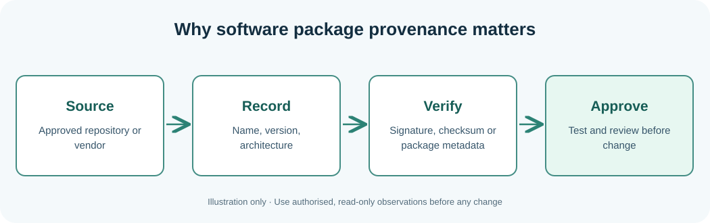

# Chapter 113 — Check package versions and provenance before updates

**Bits to Banking · System Administration From Zero · Stage 9**  
**Audience:** Absolute beginners, adults, returning professionals and supervised younger learners.  
**Safety:** Observe only your own computer or an explicitly authorised practice environment. Live changes are not required.

## Why this matters

A **package manager** installs and tracks software. **Provenance** is the record of where software came from and which release it represents. A displayed version number does not prove a downloaded package was authentic. A checksum checks bytes; a trusted signature or verified distribution channel adds identity evidence. No checksum proves an application is secure or correct.

Windows `winget list` shows software it recognises. Debian Linux `apt-cache policy` distinguishes installed and candidate versions. A package offered for installation does not mean the administrator is authorised to install it. Avoid commands that download and immediately execute unknown code. Umicom application artifacts also need their own exact source revision and package hash, separate from OS package versions.



## Learning objectives

After the lesson you should be able to explain the new terminology, run and understand a small read-only observation, distinguish observations from assumptions, and record the next safe action when a check is incomplete. A professional answer can be **not checked**, **not authorised** or **requires escalation**.

## Step-by-step Windows laboratory — PowerShell 7

Open Start, type **PowerShell**, and choose PowerShell 7 where available. Do not type the `PS C:\...>` prompt. Run each command one line at a time. PowerShell 5.1 may also run these read-only commands where the associated feature is installed.

```powershell
winget --version
winget list --id Git.Git
Get-Command git -ErrorAction SilentlyContinue | Select-Object Name, Source
```

**Interpret the result:** The output will describe *your* computer, not the fictional Umicom hosts. Names, dates and versions will differ. Record the time and the important fields. If the command cannot run or permission is denied, mark the observation incomplete rather than inventing a value. A command's exit status only reports the command's own work.

## Step-by-step Linux laboratory — Terminal

On Linux use an account you own or are permitted to use, preferably in a disposable VM. These are observational commands unless the lesson explicitly describes a practice file you create in your home directory; you do not need `sudo`.

```bash
cat /etc/os-release
apt-cache policy git
dpkg-query -W git
```

**Interpret the result:** Not all distributions install the same management tools or use systemd. Preserve errors as troubleshooting evidence. Do not install random replacements, change unit files or edit firewall rules to make classroom output look identical to a screenshot.

### Interpret installed versus offered software

An installed version is what the package manager reports as present. A candidate version is what configured repositories might offer **if** an update is approved. A checksum compares the exact artifact bytes against the expected artifact digest; copy that expected value from a trusted release record. The command `winget list` is observational but may prompt for source agreement depending on the local configuration. Record any prompt and stop if you do not understand it.

## Worked Umicom example

Suppose an Umicom Notes binary has the correct visible version but a SHA-256 that does not match the approved release. Treat this as a blocker until investigated. Keep both values with their sources; never rewrite the expected checksum to match the downloaded file. If you do not use Debian-based Linux, `apt-cache` may not exist.

## Exercises

Differentiate an installed package version from a candidate update and a verified distribution artifact. Should a mismatched package be deployed because its filename looks correct?

## Suggested answer and review criteria

A complete answer names the host, exact observation, source, timestamp with a time-zone offset, and reviewer or next owner. It also states what the command **does not** prove. In particular, a process Running is not proof of a completed Notes save, and an old release restored after failure does not make the failed proposed release successful.

## Common questions

**What if my command gives an error?** Read the exact message and check where you are with `Get-Location` on Windows or `pwd` on Linux. If the tool is not installed, note that fact. If it requires permissions you do not have, stop and contact the owner.

**What if my output differs from the book?** Computers differ. Compare the *fields and meaning* rather than expecting the same host name, drive size or process list. Never fabricate a result.

**Can I apply these commands to another person's machine?** Only after permission has been given and the information has been classified appropriately. This course never grants system-administration authority.

**Further practice:** Review [Chapter 108](108-capstone-seven-day-operations-plan.md) for the seven-day plan, then complete the Stage 9 workbook and [Chapter 120](120-capstone-investigate-two-fictional-umicom-notes-hosts.md) for the two-host exercise.
