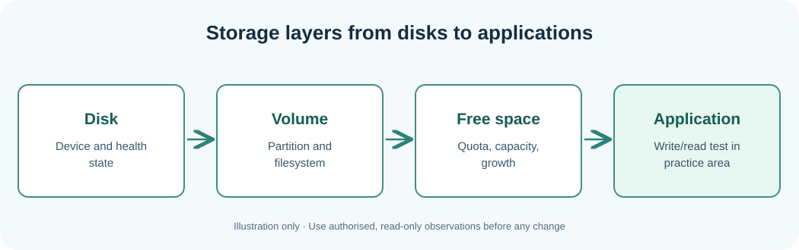

# Chapter 114 — Understand disks, partitions, filesystems and storage faults

**Bits to Banking · System Administration From Zero · Stage 9**  
**Audience:** Absolute beginners, adults, returning professionals and supervised younger learners.  
**Safety:** Observe only your own computer or an explicitly authorised practice environment. Live changes are not required.

## Why this matters

A **disk** stores bytes, a **partition** divides disk address space, and a **filesystem** makes directories and files accessible. Windows commonly uses drive letters while Linux mounts filesystems into a directory hierarchy. Free space, health, permissions, filesystem read-only status and quota are separate issues.

A Notes application can be Running yet unable to write because the data volume is full or mounted read-only. Conversely, an “access denied” error may be about permissions rather than free space. Do not run partition creation, format, repair, delete or resize commands in a beginner exercise. Observe first and hand over to the authorised storage owner.



## Learning objectives

After the lesson you should be able to explain the new terminology, run and understand a small read-only observation, distinguish observations from assumptions, and record the next safe action when a check is incomplete. A professional answer can be **not checked**, **not authorised** or **requires escalation**.

## Step-by-step Windows laboratory — PowerShell 7

Open Start, type **PowerShell**, and choose PowerShell 7 where available. Do not type the `PS C:\...>` prompt. Run each command one line at a time. PowerShell 5.1 may also run these read-only commands where the associated feature is installed.

```powershell
Get-PSDrive -PSProvider FileSystem
Get-Volume | Select-Object -First 8 DriveLetter, FileSystem, HealthStatus, SizeRemaining, Size
Get-Disk | Select-Object Number, FriendlyName, HealthStatus, OperationalStatus
```

**Interpret the result:** The output will describe *your* computer, not the fictional Umicom hosts. Names, dates and versions will differ. Record the time and the important fields. If the command cannot run or permission is denied, mark the observation incomplete rather than inventing a value. A command's exit status only reports the command's own work.

## Step-by-step Linux laboratory — Terminal

On Linux use an account you own or are permitted to use, preferably in a disposable VM. These are observational commands unless the lesson explicitly describes a practice file you create in your home directory; you do not need `sudo`.

```bash
df -hT
lsblk -o NAME,SIZE,FSTYPE,MOUNTPOINTS,RO
findmnt -o TARGET,SOURCE,FSTYPE,OPTIONS | head -n 12
```

**Interpret the result:** Not all distributions install the same management tools or use systemd. Preserve errors as troubleshooting evidence. Do not install random replacements, change unit files or edit firewall rules to make classroom output look identical to a screenshot.

### Interpret storage without changing it

On Windows `SizeRemaining` and `Size` are byte counts; they do not indicate how much free space a user quota permits. On Linux `df` reports mounted filesystem capacity, while `lsblk` shows block-device relationships; a single disk can have multiple filesystems. A mounted filesystem may also have a `ro` option. None of these read-only commands is a substitute for an authorised filesystem check, and no learner should use format, fsck repair or partition changes against live data.

## Worked Umicom example

In our example, Notes storage reports a read-only filesystem, although the main workstation's C: drive has free space. The latter does not disprove the failure: the write destination might be a different volume. A quota or full container writable layer can also explain “no space left” while another drive has capacity.

## Exercises

Record the mount or drive containing your *own* learning folder, free space and time. Name two reasons that available space on C: does not prove an unrelated data mount is writable.

## Suggested answer and review criteria

A complete answer names the host, exact observation, source, timestamp with a time-zone offset, and reviewer or next owner. It also states what the command **does not** prove. In particular, a process Running is not proof of a completed Notes save, and an old release restored after failure does not make the failed proposed release successful.

## Common questions

**What if my command gives an error?** Read the exact message and check where you are with `Get-Location` on Windows or `pwd` on Linux. If the tool is not installed, note that fact. If it requires permissions you do not have, stop and contact the owner.

**What if my output differs from the book?** Computers differ. Compare the *fields and meaning* rather than expecting the same host name, drive size or process list. Never fabricate a result.

**Can I apply these commands to another person's machine?** Only after permission has been given and the information has been classified appropriately. This course never grants system-administration authority.

**Further practice:** Review [Chapter 108](108-capstone-seven-day-operations-plan.md) for the seven-day plan, then complete the Stage 9 workbook and [Chapter 120](120-capstone-investigate-two-fictional-umicom-notes-hosts.md) for the two-host exercise.
