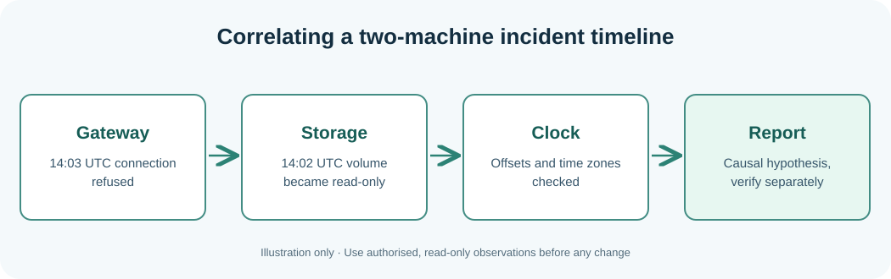

# Chapter 116 — Build a reliable two-host incident timeline

**Bits to Banking · System Administration From Zero · Stage 9**  
**Audience:** Absolute beginners, adults, returning professionals and supervised younger learners.  
**Safety:** Observe only your own computer or an explicitly authorised practice environment. Live changes are not required.

## Why this matters

A **timeline** places relevant evidence into time order, but computer clocks may differ and timestamps may use different time zones. `14:00` without a zone is ambiguous. Prefer ISO 8601 timestamps with an offset or UTC (`Z`) and preserve original log text. **Clock skew** means two clocks disagree.

Suppose storage logs a read-only filesystem at 14:02 UTC while the gateway logs connection refusal at 14:03 UTC. This suggests a hypothesis, not proof of cause. If the machines differ by three minutes, even their apparent event order may be wrong. Do not edit logs to agree with a hypothesis. Include observation source and the uncertainty introduced by clock errors.



## Learning objectives

After the lesson you should be able to explain the new terminology, run and understand a small read-only observation, distinguish observations from assumptions, and record the next safe action when a check is incomplete. A professional answer can be **not checked**, **not authorised** or **requires escalation**.

## Step-by-step Windows laboratory — PowerShell 7

Open Start, type **PowerShell**, and choose PowerShell 7 where available. Do not type the `PS C:\...>` prompt. Run each command one line at a time. PowerShell 5.1 may also run these read-only commands where the associated feature is installed.

```powershell
Get-Date -Format o
Get-TimeZone
Get-WinEvent -LogName System -MaxEvents 5 | Select-Object TimeCreated, Id, ProviderName
```

**Interpret the result:** The output will describe *your* computer, not the fictional Umicom hosts. Names, dates and versions will differ. Record the time and the important fields. If the command cannot run or permission is denied, mark the observation incomplete rather than inventing a value. A command's exit status only reports the command's own work.

## Step-by-step Linux laboratory — Terminal

On Linux use an account you own or are permitted to use, preferably in a disposable VM. These are observational commands unless the lesson explicitly describes a practice file you create in your home directory; you do not need `sudo`.

```bash
date -Is
timedatectl status
journalctl -b --no-pager -n 10 -o short-iso
```

**Interpret the result:** Not all distributions install the same management tools or use systemd. Preserve errors as troubleshooting evidence. Do not install random replacements, change unit files or edit firewall rules to make classroom output look identical to a screenshot.

### Interpret time with a zone

ISO 8601 timestamps with offsets let two observers understand the same instant. `2026-10-15T15:30:00+01:00` and `2026-10-15T14:30:00Z` represent the same instant, but an unlabelled `15:30` cannot be reliably compared. Keep original machine timestamps untouched, describe any conversion separately, and include the reported clock offset when uncertain. Two events being close in the log is a clue, not an independently tested causal relationship.

## Worked Umicom example

For the Notes example, record original timestamps from both machines and a separate normalised column. Check reported offset or time-sync state before deciding what happened first. If a learner lacks permission to read the journal, note “unavailable” instead of marking the machine healthy.

## Exercises

Explain why events one minute apart cannot reliably be ordered if one machine's clock is wrong by three minutes. Is an earlier timestamp alone proof of causation?

## Suggested answer and review criteria

A complete answer names the host, exact observation, source, timestamp with a time-zone offset, and reviewer or next owner. It also states what the command **does not** prove. In particular, a process Running is not proof of a completed Notes save, and an old release restored after failure does not make the failed proposed release successful.

## Common questions

**What if my command gives an error?** Read the exact message and check where you are with `Get-Location` on Windows or `pwd` on Linux. If the tool is not installed, note that fact. If it requires permissions you do not have, stop and contact the owner.

**What if my output differs from the book?** Computers differ. Compare the *fields and meaning* rather than expecting the same host name, drive size or process list. Never fabricate a result.

**Can I apply these commands to another person's machine?** Only after permission has been given and the information has been classified appropriately. This course never grants system-administration authority.

**Further practice:** Review [Chapter 108](108-capstone-seven-day-operations-plan.md) for the seven-day plan, then complete the Stage 9 workbook and [Chapter 120](120-capstone-investigate-two-fictional-umicom-notes-hosts.md) for the two-host exercise.
