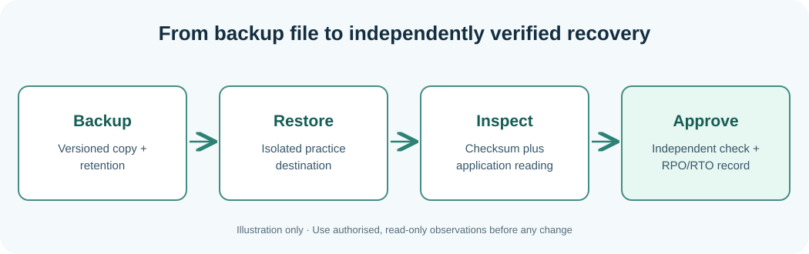

# Chapter 117 — Verify a backup by restoring a practice file

**Bits to Banking · System Administration From Zero · Stage 9**  
**Audience:** Absolute beginners, adults, returning professionals and supervised younger learners.  
**Safety:** Observe only your own computer or an explicitly authorised practice environment. Live changes are not required.

## Why this matters

A **backup** is a recoverable copy made under a policy, not merely a second file in the same folder. A **restore test** verifies that recovering the data actually works. SHA-256 detects byte differences; it does not certify a database is logically consistent. In a production recovery exercise, the application must also read and use restored data correctly.

**RPO** is the tolerated data-loss interval and **RTO** the tolerated downtime. These are targets; a successful drill measures what happened. Perform only this harmless practice in your own home folder. Do not delete your source document, run filesystem repair, or restore into a live application.



## Learning objectives

After the lesson you should be able to explain the new terminology, run and understand a small read-only observation, distinguish observations from assumptions, and record the next safe action when a check is incomplete. A professional answer can be **not checked**, **not authorised** or **requires escalation**.

## Step-by-step Windows laboratory — PowerShell 7

Open Start, type **PowerShell**, and choose PowerShell 7 where available. Do not type the `PS C:\...>` prompt. Run each command one line at a time. PowerShell 5.1 may also run these read-only commands where the associated feature is installed.

```powershell
New-Item -ItemType Directory -Force -Path "$HOME\UmicomLearning\restore\source" | Out-Null
New-Item -ItemType Directory -Force -Path "$HOME\UmicomLearning\restore\recovered" | Out-Null
Set-Content -LiteralPath "$HOME\UmicomLearning\restore\source\notes.txt" -Value 'Fictional Notes restore test'
Copy-Item -LiteralPath "$HOME\UmicomLearning\restore\source\notes.txt" -Destination "$HOME\UmicomLearning\restore\recovered\notes.txt"
Get-FileHash -Algorithm SHA256 "$HOME\UmicomLearning\restore\source\notes.txt"
Get-FileHash -Algorithm SHA256 "$HOME\UmicomLearning\restore\recovered\notes.txt"
Get-Content "$HOME\UmicomLearning\restore\recovered\notes.txt"
```

**Interpret the result:** The output will describe *your* computer, not the fictional Umicom hosts. Names, dates and versions will differ. Record the time and the important fields. If the command cannot run or permission is denied, mark the observation incomplete rather than inventing a value. A command's exit status only reports the command's own work.

## Step-by-step Linux laboratory — Terminal

On Linux use an account you own or are permitted to use, preferably in a disposable VM. These are observational commands unless the lesson explicitly describes a practice file you create in your home directory; you do not need `sudo`.

```bash
mkdir -p "$HOME/umicom-learning/restore/source" "$HOME/umicom-learning/restore/recovered"
printf 'Fictional Notes restore test\n' > "$HOME/umicom-learning/restore/source/notes.txt"
cp "$HOME/umicom-learning/restore/source/notes.txt" "$HOME/umicom-learning/restore/recovered/notes.txt"
sha256sum "$HOME/umicom-learning/restore/source/notes.txt" "$HOME/umicom-learning/restore/recovered/notes.txt"
cat "$HOME/umicom-learning/restore/recovered/notes.txt"
```

**Interpret the result:** Not all distributions install the same management tools or use systemd. Preserve errors as troubleshooting evidence. Do not install random replacements, change unit files or edit firewall rules to make classroom output look identical to a screenshot.

### Interpret the restore exercise

The two files should contain identical bytes and therefore have the same SHA-256 digest when checked on the same system. If the values differ, check whether you copied the intended file, whether the destination already existed, and whether your practice file changed between checks. The copied file is in a **different folder** but often still on the same disk; this is a lesson about verification, not an adequate real disaster-recovery strategy. For a database, additional transaction consistency and actual application read/write checks are required.

## Worked Umicom example

The two local files should have matching hashes because one was copied directly from the other. Verify the recovered text is readable. If your policy allowed 15 minutes of data loss but a fictional drill measured 20, the RPO target was missed—even if the recovery took less than its RTO.

## Exercises

Record the source and destination, two hashes and the read-back result. Why is a matching file checksum not sufficient to certify database restoration?

## Suggested answer and review criteria

A complete answer names the host, exact observation, source, timestamp with a time-zone offset, and reviewer or next owner. It also states what the command **does not** prove. In particular, a process Running is not proof of a completed Notes save, and an old release restored after failure does not make the failed proposed release successful.

## Common questions

**What if my command gives an error?** Read the exact message and check where you are with `Get-Location` on Windows or `pwd` on Linux. If the tool is not installed, note that fact. If it requires permissions you do not have, stop and contact the owner.

**What if my output differs from the book?** Computers differ. Compare the *fields and meaning* rather than expecting the same host name, drive size or process list. Never fabricate a result.

**Can I apply these commands to another person's machine?** Only after permission has been given and the information has been classified appropriately. This course never grants system-administration authority.

**Further practice:** Review [Chapter 108](108-capstone-seven-day-operations-plan.md) for the seven-day plan, then complete the Stage 9 workbook and [Chapter 120](120-capstone-investigate-two-fictional-umicom-notes-hosts.md) for the two-host exercise.
