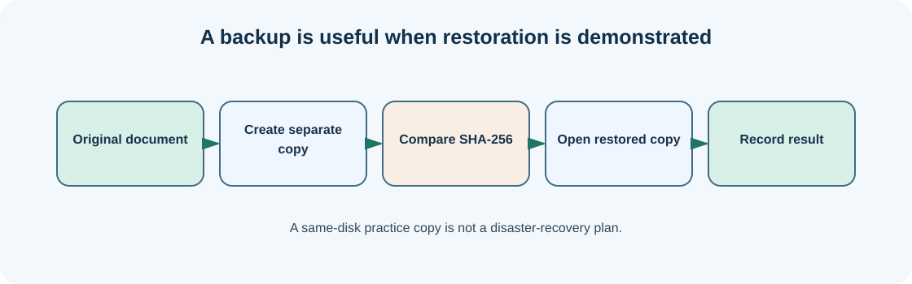

# Chapter 14 — Disks, backups and checking that restoration works

**Bits to Banking · System Administration: From Zero · Umicom Foundation**  
**Audience:** first-time users and returning learners; no prior system-administration knowledge required.  
**Code policy:** interactive PowerShell 7 and Bash commands; native C23/Assembly for Umicom executable development.  
**Estimated study time:** 25–50 minutes (longer when practising).

## What you will learn

Make and verify a training-file backup before learning recovery.

## Why this matters




A disk stores information while the computer is switched off. A filesystem organises named files and directories on a storage volume. Different storage devices may expose more than one volume; the letter `C:` is a Windows convention, not a guarantee about the underlying physical device. Before changing storage configuration, determine whether a volume contains operating-system, program, user or recovery files.

A backup is useful only if you can recover a known version when needed. Simply copying a file is a first step; you should verify that the copy is readable and identical to the source. Hashes produce a compact fingerprint of file content. If two SHA-256 hashes differ, the files differ. Matching hashes provide very strong evidence of the same bytes, though a single copy in the same folder does not protect against disk failure, theft or ransomware.

This chapter uses only a small Markdown file in your practice directory. It does not partition, format, encrypt or erase any disk. Real organisational backups should include retention policy, separate storage, access controls and periodic restore tests.

## New words, explained

| Term | Plain-English meaning |
|---|---|
| **Volume** | Logical storage area made available to the operating system. |
| **Filesystem** | Data structure for organising files and directories. |
| **Backup** | Recoverable copy kept according to an agreed policy. |
| **Restore test** | Proof that data can be read from the backup. |
| **SHA-256** | Hash function commonly used to fingerprint file content. |

## Windows practice — PowerShell 7

> **Before typing:** Run these commands in a normal, non-elevated PowerShell window. Where a file is used, complete the previous practice-folder chapters first. Do not paste the `PS C:\...>` prompt into the terminal.

**Start:** Use the Windows Start menu or Windows Terminal to open PowerShell. Check the prompt is ready. Commands beginning with `$` are still commands; type them exactly as shown.

### Step 1 — Inspect accessible drives

```powershell
Get-PSDrive -PSProvider FileSystem
```

**Expected observation:** The output lists drives and free space.

**Check:** Read the output before continuing. If it does not match, stop and investigate the specific command; do not add `-Force` or run as Administrator automatically.

### Step 2 — Return to your practice folder

```powershell
Set-Location "$HOME\UmicomLearning\Notes"
```

**Expected observation:** Your `README.md` is the only file we will copy.

**Check:** Read the output before continuing. If it does not match, stop and investigate the specific command; do not add `-Force` or run as Administrator automatically.

### Step 3 — Make an extra copy

```powershell
Copy-Item .\README.md .\README-verified-copy.md
```

**Expected observation:** The copy exists next to the original.

**Check:** Read the output before continuing. If it does not match, stop and investigate the specific command; do not add `-Force` or run as Administrator automatically.

### Step 4 — Get the original fingerprint

```powershell
Get-FileHash .\README.md -Algorithm SHA256
```

**Expected observation:** A hexadecimal hash appears.

**Check:** Read the output before continuing. If it does not match, stop and investigate the specific command; do not add `-Force` or run as Administrator automatically.

### Step 5 — Get the copied fingerprint

```powershell
Get-FileHash .\README-verified-copy.md -Algorithm SHA256
```

**Expected observation:** The hash should match the original exactly.

**Check:** Read the output before continuing. If it does not match, stop and investigate the specific command; do not add `-Force` or run as Administrator automatically.

### Step 6 — Read the restored copy

```powershell
Get-Content .\README-verified-copy.md
```

**Expected observation:** You can read the content, demonstrating a small restore check.

**Check:** Read the output before continuing. If it does not match, stop and investigate the specific command; do not add `-Force` or run as Administrator automatically.

## Linux comparison — terminal/Bash

> Linux commands are alternatives on a Linux machine or authorised VM. Do not paste them into Windows PowerShell as though the shells have identical syntax.

### Linux step 1 — Show available filesystem space

```bash
df -h
```

**Expected observation:** $HOME is normally stored on one of the listed filesystems.

### Linux step 2 — Copy and verify a safe sample

```bash
cp "$HOME/UmicomLearning/Notes/README.md" "$HOME/UmicomLearning/Notes/README-verified-copy.md" && sha256sum "$HOME/UmicomLearning/Notes/README"*.md
```

**Expected observation:** The original and copied file should display matching hashes.

## Worked support scenario

A charity office keeps important financial spreadsheets. A working local copy protects against an accidental edit, but not against a stolen computer. An appropriate real backup arrangement needs separate protected storage and a practice restoration, with personal information handled under the organisation’s policy.

## Common problems and how to respond

| Problem or assumption | Better response |
|---|---|
| Equating copies on one disk with disaster recovery | Keep important backups on separate managed storage. |
| Backing up a file but never reopening it | Verify readability and content after copying. |
| Running partition or format commands as practice | Use read-only commands; destructive storage operations require separate authorised training. |

## Exercise: demonstrate understanding

1. Write down the purpose of **two commands** from this chapter, in your own words.
2. Run a **read-only command** and record only the information needed to answer its question.
3. Explain which command would change the machine, if any, and why the chapter avoids it.
4. Explain the difference between an observation, a conclusion and an unverified assumption.

## Review questions

1. What does a mismatched SHA-256 hash tell you?
2. Why is a copy next to the original not sufficient disaster protection?

<details><summary>Show the suggested answers</summary>

1. The compared files do not have identical content.
2. Both can be lost to the same disk failure or attack.

</details>

## How this connects to Umicom

Before changing a repository, preserve source through Git commits and separately back up irreplaceable data. Git history is not a substitute for system backups or secret-management policy.

## Where to go next

Continue with [Chapter 15 — IP addresses, networks, DNS and ports](15-ip-dns-ports-and-the-internet.md).
