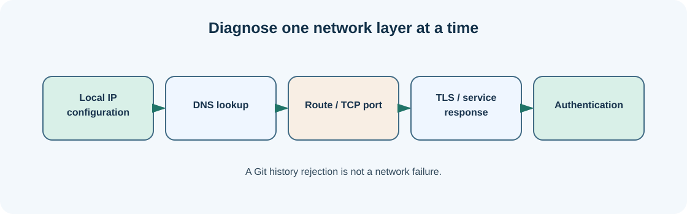

# Chapter 15 — IP addresses, networks, DNS and ports

**Bits to Banking · System Administration: From Zero · Umicom Foundation**  
**Audience:** first-time users and returning learners; no prior system-administration knowledge required.  
**Code policy:** interactive PowerShell 7 and Bash commands; native C23/Assembly for Umicom executable development.  
**Estimated study time:** 25–50 minutes (longer when practising).

## What you will learn

Identify the layers involved when a computer connects to a website or service.

## Why this matters




A network connects devices that exchange messages. An IP address identifies a network interface in the relevant routing context. A router forwards traffic between networks. DNS maps names such as `github.com` to addresses. A TCP port identifies a service endpoint, such as port 443 commonly used for HTTPS. An HTTP application works above these layers.

A browser opening a GitHub page may depend on Wi-Fi or Ethernet, a valid IP configuration, working DNS, routing, a reachable server and TLS certificate validation. A failure at one layer can resemble a failure at another. For example, being able to reach a numeric IP does not prove name resolution works, while a failed ping does not prove HTTPS is broken because ICMP may be blocked.

Diagnostics should favour observation and approved destinations. This chapter uses public documentation domains as examples but does not imply that they are always reachable from every network. Avoid scanning arbitrary hosts or internal services unless you have permission.

## New words, explained

| Term | Plain-English meaning |
|---|---|
| **IP address** | Network-layer address used to deliver packets. |
| **DNS** | System that resolves names to network addresses. |
| **Router** | Device or service that forwards packets between networks. |
| **TCP port** | Number identifying a transport endpoint on a host. |
| **HTTPS** | HTTP carried over a secure TLS connection. |

## Windows practice — PowerShell 7

> **Before typing:** Run these commands in a normal, non-elevated PowerShell window. Where a file is used, complete the previous practice-folder chapters first. Do not paste the `PS C:\...>` prompt into the terminal.

**Start:** Use the Windows Start menu or Windows Terminal to open PowerShell. Check the prompt is ready. Commands beginning with `$` are still commands; type them exactly as shown.

### Step 1 — Review local IP configuration

```powershell
Get-NetIPConfiguration
```

**Expected observation:** Windows reports interface address, gateway and DNS information where available.

**Check:** Read the output before continuing. If it does not match, stop and investigate the specific command; do not add `-Force` or run as Administrator automatically.

### Step 2 — Resolve a known host name

```powershell
Resolve-DnsName github.com
```

**Expected observation:** A set of DNS records is returned when name resolution works.

**Check:** Read the output before continuing. If it does not match, stop and investigate the specific command; do not add `-Force` or run as Administrator automatically.

### Step 3 — Test an HTTPS service connection

```powershell
Test-NetConnection github.com -Port 443
```

**Expected observation:** A TCP connection test result appears; firewall and network policy can affect it.

**Check:** Read the output before continuing. If it does not match, stop and investigate the specific command; do not add `-Force` or run as Administrator automatically.

### Step 4 — Inspect connection status without changing it

```powershell
Get-NetAdapter | Select-Object Name, Status, LinkSpeed
```

**Expected observation:** Adapter status and reported link speed appear where supported.

**Check:** Read the output before continuing. If it does not match, stop and investigate the specific command; do not add `-Force` or run as Administrator automatically.

## Linux comparison — terminal/Bash

> Linux commands are alternatives on a Linux machine or authorised VM. Do not paste them into Windows PowerShell as though the shells have identical syntax.

### Linux step 1 — Show local interfaces if `ip` is installed

```bash
ip -brief address
```

**Expected observation:** Addresses associated with interfaces appear.

### Linux step 2 — Ask the resolver for GitHub

```bash
getent hosts github.com
```

**Expected observation:** The resolver returns addresses when resolution succeeds.

### Linux step 3 — Inspect routing entries

```bash
ip route
```

**Expected observation:** Linux displays configured routes.

## Worked support scenario

A new contributor can open the terminal but cannot `git clone` from GitHub. You check whether they can resolve `github.com` and establish a TLS connection to the service. You then distinguish a connectivity failure from an authentication failure such as “repository not found” or “permission denied.”

## Common problems and how to respond

| Problem or assumption | Better response |
|---|---|
| Assuming DNS is the same as the internet connection | DNS resolves names; network routing and service access are separate. |
| Treating a failed ping as proof a website is down | ICMP may be filtered; test the service port and protocol. |
| Publishing private network details publicly | Mask sensitive addresses and network identifiers in support tickets. |

## Exercise: demonstrate understanding

1. Write down the purpose of **two commands** from this chapter, in your own words.
2. Run a **read-only command** and record only the information needed to answer its question.
3. Explain which command would change the machine, if any, and why the chapter avoids it.
4. Explain the difference between an observation, a conclusion and an unverified assumption.

## Review questions

1. What does DNS provide?
2. What does port 443 usually indicate?

<details><summary>Show the suggested answers</summary>

1. Name-to-address resolution.
2. An HTTPS/TLS service endpoint.

</details>

## How this connects to Umicom

Umicom Trader or Bank network adapters should use Framework-owned secure connectivity contracts. Beginners first learn to diagnose connections without implementing a new socket stack.

## Where to go next

Continue with [Chapter 16 — Troubleshoot a failed connection one layer at a time](16-diagnose-dns-firewall-and-connections.md).
