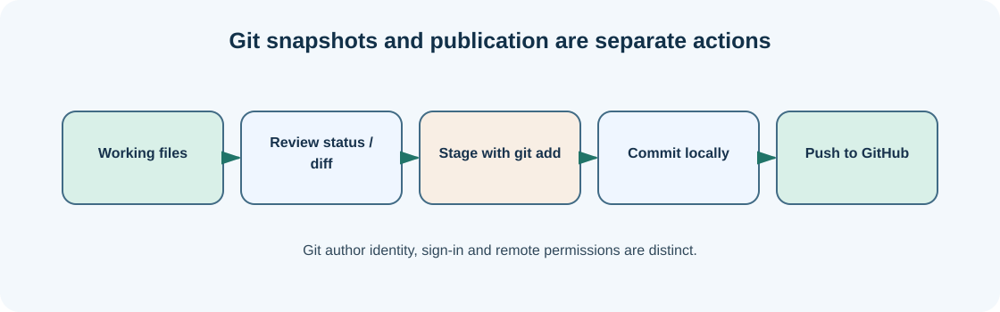

# Chapter 20 — GitHub: authenticate, publish and collaborate responsibly

**Bits to Banking · System Administration: From Zero · Umicom Foundation**  
**Audience:** first-time users and returning learners; no prior system-administration knowledge required.  
**Code policy:** interactive PowerShell 7 and Bash commands; native C23/Assembly for Umicom executable development.  
**Estimated study time:** 25–50 minutes (longer when practising).

## What you will learn

Understand the difference between a local commit and an online repository.

## Why this matters




GitHub hosts Git repositories and adds collaboration features such as issues, reviews and pull requests. GitHub CLI is an optional command-line program named `gh` that can manage repositories and authentication from PowerShell. `git` records and synchronises commits; `gh` interacts with GitHub services. They are complementary, not interchangeable.

A Git user name and email identify commit authors; they are not credentials for accessing GitHub. Authentication is separate and should be performed through the supported sign-in process. `gh auth status` checks whether a user is signed in, and `gh auth login` starts an interactive flow. Never place access tokens or passwords inside a repository.

A beginner should publish a **private** practice repository first. Public repositories are useful for open-source collaboration but can expose accidentally committed data. Review the complete staged snapshot and repository visibility before creating a remote. Creating a repository on an organisation account additionally requires permission; most beginners should use their own account.

## New words, explained

| Term | Plain-English meaning |
|---|---|
| **GitHub** | Online hosting and collaboration platform for Git repositories. |
| **GitHub CLI** | Command-line interface (`gh`) for GitHub operations. |
| **Authentication** | Proof that an account is authorised to access a service. |
| **Private repository** | Repository visible only to granted accounts. |
| **Pull request** | Proposed change submitted for review before integration. |

## Windows practice — PowerShell 7

> **Before typing:** Run these commands in a normal, non-elevated PowerShell window. Where a file is used, complete the previous practice-folder chapters first. Do not paste the `PS C:\...>` prompt into the terminal.

**Start:** Use the Windows Start menu or Windows Terminal to open PowerShell. Check the prompt is ready. Commands beginning with `$` are still commands; type them exactly as shown.

### Step 1 — Check GitHub CLI installation

```powershell
gh --version
```

**Expected observation:** Installed GitHub CLI version appears.

**Check:** Read the output before continuing. If it does not match, stop and investigate the specific command; do not add `-Force` or run as Administrator automatically.

### Step 2 — Configure public commit attribution

```powershell
git config --global user.name (Read-Host "Your display name")
git config --global user.email (Read-Host "Your verified Git email or GitHub noreply address")
```

**Expected observation:** The settings are stored locally; they do not log you in.

**Check:** Read the output before continuing. If it does not match, stop and investigate the specific command; do not add `-Force` or run as Administrator automatically.

### Step 3 — Check login state

```powershell
gh auth status
```

**Expected observation:** Status indicates whether authentication is configured.

**Check:** Read the output before continuing. If it does not match, stop and investigate the specific command; do not add `-Force` or run as Administrator automatically.

### Step 4 — Start supported sign-in only if needed

```powershell
gh auth login
```

**Expected observation:** Follow the interactive browser/code prompts if not already signed in.

**Check:** Read the output before continuing. If it does not match, stop and investigate the specific command; do not add `-Force` or run as Administrator automatically.

### Step 5 — Open your private practice repository

```powershell
Set-Location "$HOME\UmicomLearning\git-first-project"
git status
```

**Expected observation:** Confirm you are in the practice project and have a reviewed commit.

**Check:** Read the output before continuing. If it does not match, stop and investigate the specific command; do not add `-Force` or run as Administrator automatically.

### Step 6 — Create a private remote once, if you choose to publish

```powershell
gh repo create umicom-git-practice --private --source . --remote origin --push
```

**Expected observation:** GitHub creates a private remote for your signed-in account and pushes the current branch.

**Check:** Read the output before continuing. If it does not match, stop and investigate the specific command; do not add `-Force` or run as Administrator automatically.

## Linux comparison — terminal/Bash

> Linux commands are alternatives on a Linux machine or authorised VM. Do not paste them into Windows PowerShell as though the shells have identical syntax.

### Linux step 1 — Check CLI and Git installation

```bash
gh --version && git --version
```

**Expected observation:** Both tools report versions if installed.

### Linux step 2 — Check login status

```bash
gh auth status
```

**Expected observation:** The CLI reports the signed-in account or a login requirement.

## Worked support scenario

A new Umicom contributor cannot push to the Foundation repository because they do not have direct write permission. That is expected for many collaborators. They can contribute through a personal fork and pull request. Project maintainers with authorised access may use the project’s direct-to-main policy; permission boundaries still apply.

## Common problems and how to respond

| Problem or assumption | Better response |
|---|---|
| Treating `git config user.email` as GitHub authentication | Use `gh auth login` for sign-in. |
| Creating a public repository for private practice by accident | Choose `--private`, inspect the destination and avoid secrets. |
| Re-running `gh repo create` when the remote already exists | Inspect `git remote -v` and `gh repo view` before creating anything else. |

## Exercise: demonstrate understanding

1. Write down the purpose of **two commands** from this chapter, in your own words.
2. Run a **read-only command** and record only the information needed to answer its question.
3. Explain which command would change the machine, if any, and why the chapter avoids it.
4. Explain the difference between an observation, a conclusion and an unverified assumption.

## Review questions

1. What is the difference between Git and GitHub?
2. What does `git push origin main` do?

<details><summary>Show the suggested answers</summary>

1. Git versions files locally; GitHub hosts repositories and collaboration features.
2. Sends commits on local `main` to the configured `origin` remote `main`, if permitted.

</details>

## How this connects to Umicom

Foundation maintainers commit tested changes to `main` according to current policy. New public contributors may be asked to submit pull requests; respect permissions rather than attempting to bypass them.

## Where to go next

Continue with [Chapter 21 — Create a new Umicom application: repositories, modules and discovery](21-new-umicom-application-module-and-discovery.md).
