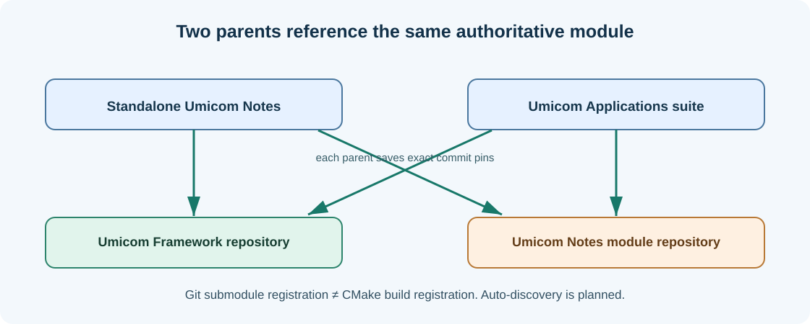

# Chapter 21 — Create a new Umicom application: repositories, modules and discovery

**Bits to Banking · System Administration: From Zero · Umicom Foundation**  
**Audience:** first-time users and returning learners; no prior system-administration knowledge required.  
**Code policy:** interactive PowerShell 7 and Bash commands; native C23/Assembly for Umicom executable development.  
**Estimated study time:** 25–50 minutes (longer when practising).

## What you will learn

Understand the supplied Umicom project creation guide and its future-automation boundary.

## Why this matters




The included document **Creating a New Umicom Application — A Beginner’s PowerShell Guide and Automatic Registration Blueprint** explains how an application may be split between a standalone parent repository and a reusable application-module repository. It uses a fictional Umicom Notes product, with Framework linked as a submodule and the same Notes module referenced from two parents. This is a useful architecture example, not an instruction to create live GitHub repositories during a classroom exercise.

A Git submodule points to an exact commit in another repository. Parent repositories can pin different commits even when both refer to the same remote module. This matters in Umicom Applications and Umicom OS: updating Framework code in one checkout does not automatically update every parent gitlink. Git registration also does not guarantee CMake build registration.

The supplied guide distinguishes **currently documented manual CMake registration** from a proposed future native, Framework-owned auto-discovery workflow. Do not treat its `umicom project create ... --standalone ... --suite` example as an existing command. The planned implementation must be reviewed, permissions verified, and tests passed before anyone may rely on it.

## New words, explained

| Term | Plain-English meaning |
|---|---|
| **Standalone parent** | Repository that composes Framework and an application module. |
| **Application module** | Reusable independently versioned product-specific source. |
| **Submodule gitlink** | Parent reference to one commit of another repository. |
| **Manifest** | Declared application identity, frontend and build metadata. |
| **Auto-discovery blueprint** | Future plan, not evidence that the capability is implemented. |

## Windows practice — PowerShell 7

> **Before typing:** Run these commands in a normal, non-elevated PowerShell window. Where a file is used, complete the previous practice-folder chapters first. Do not paste the `PS C:\...>` prompt into the terminal.

**Start:** Use the Windows Start menu or Windows Terminal to open PowerShell. Check the prompt is ready. Commands beginning with `$` are still commands; type them exactly as shown.

### Step 1 — Observe the real suite before changing it

```powershell
Set-Location "C:\umicom\Umicom-Applications"
git status --short
```

**Expected observation:** If the directory exists, review its state before any operation; otherwise use the supplied guide as reading only.

**Check:** Read the output before continuing. If it does not match, stop and investigate the specific command; do not add `-Force` or run as Administrator automatically.

### Step 2 — Inspect registered module references

```powershell
git submodule status
```

**Expected observation:** Initialised and non-initialised submodule states appear.

**Check:** Read the output before continuing. If it does not match, stop and investigate the specific command; do not add `-Force` or run as Administrator automatically.

### Step 3 — Inspect the native Umicom tool when it is built

```powershell
Get-Command umicom -ErrorAction SilentlyContinue
```

**Expected observation:** No result means the executable is not on PATH; find the actual built tool before using it.

**Check:** Read the output before continuing. If it does not match, stop and investigate the specific command; do not add `-Force` or run as Administrator automatically.

### Step 4 — Return safely to the practice workspace

```powershell
Set-Location "$HOME\UmicomLearning"
```

**Expected observation:** Your working directory leaves the real code checkout.

**Check:** Read the output before continuing. If it does not match, stop and investigate the specific command; do not add `-Force` or run as Administrator automatically.

## Linux comparison — terminal/Bash

> Linux commands are alternatives on a Linux machine or authorised VM. Do not paste them into Windows PowerShell as though the shells have identical syntax.

### Linux step 1 — Read current directory before interacting with a repository

```bash
pwd
```

**Expected observation:** Confirm you are in the intended checkout before invoking Git.

## Worked support scenario

A healthcare contributor wants a new application module. They begin by identifying whether a module repository already exists, which parent application will compose it, which manifest the Framework understands, and whether the code can build with current CMake. They do not blindly paste three new CMake sections into a shared build configuration before reviewing the latest project capabilities.

## Common problems and how to respond

| Problem or assumption | Better response |
|---|---|
| Calling proposed `umicom project create` options as if they already exist | Read the original guide’s “Future” labels and use current documented commands only. |
| Assuming a Git submodule automatically compiles | Build registration and source registration are separate contracts. |
| Cloning Framework source into every module manually | Reuse one authoritative Framework repository through pinned submodules. |

## Exercise: demonstrate understanding

1. Write down the purpose of **two commands** from this chapter, in your own words.
2. Run a **read-only command** and record only the information needed to answer its question.
3. Explain which command would change the machine, if any, and why the chapter avoids it.
4. Explain the difference between an observation, a conclusion and an unverified assumption.

## Review questions

1. What does a parent gitlink store?
2. Is the proposed one-command two-repository creation flow already proved in the guide?

<details><summary>Show the suggested answers</summary>

1. The selected commit of a submodule repository.
2. No; the guide explicitly labels it as future work.

</details>

## How this connects to Umicom

Read the [complete supplied new-project guide](../../assets/reference/umicom-new-project-beginner-guide-original.html) unchanged. Use it as the architectural reference and distinguish the documented existing steps from its proposed native C23 improvements.

## Where to go next

Continue with [Chapter 22 — Build, test and inspect a read-only C23 program](22-c23-build-tests-and-safe-inspection.md).
