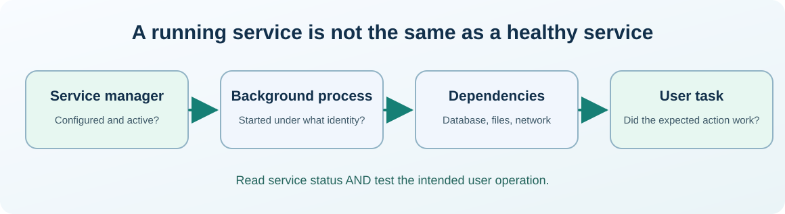

# Chapter 27 — Investigate a Windows service and its event records

**Bits to Banking · System Administration: From Zero · Umicom Foundation**  

**Audience:** first-time users and returning learners; practical examples appropriate for supervised younger learners.  

**Estimated study time:** 45–70 minutes.  

**Prerequisites:** Chapters 10–12.


## Why this matters

An application window will not open. Restarting the entire computer might hide the problem temporarily, but it does not explain it. Windows has background services that support networking, software updates and many other functions. We will learn to inspect those services **without stopping or reconfiguring them**.




## What you will be able to do

By the end of this chapter you should be able to explain the new terms in ordinary language, select a safe read-only command for the right operating system, recognise a normal result and identify an unverified result. You should also be able to describe what permission would be needed before making a real system change.


## The mental model

A Windows service is a background program managed by the Service Control Manager. It has a configuration, an account, dependencies and a runtime status such as Running or Stopped. A process can exist while the service is unhealthy; a service can also be deliberately Stopped when not required. An event log records messages generated by Windows and applications. Look for a sequence: when was the last successful startup, what changed immediately before failure, and was the failure in the application, a dependency or access to a resource? Event timestamps are observations, not proof of causation.

### Separate a service state from a user-visible outcome

A service manager reports lifecycle information: configured start type, process state and sometimes exit codes. A student needs to know whether an application can actually complete a task. These are different checks. A service can report Running while its database credentials are expired, its dependency is slow or its listener is on the wrong port. Likewise, a stopped Print Spooler is not evidence that a headless C23 test machine is faulty.

When reading events, limit the time range and choose a relevant provider if possible. A System log contains many unrelated messages. A useful support report records a specific user-visible failure at 10:12, then examines events immediately before and after 10:12 for the correct service. A timestamp without a matching process, machine and operation is context, not causation. Keep raw logs in an approved restricted location rather than pasting them into a public report.


## Words you should know
| Term | Meaning |
|---|---|
| **Service** | A background program managed by the operating system. |
| **Dependency** | Another component required for correct operation. |
| **Event ID** | An identifier issued by a log provider for a kind of event. |
| **Provider** | The component that wrote a log record. |
| **Incident timeline** | An ordered view of observations surrounding a problem. |


## Windows: PowerShell 7, one command at a time

> Use a **normal non-elevated PowerShell** window. Do not type the `PS C:\...>` prompt. If a command is unavailable or returns Access Denied, record that result; do not attempt to defeat the restriction.

The lines in a code block may contain more than one interactive command. Run them in order, checking each result before continuing. **No `.ps1` file is created or required.**

### Windows step 1 — List a small sample of services

```powershell
Get-Service | Select-Object -First 12 Name, Status, DisplayName
```

**Expected result:** Several services appear. Do not treat every Stopped service as broken.

**What this does:** PowerShell runs the command in your current session and displays information or, where clearly indicated, changes only your own practice files. If output differs, record the actual result before going further.

### Windows step 2 — Inspect a known service only when present

```powershell
Get-Service -Name Spooler -ErrorAction SilentlyContinue
```

**Expected result:** The Print Spooler may be absent or disabled; no output is a valid observation.

**What this does:** PowerShell runs the command in your current session and displays information or, where clearly indicated, changes only your own practice files. If output differs, record the actual result before going further.

### Windows step 3 — Read recent Application log events

```powershell
Get-WinEvent -LogName Application -MaxEvents 8 | Select-Object TimeCreated, Id, ProviderName, LevelDisplayName
```

**Expected result:** Recent entries are displayed. If access is refused, note that the log requires different authorisation.

**What this does:** PowerShell runs the command in your current session and displays information or, where clearly indicated, changes only your own practice files. If output differs, record the actual result before going further.

### Windows step 4 — Read service-related Windows records

```powershell
Get-WinEvent -FilterHashtable @{ LogName = "System"; ProviderName = "Service Control Manager" } -MaxEvents 8 | Select-Object TimeCreated, Id, Message
```

**Expected result:** Where events exist, compare their timestamps with the reported failure. Some messages contain identifying information; keep them private.

**What this does:** PowerShell runs the command in your current session and displays information or, where clearly indicated, changes only your own practice files. If output differs, record the actual result before going further.


## Linux: terminal and distribution differences

> Run the following only in an authorised Linux computer or VM. If you use Windows only, read this section for comparison. A program being absent does not mean the whole operating system is faulty.

### Linux step 1 — Compare the concept with running services on systemd hosts

```bash
systemctl list-units --type=service --state=running --no-pager
```

**Expected result:** Service unit names appear if systemd is used.

### Linux step 2 — Read recent system journal entries when allowed

```bash
journalctl -n 8 --no-pager
```

**Expected result:** Some records may be hidden from ordinary users; do not escalate automatically.


## Worked support scenario

A training web-server exercise shows a connection refusal. You inspect the expected process, the port, and the relevant application log. If the service never started, the problem is not necessarily networking. If it started but binds the wrong interface, the service can be Running but still unusable to the intended client. Write down the **exact reported status**, **time**, and **tested endpoint** before suggesting a restart.


## Common mistakes and safe responses
| Mistake | Better response |
|---|---|
| “Stopped always means failed.” | Services can be manual, disabled or simply not needed at present. |
| “A successful Start command proves the application works.” | Probe the actual dependent function; process existence is not end-to-end health. |
| “All Event ID numbers are globally unique.” | Use the event provider plus ID and relevant timestamp when interpreting logs. |


## Exercises

1. Find one service without changing its state; report only its name and status.

2. Identify the extra facts needed to connect a log entry to an incident.

3. Explain why you should not paste full logs containing paths, usernames or credentials into public chats.


## Review questions and suggested answers

<details><summary>Show the suggested answers after attempting the exercises</summary>


1. `Get-Service` is read-only; choose an ordinary service.

2. Provider, time, event identifier, affected service and observed symptom.

3. Logs may contain identifiable or confidential information; share only redacted excerpts.


</details>


## Connecting this chapter to Umicom

Production Umicom software should use the appropriate **Umicom Framework** service for identities, processes, filesystem operations, Git, diagnostics, build planning or observability. The teaching commands here are interactive; they are **not** substitute Python or PowerShell implementations. Any reusable new executable component must first be considered for Framework ownership and designed in C23 or justified Assembly.


## References and further reading

- https://learn.microsoft.com/powershell/module/microsoft.powershell.management/get-service

- https://learn.microsoft.com/powershell/module/microsoft.powershell.diagnostics/get-winevent


**Course progression:** [Chapter 26](26-understand-ntfs-and-linux-permissions.md) → **Chapter 27** → [Chapter 28](28-linux-systemd-units-and-journal-logs.md)


---

**Practical safety reminder:** No exercise requires access to private records, bank accounts, live production systems or another person’s computer. A successful “not permitted” or “not run” observation is an acceptable learning outcome.
