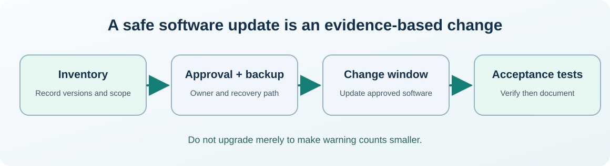

# Chapter 29 — Plan software updates and understand the change window

**Bits to Banking · System Administration: From Zero · Umicom Foundation**  

**Audience:** first-time users and returning learners; practical examples appropriate for supervised younger learners.  

**Estimated study time:** 45–70 minutes.  

**Prerequisites:** Chapters 8 and 23.


## Why this matters

A package manager reports ten available updates. Installing all ten immediately might seem responsible, but a machine could be in the middle of an important class, a medical support session or a planned Umicom build. An administrator first identifies the change, verifies a backup and maintenance window, and understands what a rollback would require.




## What you will be able to do

By the end of this chapter you should be able to explain the new terms in ordinary language, select a safe read-only command for the right operating system, recognise a normal result and identify an unverified result. You should also be able to describe what permission would be needed before making a real system change.


## The mental model

A package manager tracks installed software and available packages. A security update fixes a vulnerability; a feature update may change behaviour; a driver or compiler update can invalidate assumptions about build reproducibility. The visible package list is not the whole software inventory: applications can be installed manually or managed by another provider. Upgrading software is a change with potential downstream effects. The correct rhythm is *inventory → evaluate → obtain permission → prepare recovery → apply → verify → record*. The first part of this lesson is deliberately read-only.

### A deployment is not finished when an installer exits

A controlled upgrade needs a post-change acceptance test. For a text editor that might mean opening and saving a harmless document. For an Umicom Studio build environment it means checking compiler and linker versions, configuring the correct preset, building the expected targets and running the registered tests. A package manager exit code says whether its transaction succeeded; it does not prove that an unrelated dependent program still behaves correctly.

On a managed computer, administrators may pin versions, use central update policies or require maintenance windows. A beginner should not bypass those controls. It is also important to distinguish **information collection** from **change**. `winget list --upgrade-available` is observational. `winget upgrade` changes installed software. The latter belongs in a separate approved maintenance procedure with a recovery plan.


## Words you should know
| Term | Meaning |
|---|---|
| **Package manager** | Software that installs, upgrades or removes software packages. |
| **Dependency** | Another package or library required by an application. |
| **Change window** | An agreed time to apply changes with controlled impact. |
| **Rollback** | Returning to a known working configuration after a failed change. |
| **Compatibility matrix** | Recorded versions known to work together. |


## Windows: PowerShell 7, one command at a time

> Use a **normal non-elevated PowerShell** window. Do not type the `PS C:\...>` prompt. If a command is unavailable or returns Access Denied, record that result; do not attempt to defeat the restriction.

The lines in a code block may contain more than one interactive command. Run them in order, checking each result before continuing. **No `.ps1` file is created or required.**

### Windows step 1 — Check the package manager version

```powershell
winget --version
```

**Expected result:** A version number indicates Windows Package Manager is available; if unrecognised, consult the Windows installation guide.

**What this does:** PowerShell runs the command in your current session and displays information or, where clearly indicated, changes only your own practice files. If output differs, record the actual result before going further.

### Windows step 2 — List installed packages

```powershell
winget list
```

**Expected result:** The result can be long and may include software installed through other methods.

**What this does:** PowerShell runs the command in your current session and displays information or, where clearly indicated, changes only your own practice files. If output differs, record the actual result before going further.

### Windows step 3 — List applications with available updates

```powershell
winget list --upgrade-available
```

**Expected result:** Available updates are listed without installing them. A missing update is not proof the PC has no security issues.

**What this does:** PowerShell runs the command in your current session and displays information or, where clearly indicated, changes only your own practice files. If output differs, record the actual result before going further.

### Windows step 4 — Inspect one package’s metadata

```powershell
winget show --id Git.Git --exact
```

**Expected result:** Package details and source are displayed when available; this is not an installation.

**What this does:** PowerShell runs the command in your current session and displays information or, where clearly indicated, changes only your own practice files. If output differs, record the actual result before going further.


## Linux: terminal and distribution differences

> Run the following only in an authorised Linux computer or VM. If you use Windows only, read this section for comparison. A program being absent does not mean the whole operating system is faulty.

### Linux step 1 — Find the distribution

```bash
cat /etc/os-release
```

**Expected result:** Identifies the operating-system family; this file is normally world-readable.

### Linux step 2 — List upgrade candidates on Debian/Ubuntu

```bash
apt list --upgradable
```

**Expected result:** Displays upgrade candidates from currently cached package metadata. The result can be stale until an authorised update refreshes it.

### Linux step 3 — List installed OpenSSH package information (Debian/Ubuntu)

```bash
dpkg-query -W openssh-client
```

**Expected result:** Reports a version if installed, or a non-zero status if absent; do not assume all Linux uses dpkg.


## Worked support scenario

The Umicom C23 laboratory compiled yesterday but fails after a compiler upgrade. Save the exact GCC, CMake and Ninja versions, the error log and the Git commit used. Before making further changes, check whether dependencies or compiler defaults have changed. A rollback of the compiler is a separate approved task; rewriting source without evidence can obscure the root cause.


## Common mistakes and safe responses
| Mistake | Better response |
|---|---|
| “Run `winget upgrade --all` during the exercise.” | That modifies real software and is not an observation; no updates are installed in this lab. |
| “A software update is always safe because it comes from a package manager.” | Compatibility, trust, vendor support and rollback still need review. |
| “The package list is an immutable record.” | Repositories and cached metadata change; note when and where the observation was taken. |


## Exercises

1. Identify the difference between `winget list --upgrade-available` and `winget upgrade`.

2. Write three checks you would make before updating a machine used for an Umicom demonstration.

3. Record the currently installed version of one harmless development tool, without upgrading it.


## Review questions and suggested answers

<details><summary>Show the suggested answers after attempting the exercises</summary>


1. The first lists candidates; the second applies an update.

2. Owner permission, current backup/recovery evidence, compatibility and timing are useful checks.

3. For example, `git --version` or `cmake --version` records a version without changing software.


</details>


## Connecting this chapter to Umicom

Production Umicom software should use the appropriate **Umicom Framework** service for identities, processes, filesystem operations, Git, diagnostics, build planning or observability. The teaching commands here are interactive; they are **not** substitute Python or PowerShell implementations. Any reusable new executable component must first be considered for Framework ownership and designed in C23 or justified Assembly.


## References and further reading

- https://learn.microsoft.com/windows/package-manager/winget/list

- https://learn.microsoft.com/windows/package-manager/winget/upgrade


**Course progression:** [Chapter 28](28-linux-systemd-units-and-journal-logs.md) → **Chapter 29** → [Chapter 30](30-understand-ssh-host-keys-and-safe-remote-access.md)


---

**Practical safety reminder:** No exercise requires access to private records, bank accounts, live production systems or another person’s computer. A successful “not permitted” or “not run” observation is an acceptable learning outcome.
