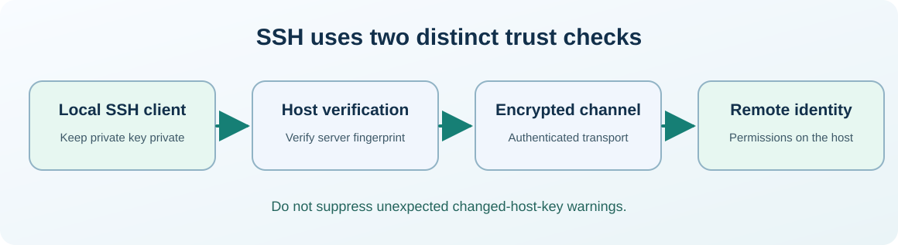

# Chapter 30 — SSH: encrypted remote access, identity keys and host trust

**Bits to Banking · System Administration: From Zero · Umicom Foundation**  

**Audience:** first-time users and returning learners; practical examples appropriate for supervised younger learners.  

**Estimated study time:** 50–80 minutes.  

**Prerequisites:** Chapters 15–18 and 34 (read 34 later for extended security).


## Why this matters

A contributor wants to inspect a Linux test machine from a Windows laptop. SSH can provide encrypted access, but the learner must understand **two different kinds of trust**: proving that the server is the intended server and proving to the server who the user is. Mixing those questions is a common source of security mistakes.




## What you will be able to do

By the end of this chapter you should be able to explain the new terms in ordinary language, select a safe read-only command for the right operating system, recognise a normal result and identify an unverified result. You should also be able to describe what permission would be needed before making a real system change.


## The mental model

An SSH client contacts an SSH server over a network connection, commonly TCP port 22. The server presents a **host key** so the client can recognise the same server in future sessions. The client can authenticate with a password or user key pair, subject to server policy. A **private key** is secret and remains on your computer; a **public key** can be registered with authorised servers. The `known_hosts` file remembers server host keys. A changed host-key warning is a trust event requiring verification, not an inconvenience to suppress with `StrictHostKeyChecking=no`.

### What a trustworthy first SSH connection looks like

Before connecting, the learner must know the hostname or address from a trusted administrator, their authorised username and the expected server host-key fingerprint. The host key may be new because the machine has never been contacted, but that does not make an unverified first connection automatically trustworthy. Once the administrator confirms the fingerprint independently, the client can establish a recorded identity for future connections.

An SSH public key file ending in `.pub` is intended to be distributed for authentication. The matching private key is not. Do not paste either into commands from a stranger who says it is required to repair GitHub authentication. You may see SSH used for Git transport (`git@github.com:...`) without ever opening an interactive server terminal; the same cryptographic trust concepts apply, but the permitted operations differ.


## Words you should know
| Term | Meaning |
|---|---|
| **SSH** | Secure Shell, a protocol for authenticated and encrypted remote sessions. |
| **Host key** | A server identity key checked by the client. |
| **Private key** | Secret half of an authentication key pair. |
| **Public key** | The shareable half used to verify signatures. |
| **Known hosts** | A client-side record of recognised server identities. |


## Windows: PowerShell 7, one command at a time

> Use a **normal non-elevated PowerShell** window. Do not type the `PS C:\...>` prompt. If a command is unavailable or returns Access Denied, record that result; do not attempt to defeat the restriction.

The lines in a code block may contain more than one interactive command. Run them in order, checking each result before continuing. **No `.ps1` file is created or required.**

### Windows step 1 — Check whether the SSH client exists

```powershell
Get-Command ssh -ErrorAction SilentlyContinue
```

**Expected result:** An application path appears if OpenSSH client is installed.

**What this does:** PowerShell runs the command in your current session and displays information or, where clearly indicated, changes only your own practice files. If output differs, record the actual result before going further.

### Windows step 2 — Read the OpenSSH version

```powershell
ssh -V
```

**Expected result:** A version line often appears on the error stream; no network connection is made.

**What this does:** PowerShell runs the command in your current session and displays information or, where clearly indicated, changes only your own practice files. If output differs, record the actual result before going further.

### Windows step 3 — Check for an existing training key without opening it

```powershell
Test-Path "$HOME\.ssh\umicom_training_ed25519"
```

**Expected result:** True means a private training key file with this name exists. Do not overwrite it.

**What this does:** PowerShell runs the command in your current session and displays information or, where clearly indicated, changes only your own practice files. If output differs, record the actual result before going further.

### Windows step 4 — Inspect *only* the public key fingerprint if a public key exists

```powershell
ssh-keygen -lf "$HOME\.ssh\umicom_training_ed25519.pub"
```

**Expected result:** Displays a public-key fingerprint. If the file does not exist, skip this step.

**What this does:** PowerShell runs the command in your current session and displays information or, where clearly indicated, changes only your own practice files. If output differs, record the actual result before going further.


## Linux: terminal and distribution differences

> Run the following only in an authorised Linux computer or VM. If you use Windows only, read this section for comparison. A program being absent does not mean the whole operating system is faulty.

### Linux step 1 — Confirm the SSH client is available

```bash
ssh -V
```

**Expected result:** Outputs the installed OpenSSH client version.

### Linux step 2 — Inspect your own SSH folder metadata, if present

```bash
ls -ld "$HOME/.ssh"
```

**Expected result:** Permissions and owner; if the folder is absent, that is not an error for first-time users.

### Linux step 3 — Inspect public keys only, when present

```bash
ls -l "$HOME/.ssh"/*.pub
```

**Expected result:** Lists public key files; if none exist, shell glob behaviour differs by shell.


## Worked support scenario

During a scheduled lesson, a previously used SSH host suddenly reports that its host key changed. Do **not** remove the known-host entry automatically. Ask the administrator to verify the machine fingerprint by a trusted independent channel, such as the console or approved inventory. Only after that verification should the client record the new identity. Never email or publish private key contents, password prompts or sensitive host details.


## Common mistakes and safe responses
| Mistake | Better response |
|---|---|
| “A public SSH key is the password.” | The public key is not secret; the private key must remain protected. |
| “Delete known_hosts whenever there is a warning.” | Host-key warnings can indicate a legitimate rebuild or an attack; verify independently. |
| “The port being open means login is safe.” | Connectivity alone does not prove server identity or permission to connect. |


## Exercises

1. Explain the difference between a server host key and a user authentication key.

2. Check `ssh -V` without contacting a remote machine.

3. Write a safe response to an unexpected host-key warning.


## Review questions and suggested answers

<details><summary>Show the suggested answers after attempting the exercises</summary>


1. Host key identifies the server; a user key pair can authenticate the client.

2. The command is local and read-only.

3. Stop, preserve the warning, verify the expected fingerprint through an authorised channel, then proceed only after confirmation.


</details>


## Connecting this chapter to Umicom

Production Umicom software should use the appropriate **Umicom Framework** service for identities, processes, filesystem operations, Git, diagnostics, build planning or observability. The teaching commands here are interactive; they are **not** substitute Python or PowerShell implementations. Any reusable new executable component must first be considered for Framework ownership and designed in C23 or justified Assembly.


## References and further reading

- https://learn.microsoft.com/windows-server/administration/openssh/openssh_keymanagement

- https://www.openssh.com/manual.html


**Course progression:** [Chapter 29](29-plan-windows-and-linux-software-updates.md) → **Chapter 30** → [Chapter 31](31-diagnose-dns-tcp-and-firewall-boundaries.md)


---

**Practical safety reminder:** No exercise requires access to private records, bank accounts, live production systems or another person’s computer. A successful “not permitted” or “not run” observation is an acceptable learning outcome.
