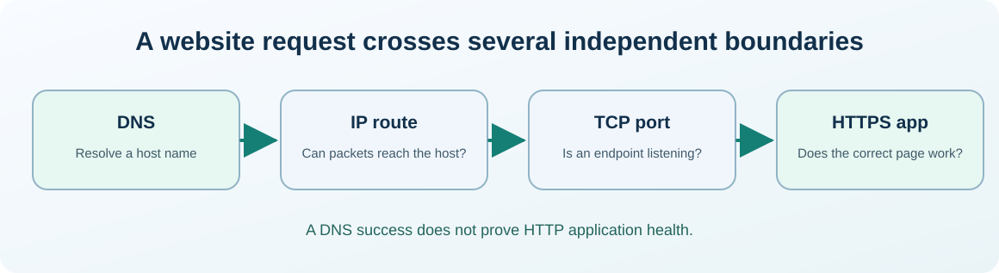

# Chapter 31 — Diagnose DNS, TCP ports and firewall boundaries

**Bits to Banking · System Administration: From Zero · Umicom Foundation**  

**Audience:** first-time users and returning learners; practical examples appropriate for supervised younger learners.  

**Estimated study time:** 55–85 minutes.  

**Prerequisites:** Chapters 15–16.


## Why this matters

A browser says a learning website cannot be reached. The problem might be its name, the network route, the server process, its listening port or a security policy. A single failed test cannot reliably distinguish these possibilities. System administrators isolate one layer at a time.




## What you will be able to do

By the end of this chapter you should be able to explain the new terms in ordinary language, select a safe read-only command for the right operating system, recognise a normal result and identify an unverified result. You should also be able to describe what permission would be needed before making a real system change.


## The mental model

A hostname such as `example.com` is a human-friendly identifier. DNS translates names into addresses; the application then attempts a connection to a server address and port. A successful DNS lookup does not prove TCP reachability. A successful TCP connection does not prove that the HTTP service returns a correct application response. A `ping` refusal also does not prove that a web service is down because ICMP can be blocked. A firewall applies policy to traffic; it should never be disabled wholesale merely to “see if that fixes it”.

### Make each network check answer only one question

Name resolution asks “which address should this name refer to?”. A TCP connection asks “did I reach an accepting endpoint on this port?”. An HTTPS request asks “did the web server negotiate transport security and return an application-level response?”. The three checks build on one another but cannot be substituted for each other. A successful TCP probe on 443 does not prove that the certificate is trusted, the application is authenticated or the requested page exists.

Be precise about localhost. `127.0.0.1` always refers to the same host network namespace that issued the request; it does not refer to your colleague’s machine. In containers or virtual machines, the localhost of one environment is often different from the host's localhost. An educational server bound to loopback should not be exposed externally just to make a remote demo work. Use approved routing and listen policies instead.


## Words you should know
| Term | Meaning |
|---|---|
| **DNS** | System that maps domain names to resource records such as IP addresses. |
| **TCP** | Connection-oriented transport protocol used by many services. |
| **Port** | Number identifying a service endpoint at a host. |
| **Firewall** | Policy enforcement point controlling network traffic. |
| **Loopback** | Local network interface, normally `127.0.0.1` or `::1`. |


## Windows: PowerShell 7, one command at a time

> Use a **normal non-elevated PowerShell** window. Do not type the `PS C:\...>` prompt. If a command is unavailable or returns Access Denied, record that result; do not attempt to defeat the restriction.

The lines in a code block may contain more than one interactive command. Run them in order, checking each result before continuing. **No `.ps1` file is created or required.**

### Windows step 1 — Inspect an ordinary public DNS name

```powershell
Resolve-DnsName example.com
```

**Expected result:** A or AAAA address records can appear. If DNS is not configured, record the failure.

**What this does:** PowerShell runs the command in your current session and displays information or, where clearly indicated, changes only your own practice files. If output differs, record the actual result before going further.

### Windows step 2 — Test a documented HTTPS endpoint

```powershell
Test-NetConnection -ComputerName example.com -Port 443
```

**Expected result:** `TcpTestSucceeded` indicates whether a TCP connection succeeded during this attempt; it is not an HTTP application test.

**What this does:** PowerShell runs the command in your current session and displays information or, where clearly indicated, changes only your own practice files. If output differs, record the actual result before going further.

### Windows step 3 — View local TCP listeners

```powershell
Get-NetTCPConnection -State Listen | Select-Object -First 12 LocalAddress, LocalPort, OwningProcess
```

**Expected result:** Shows bound sockets when the cmdlet is available; no firewall rule changes.

**What this does:** PowerShell runs the command in your current session and displays information or, where clearly indicated, changes only your own practice files. If output differs, record the actual result before going further.

### Windows step 4 — Fetch only response headers

```powershell
curl.exe --head https://example.com/
```

**Expected result:** Shows an HTTP result if the host/network permits access. `curl.exe` avoids the older Windows PowerShell alias ambiguity.

**What this does:** PowerShell runs the command in your current session and displays information or, where clearly indicated, changes only your own practice files. If output differs, record the actual result before going further.


## Linux: terminal and distribution differences

> Run the following only in an authorised Linux computer or VM. If you use Windows only, read this section for comparison. A program being absent does not mean the whole operating system is faulty.

### Linux step 1 — Resolve the same name

```bash
getent ahosts example.com
```

**Expected result:** Address records as provided by the host name service configuration.

### Linux step 2 — List locally listening TCP endpoints

```bash
ss -ltn
```

**Expected result:** Listening sockets; process owners may be hidden without permissions.

### Linux step 3 — Ask for HTTPS headers only

```bash
curl -I https://example.com/
```

**Expected result:** The response is subject to network policies; no login should be necessary.


## Worked support scenario

A local C23 HTTP server is expected at `127.0.0.1:8765`. First verify the server actually started and recorded its bind address. Then try `curl.exe -i http://127.0.0.1:8765/` on Windows or `curl -i http://127.0.0.1:8765/` on Linux. A connection refusal means no acceptor is reachable at that endpoint; it is not an instruction to turn off the firewall or expose the service publicly. The test remains loopback-only.


## Common mistakes and safe responses
| Mistake | Better response |
|---|---|
| “The hostname resolves, so the site must be healthy.” | DNS covers name resolution, not application response. |
| “Ping fails, therefore the computer is offline.” | ICMP may be blocked while TCP services are reachable. |
| “Fix the problem by disabling the firewall.” | Preserve security controls and investigate the exact path, port and allowed policy. |


## Exercises

1. Explain the difference between a DNS failure and a TCP connection refusal.

2. Run one read-only network probe against an approved public or loopback endpoint.

3. Draw the path from browser to hostname, address, port and application response.


## Review questions and suggested answers

<details><summary>Show the suggested answers after attempting the exercises</summary>


1. DNS failure means no usable name resolution; refusal occurs after addressing when no accepting endpoint is reached.

2. Record endpoint, time, command and result.

3. Browser → DNS → IP routing → TCP endpoint → HTTP application is a useful outline.


</details>


## Connecting this chapter to Umicom

Production Umicom software should use the appropriate **Umicom Framework** service for identities, processes, filesystem operations, Git, diagnostics, build planning or observability. The teaching commands here are interactive; they are **not** substitute Python or PowerShell implementations. Any reusable new executable component must first be considered for Framework ownership and designed in C23 or justified Assembly.


## References and further reading

- https://learn.microsoft.com/powershell/module/nettcpip/test-netconnection

- https://www.rfc-editor.org/rfc/rfc9293


**Course progression:** [Chapter 30](30-understand-ssh-host-keys-and-safe-remote-access.md) → **Chapter 31** → [Chapter 32](32-storage-space-filesystems-and-disk-health.md)


---

**Practical safety reminder:** No exercise requires access to private records, bank accounts, live production systems or another person’s computer. A successful “not permitted” or “not run” observation is an acceptable learning outcome.
