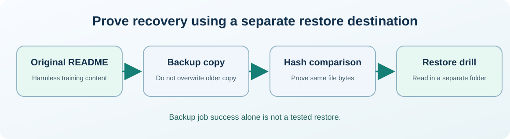

# Chapter 32 — Understand disk space, filesystems and safe capacity checks

**Bits to Banking · System Administration: From Zero · Umicom Foundation**  

**Audience:** first-time users and returning learners; practical examples appropriate for supervised younger learners.  

**Estimated study time:** 45–70 minutes.  

**Prerequisites:** Chapters 13–14.


## Why this matters

A training application fails to save a file. Before touching configuration, check whether the destination exists, whether the user can write there and whether sufficient storage is available. Disk capacity is a finite resource, and different storage layers can fail for different reasons.




## What you will be able to do

By the end of this chapter you should be able to explain the new terms in ordinary language, select a safe read-only command for the right operating system, recognise a normal result and identify an unverified result. You should also be able to describe what permission would be needed before making a real system change.


## The mental model

A physical disk stores data, while a partition or volume describes a managed region. A filesystem organises files and directories within a volume. Windows frequently uses NTFS and drive letters; Linux often mounts filesystems at directories such as `/home` and `/var`. **Free space** is different from **free inodes** on some filesystems: a Linux volume can have available bytes but run out of metadata entries. A disk can have free space and still produce I/O errors. Reading filesystem information is a safe first step; formatting, repartitioning or repairing a device is not part of this beginner course.

### Why administrators treat available space as evidence, not a repair instruction

A file save can fail because the filesystem is full, but the same symptom may come from permissions, a stale path, locked files or quota rules. When a compiler prints “no space left”, identify the exact output path and mount point before clearing anything. Build directories contain reproducible artefacts, yet they can also contain logs and diagnostic evidence important to an investigation. Removing a build folder without review may make the original failure impossible to reproduce.

Storage reports can also differ across tools. Free disk blocks, available blocks for ordinary users, filesystem quota and cloud-drive availability are not necessarily the same quantity. A percent utilisation indicator is an overview, not an exact promise that a particular file can be written. System administrators keep the measurements alongside the workload and timestamp.


## Words you should know
| Term | Meaning |
|---|---|
| **Volume** | A managed filesystem storage unit or logical drive. |
| **Filesystem** | Rules that map filenames and metadata to stored content. |
| **Mount point** | Directory through which a Linux filesystem is accessed. |
| **Free space** | Capacity available for new data. |
| **Inode** | Unix-like filesystem metadata object identifying a file. |


## Windows: PowerShell 7, one command at a time

> Use a **normal non-elevated PowerShell** window. Do not type the `PS C:\...>` prompt. If a command is unavailable or returns Access Denied, record that result; do not attempt to defeat the restriction.

The lines in a code block may contain more than one interactive command. Run them in order, checking each result before continuing. **No `.ps1` file is created or required.**

### Windows step 1 — List mounted file-system drives

```powershell
Get-PSDrive -PSProvider FileSystem
```

**Expected result:** Drives with free and used space appear when the provider supports those properties.

**What this does:** PowerShell runs the command in your current session and displays information or, where clearly indicated, changes only your own practice files. If output differs, record the actual result before going further.

### Windows step 2 — Inspect volume details where available

```powershell
Get-Volume | Select-Object DriveLetter, FileSystem, SizeRemaining, Size
```

**Expected result:** Volumes are listed. A machine may restrict some fields or omit removable volumes.

**What this does:** PowerShell runs the command in your current session and displays information or, where clearly indicated, changes only your own practice files. If output differs, record the actual result before going further.

### Windows step 3 — Check the size of your sample learning file

```powershell
Get-Item "$HOME\UmicomLearning\Notes\README.md" | Select-Object Name, Length
```

**Expected result:** Shows file size in bytes if the practice file exists.

**What this does:** PowerShell runs the command in your current session and displays information or, where clearly indicated, changes only your own practice files. If output differs, record the actual result before going further.

### Windows step 4 — Identify the exact practice directory

```powershell
Resolve-Path "$HOME\UmicomLearning"
```

**Expected result:** Shows the resolved location; never assume a sample directory sits on the intended drive.

**What this does:** PowerShell runs the command in your current session and displays information or, where clearly indicated, changes only your own practice files. If output differs, record the actual result before going further.


## Linux: terminal and distribution differences

> Run the following only in an authorised Linux computer or VM. If you use Windows only, read this section for comparison. A program being absent does not mean the whole operating system is faulty.

### Linux step 1 — Check mounted filesystem usage

```bash
df -h "$HOME"
```

**Expected result:** Disk capacity of the filesystem containing your home directory.

### Linux step 2 — Check inode usage when relevant

```bash
df -i "$HOME"
```

**Expected result:** Displays metadata-entry utilisation on supported filesystems.

### Linux step 3 — Read-only summary of block devices

```bash
lsblk -f
```

**Expected result:** Device and filesystem metadata; may be limited inside containers.


## Worked support scenario

An Umicom student cannot build the C23 laboratory because linking reports `No space left on device`. Save the first error, inspect the filesystem containing the build output, and record its available space. Do not delete source files or run `git clean` automatically. The safest next step may be requesting additional space or reviewing generated build artefacts under a clearly identified temporary build directory with its owner.


## Common mistakes and safe responses
| Mistake | Better response |
|---|---|
| “The C: drive has space, so every path has space.” | Output may be redirected to another volume or network share. |
| “A full disk means files must be deleted immediately.” | Confirm the owning workspace and approved retention/backup policy first. |
| “A percentage tells the complete storage health story.” | I/O errors, failing hardware and quotas also matter. |


## Exercises

1. Explain how a partition differs from a filesystem.

2. Check free space on your own practice workspace without changing files.

3. Identify two reasons a save could fail despite available disk space.


## Review questions and suggested answers

<details><summary>Show the suggested answers after attempting the exercises</summary>


1. Partition divides a device; filesystem organises and names stored data.

2. Use `Get-PSDrive` or `df -h`.

3. Permissions, quotas, file locks, filesystem errors or invalid paths may block writes.


</details>


## Connecting this chapter to Umicom

Production Umicom software should use the appropriate **Umicom Framework** service for identities, processes, filesystem operations, Git, diagnostics, build planning or observability. The teaching commands here are interactive; they are **not** substitute Python or PowerShell implementations. Any reusable new executable component must first be considered for Framework ownership and designed in C23 or justified Assembly.


## References and further reading

- https://learn.microsoft.com/powershell/module/microsoft.powershell.management/get-psdrive

- https://www.gnu.org/software/coreutils/manual/html_node/df-invocation.html


**Course progression:** [Chapter 31](31-diagnose-dns-tcp-and-firewall-boundaries.md) → **Chapter 32** → [Chapter 33](33-backups-restore-drills-and-verification.md)


---

**Practical safety reminder:** No exercise requires access to private records, bank accounts, live production systems or another person’s computer. A successful “not permitted” or “not run” observation is an acceptable learning outcome.
