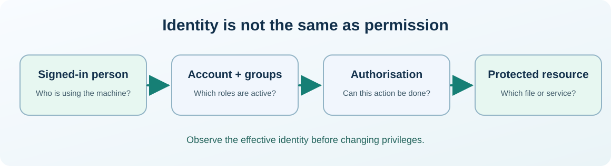

# Chapter 34 — Protect credentials, use MFA and practise least privilege

**Bits to Banking · System Administration: From Zero · Umicom Foundation**  

**Audience:** first-time users and returning learners; practical examples appropriate for supervised younger learners.  

**Estimated study time:** 45–70 minutes.  

**Prerequisites:** Chapters 9, 19–20 and 25.


## Why this matters

The most expensive mistake in an introductory Git lesson is not a syntax error: it is accidentally sharing a password or token in a repository, screenshot or support log. Good administration treats credentials as secrets from the beginning.




## What you will be able to do

By the end of this chapter you should be able to explain the new terms in ordinary language, select a safe read-only command for the right operating system, recognise a normal result and identify an unverified result. You should also be able to describe what permission would be needed before making a real system change.


## The mental model

A password is one authentication factor; a hardware authenticator or app-based challenge can provide an additional factor. Multi-factor authentication (MFA) reduces the risk of a stolen password being enough to sign in. A personal access token, SSH private key and API secret are all credentials even when they do not look like a password. Least privilege applies to humans and background services. Permission to administer a computer is separate from permission to access customer, patient or colleague data. Rotating a token after exposure is necessary, but repository history may still contain the leaked value and must be remediated according to project policy.

### Where secrets accidentally leak during ordinary development

A shell command can reveal sensitive information in its arguments, console history, screenshots, diagnostic logs or copied support transcripts. A repository can preserve deleted lines inside Git history even after the working file looks clean. This is why we do not store `secrets.env`, personal access tokens, credentials or recovery codes in tracked source files. Template files may describe required variable names, but should never contain production values.

A properly delegated task should also limit what the account can do. A classroom contributor needs permission to edit a documentation fork, not to administer a production Linux server or view beneficiaries’ personal records. An Umicom application that needs to read published lessons should not automatically receive write access to security configuration. Security works best when permissions and ownership are designed before an incident forces emergency changes.


## Words you should know
| Term | Meaning |
|---|---|
| **MFA** | Authentication using at least two independent factors. |
| **Token** | Credential issued for a defined application or operation. |
| **Secret store** | Protected location or service for sensitive credentials. |
| **UAC** | Windows prompt that controls privilege elevation. |
| **Security incident** | Event where confidentiality, integrity or availability may be at risk. |


## Windows: PowerShell 7, one command at a time

> Use a **normal non-elevated PowerShell** window. Do not type the `PS C:\...>` prompt. If a command is unavailable or returns Access Denied, record that result; do not attempt to defeat the restriction.

The lines in a code block may contain more than one interactive command. Run them in order, checking each result before continuing. **No `.ps1` file is created or required.**

### Windows step 1 — Identify which GitHub account is signed in, without logging in again

```powershell
gh auth status
```

**Expected result:** Displays authentication state; redact identifying details before sharing the output.

**What this does:** PowerShell runs the command in your current session and displays information or, where clearly indicated, changes only your own practice files. If output differs, record the actual result before going further.

### Windows step 2 — Inspect configured Git remote destinations

```powershell
git remote -v
```

**Expected result:** Run inside your **practice** Git repository; URLs can identify accounts and organisations.

**What this does:** PowerShell runs the command in your current session and displays information or, where clearly indicated, changes only your own practice files. If output differs, record the actual result before going further.

### Windows step 3 — Confirm the current Windows identity

```powershell
whoami
```

**Expected result:** Identifies the effective user; no credentials are revealed.

**What this does:** PowerShell runs the command in your current session and displays information or, where clearly indicated, changes only your own practice files. If output differs, record the actual result before going further.

### Windows step 4 — Check the current PowerShell session’s executable

```powershell
(Get-Process -Id $PID).Path
```

**Expected result:** Shows the path of the running PowerShell program; this is not a privilege escalation.

**What this does:** PowerShell runs the command in your current session and displays information or, where clearly indicated, changes only your own practice files. If output differs, record the actual result before going further.


## Linux: terminal and distribution differences

> Run the following only in an authorised Linux computer or VM. If you use Windows only, read this section for comparison. A program being absent does not mean the whole operating system is faulty.

### Linux step 1 — Inspect the active account

```bash
id
```

**Expected result:** User and group IDs; no authentication secrets are displayed.

### Linux step 2 — Check GitHub CLI auth if installed

```bash
gh auth status
```

**Expected result:** The result may be unavailable; do not paste secrets or auth files.

### Linux step 3 — Check permissions on your own SSH folder if it exists

```bash
ls -ld "$HOME/.ssh"
```

**Expected result:** If absent, skip. If a private key exists, do not print or upload its contents.


## Worked support scenario

Someone accidentally commits `secrets.env` containing a service token. Do not just remove the line and push another commit: the secret may remain in history and in clones. Stop publication if possible, revoke/rotate the exposed credential, alert the authorised security contact, assess access and retention, and follow the repository’s approved history-remediation procedure. Avoid including the actual secret in a public incident ticket.


## Common mistakes and safe responses
| Mistake | Better response |
|---|---|
| “Private GitHub repository means secrets are safe to commit.” | Repo access can expand, history persists, and accounts can be compromised. |
| “Run every installer as Administrator.” | Use standard privileges unless a legitimate installation step explicitly requires elevation. |
| “MFA is the same as a stronger password.” | MFA adds a distinct authentication factor; it is not only password length. |


## Exercises

1. Describe three things that count as secrets besides passwords.

2. Explain why `gh auth status` is safer than displaying token files.

3. Write the first four actions after discovering a leaked access token.


## Review questions and suggested answers

<details><summary>Show the suggested answers after attempting the exercises</summary>


1. SSH private key, OAuth or personal access token, API secret, recovery codes.

2. It reports status without printing stored credentials.

3. Stop exposure, revoke token, report appropriately, inspect impact and preserve evidence.


</details>


## Connecting this chapter to Umicom

Production Umicom software should use the appropriate **Umicom Framework** service for identities, processes, filesystem operations, Git, diagnostics, build planning or observability. The teaching commands here are interactive; they are **not** substitute Python or PowerShell implementations. Any reusable new executable component must first be considered for Framework ownership and designed in C23 or justified Assembly.


## References and further reading

- https://docs.github.com/authentication/keeping-your-account-and-data-secure/about-authentication-to-github

- https://learn.microsoft.com/windows/security/application-security/application-control/user-account-control/


**Course progression:** [Chapter 33](33-backups-restore-drills-and-verification.md) → **Chapter 34** → [Chapter 35](35-monitor-metrics-logs-and-incident-timelines.md)


---

**Practical safety reminder:** No exercise requires access to private records, bank accounts, live production systems or another person’s computer. A successful “not permitted” or “not run” observation is an acceptable learning outcome.
