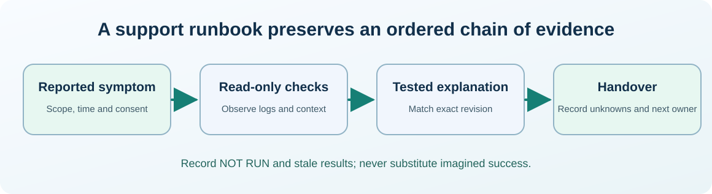

# Chapter 35 — Read system metrics, logs and an incident timeline

**Bits to Banking · System Administration: From Zero · Umicom Foundation**  

**Audience:** first-time users and returning learners; practical examples appropriate for supervised younger learners.  

**Estimated study time:** 50–80 minutes.  

**Prerequisites:** Chapters 12, 23 and 27.


## Why this matters

At 09:00 a build starts. At 09:02 disk space drops. At 09:03 the linker fails. At 09:04 a service reports an error. Which event caused the failure? An experienced administrator gathers evidence in order rather than assuming the latest visible warning is the root cause.




## What you will be able to do

By the end of this chapter you should be able to explain the new terms in ordinary language, select a safe read-only command for the right operating system, recognise a normal result and identify an unverified result. You should also be able to describe what permission would be needed before making a real system change.


## The mental model

Observability means understanding a system from useful signals. **Metrics** are measurements such as available memory or request rate. **Logs** are event records containing timestamps and context. **Traces** describe the path of one operation across components. These signals are complementary: high CPU is not itself an error, and a log entry that says ERROR may describe an issue unrelated to the incident. Always record the time zone, host, process and source revision, because an event from yesterday’s version cannot prove today’s build behaviour.

### How to avoid reading the wrong evidence

Metrics answer questions about quantities; logs record discrete events; traces connect work across components. A high number of log entries may be completely normal during build progress, while one concise linker error can block the entire application. The responsible investigator narrows the time window, searches for the **first failing stage**, and keeps a reference to the original raw output when permitted. Compiler warnings and test outcomes should be attributed to the exact CMake preset and source revision that produced them.

If two machines use different time zones, their “09:00” events may not be simultaneous. Prefer timestamps with offsets and note clock synchronisation. Also protect privacy when sharing diagnostic artefacts. A useful report can say “the service failed to read an expected config file at 14:03 UTC” without publishing the contents of the private configuration or the username in its path.


## Words you should know
| Term | Meaning |
|---|---|
| **Metric** | A numeric measurement over time. |
| **Log** | A recorded event with context and timestamp. |
| **Trace** | A connected view of events belonging to one operation. |
| **Correlation ID** | Identifier used to link related operations or records. |
| **Root cause** | The underlying factor whose correction prevents recurrence. |


## Windows: PowerShell 7, one command at a time

> Use a **normal non-elevated PowerShell** window. Do not type the `PS C:\...>` prompt. If a command is unavailable or returns Access Denied, record that result; do not attempt to defeat the restriction.

The lines in a code block may contain more than one interactive command. Run them in order, checking each result before continuing. **No `.ps1` file is created or required.**

### Windows step 1 — Identify the five processes with highest accumulated CPU time

```powershell
Get-Process | Sort-Object CPU -Descending | Select-Object -First 5 ProcessName, CPU, Id
```

**Expected result:** CPU is usually accumulated process time, not live percentage utilisation.

**What this does:** PowerShell runs the command in your current session and displays information or, where clearly indicated, changes only your own practice files. If output differs, record the actual result before going further.

### Windows step 2 — Inspect recent Application events

```powershell
Get-WinEvent -LogName Application -MaxEvents 10 | Select-Object TimeCreated, Id, ProviderName, LevelDisplayName
```

**Expected result:** Recent messages appear when access permits; save only redacted evidence for sharing.

**What this does:** PowerShell runs the command in your current session and displays information or, where clearly indicated, changes only your own practice files. If output differs, record the actual result before going further.

### Windows step 3 — Read free space in the same session

```powershell
Get-PSDrive -PSProvider FileSystem | Select-Object Name, Free, Used
```

**Expected result:** Helps judge whether storage pressure is plausible.

**What this does:** PowerShell runs the command in your current session and displays information or, where clearly indicated, changes only your own practice files. If output differs, record the actual result before going further.

### Windows step 4 — Observe local time zone

```powershell
Get-Date -Format o
```

**Expected result:** An ISO-formatted timestamp includes local offset; useful for cross-machine comparisons.

**What this does:** PowerShell runs the command in your current session and displays information or, where clearly indicated, changes only your own practice files. If output differs, record the actual result before going further.


## Linux: terminal and distribution differences

> Run the following only in an authorised Linux computer or VM. If you use Windows only, read this section for comparison. A program being absent does not mean the whole operating system is faulty.

### Linux step 1 — Check load averages and system uptime

```bash
uptime
```

**Expected result:** Load averages relate to demand for runnable or uninterruptible tasks, not an absolute CPU percentage.

### Linux step 2 — Read memory availability

```bash
free -h
```

**Expected result:** Shows available and used memory on Linux.

### Linux step 3 — Inspect recent permitted journal entries

```bash
journalctl -n 10 --no-pager
```

**Expected result:** No output or permission errors must be recorded honestly.

### Linux step 4 — Record an offset-aware timestamp

```bash
date --iso-8601=seconds
```

**Expected result:** A timestamp suitable for an incident timeline on GNU/Linux.


## Worked support scenario

An Umicom Studio test reports `Not Run` after a CMake reconfiguration. The first question is not “which source file should be deleted?” Check that the test executable exists, that the build completed, and that the same build directory and source revision were used. Distinguish a test which **ran and failed** from a test which **never executed**. Attach the smallest relevant log excerpt with paths and credentials redacted.


## Common mistakes and safe responses
| Mistake | Better response |
|---|---|
| “An ERROR event is automatically the incident root cause.” | Check relevance, ordering and reproduction before concluding. |
| “Top CPU time means current CPU saturation.” | Process CPU fields may be cumulative, not instant utilisation. |
| “No output from `journalctl` proves no failure happened.” | Retention, time filters and access rights influence visibility. |


## Exercises

1. Construct a five-event timeline for a fictional build failure.

2. Explain why timestamps should include time zone.

3. Define which observations would distinguish a missing test executable from a failing assertion.


## Review questions and suggested answers

<details><summary>Show the suggested answers after attempting the exercises</summary>


1. Record source revision, configure, build, test registration and observed failure times.

2. Hosts may have different local offsets, so naïve ordering can be wrong.

3. Build output, expected executable path, CTest registration and process exit/test log.


</details>


## Connecting this chapter to Umicom

Production Umicom software should use the appropriate **Umicom Framework** service for identities, processes, filesystem operations, Git, diagnostics, build planning or observability. The teaching commands here are interactive; they are **not** substitute Python or PowerShell implementations. Any reusable new executable component must first be considered for Framework ownership and designed in C23 or justified Assembly.


## References and further reading

- https://learn.microsoft.com/powershell/module/microsoft.powershell.management/get-process

- https://learn.microsoft.com/powershell/module/microsoft.powershell.diagnostics/get-winevent


**Course progression:** [Chapter 34](34-passwords-mfa-least-privilege-and-secrets.md) → **Chapter 35** → [Chapter 36](36-capstone-a-safe-umicom-support-runbook.md)


---

**Practical safety reminder:** No exercise requires access to private records, bank accounts, live production systems or another person’s computer. A successful “not permitted” or “not run” observation is an acceptable learning outcome.
