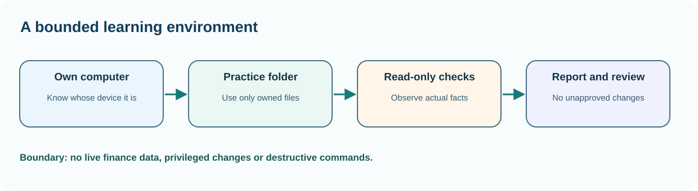

# Chapter 37 — Plan a safe home administration laboratory

**Bits to Banking · System Administration: From Zero · Umicom Foundation**  
**Audience:** beginners of any age; younger learners should use a supervised computer.  
**Suggested study time:** 55–75 minutes.  
**Before this chapter:** Chapters 1–9 and 24: terminals, folders, safe observation.

## The question this chapter answers

**How can I understand and check this part of a computer without accidentally changing something important?**

## Why this matters

System administrators learn by changing machines, yet experimentation on a family computer or production server can be expensive. Before changing a setting, decide where the experiment will take place and how to return to a known condition. A learning laboratory can be nothing more than an ordinary folder and read-only commands; a virtual machine is useful later, but is not a prerequisite.

A beginner should be able to explain which machine is being used, which account is signed in, which files belong to the lesson and whether any command needs elevated permission. On a school computer, managed laptop or shared household device, ask for permission before installing software or changing configuration.

## A useful mental model

Imagine a school science experiment. You label the specimen, record the initial condition and keep the experiment separate from things people depend on. Your operating system is the laboratory bench; your practice folder is the safe work area. The host is the physical computer. A guest is an operating system running inside a virtual machine (VM). A snapshot is a VM feature that may restore its virtual disk and settings; it is not a substitute for backups of important files.



*Figure 37 — The concept and its safe evidence boundary.*

## Key terms, explained before using them

| Term | Meaning |
|---|---|
| **Host** | The physical computer that provides CPU, memory and storage. |
| **Guest** | An operating system running within a virtual machine. |
| **Privilege** | Permission to perform an operation, such as changing system settings. |
| **Snapshot** | A VM checkpoint whose availability and scope depend on the VM product. |
| **Rollback** | Returning to a verified previous state after a change. |
| **Lab boundary** | An explicit rule saying what the student may and may not change. |

## Read this before typing commands

> **Authorisation and safety:** Use your own computer or an explicitly authorised learning environment. Start with an ordinary user account. Commands that install software, change access, restart services or modify networks are outside this exercise unless the text clearly identifies a harmless practice-file operation. You never need to disable a firewall or change system permissions to complete this chapter.

> **Reading code blocks:** Open PowerShell 7 on Windows (`pwsh`) or a terminal on Linux. Type the line inside the block, not the example prompt. Run one command at a time. Some examples contain multiple interactive commands separated by semicolons; verify their results individually. These are interactive commands, **not scripts added to Umicom**.

## Windows — PowerShell 7 practice

Do these steps on Windows. If you use Linux, read them for comparison and continue below. A missing command means that a tool or module may be unavailable; it is not a reason to bypass computer policy.

### Step 1 — Open a normal PowerShell session

```powershell
pwsh
```

**Expected result:** A prompt appears, usually beginning with PS and a folder path.

**Why this command matters:** Start PowerShell 7 if installed. The command opens a shell; it does not grant administrator rights.

**Safety and troubleshooting:** If pwsh is not installed, the older Windows PowerShell can be used to install it with the approved package-manager instructions in Chapter 8.

### Step 2 — Identify the working directory

```powershell
Get-Location
```

**Expected result:** A folder path such as C:\Users\Student appears.

**Why this command matters:** This path matters because relative file names are resolved against it. A successful Get-Location never creates or deletes files.

**Safety and troubleshooting:** Do not include PS C:\...> when typing a command shown in a lesson.

### Step 3 — Check that a private practice folder is available

```powershell
Test-Path -LiteralPath "$HOME\UmicomLearning"
```

**Expected result:** True if the folder exists; False if it does not.

**Why this command matters:** Testing for existence before creating directories avoids confusing an existing personal workspace with a new one.

**Safety and troubleshooting:** Use your own home directory rather than a shared system folder.

### Step 4 — Create only your own practice directory

```powershell
New-Item -ItemType Directory -Force -Path "$HOME\UmicomLearning\SysadminLab"
```

**Expected result:** Directory details appear; no system service is changed.

**Why this command matters:** The operation is limited to the learner's profile. -Force allows already-existing folders; it is not an instruction to overwrite work inside them.

**Safety and troubleshooting:** If you are on a managed machine and cannot create folders, stop and ask the device owner.

### Step 5 — Inspect available storage before choosing a VM

```powershell
Get-PSDrive -PSProvider FileSystem
```

**Expected result:** Drive names, used space and free space are displayed where supported.

**Why this command matters:** A VM consumes storage and RAM even though it appears to run in a window. Beginners should confirm spare capacity before downloading images.

**Safety and troubleshooting:** Do not erase files merely to meet a VM's advertised free-space requirement.

## Linux — terminal practice

Run these in a Linux terminal on an authorised computer or VM. Some distributions do not install the same commands. An unavailable check should be reported as unavailable; do not assume an unobserved result is successful. No command below requires `sudo`.

### Step 1 — Locate your home directory

```bash
pwd
```

**Expected result:** Your current directory appears; after login it is often under /home/username.

**Why this command matters:** A shell prompt can look different across distributions; only the command should be typed.

**Safety and troubleshooting:** If this command is unavailable or access is refused, record the result. Do not alter system configuration simply to make the example succeed.

### Step 2 — Check free space on the current filesystem

```bash
df -h .
```

**Expected result:** A mounted filesystem and available capacity appear.

**Why this command matters:** The dot means current directory. The command reads the filesystem's capacity without repartitioning it.

**Safety and troubleshooting:** If this command is unavailable or access is refused, record the result. Do not alter system configuration simply to make the example succeed.

### Step 3 — Create a user-owned learning directory

```bash
mkdir -p "$HOME/UmicomLearning/SysadminLab"
```

**Expected result:** The folder exists; the command may produce no output.

**Why this command matters:** Do not use sudo or root for your own practice files.

**Safety and troubleshooting:** If this command is unavailable or access is refused, record the result. Do not alter system configuration simply to make the example succeed.

## Worked Umicom support scenario

A family shares one Windows laptop. One person wants to learn how background services work. They create a private practice folder and run observation-only commands first. Before trying a VM they write down memory and free-space requirements and agree that the family laptop's security settings, disk partitions and accounts are out of scope. The first successful lab is a correctly labelled baseline, not a machine with more software installed.

### A disciplined investigation sequence

1. **Describe the symptom precisely.** Identify what failed and the expected result.
2. **Identify the environment.** Record current account, machine class, working directory and observation time; redact private identifiers.
3. **Run the smallest relevant read-only check.** Choose evidence that distinguishes two possible causes.
4. **Compare results with the requirement.** Missing, blocked or outdated checks are not successful checks.
5. **Separate fact and interpretation.** Label hypotheses explicitly.
6. **Propose, do not silently apply, a change.** State approval, effect, rollback and validation criteria.

## Common mistakes and how to respond

| Incorrect assumption | Better engineering response |
|---|---|
| I have administrator rights, so I should use them. | An elevated shell increases the consequences of mistakes. Begin with a normal shell. |
| A VM snapshot protects the host computer. | Snapshots normally describe VM state, not the host's files or account permissions. |
| A successful command means the experiment was safe. | Safety also depends on authorisation, scope, reversibility and evidence of the original state. |

## Practical exercises — try these before opening the answers

1. Define a safe lab boundary.
2. Distinguish host and guest.
3. Propose one rollback method.

<details>
<summary><strong>Suggested answers and reasoning</strong> — open after attempting the exercises</summary>

1. **Define a safe lab boundary.** Write three allowed activities and three prohibited activities. Allow reading system information and working in your own practice directory; prohibit modifying another user's files and restarting production services.
2. **Distinguish host and guest.** Describe which computer would still run if the virtual machine were shut down.
3. **Propose one rollback method.** For an ordinary practice document, a verified backup is suitable. For a VM, a tested snapshot may be useful but not sufficient for important data.

</details>

## Engineering connection: Umicom Framework

Umicom Studio, the Framework and OS project can all be studied without changing their remote repositories. The learner should begin by reading documentation and running safe status commands. Kernel and OS experiments belong in an isolated, explicitly configured VM or emulator, not on the host boot disk.

## Short support-note template

```text
Observation ID: PRACTICE-____
Observed at (include timezone):
Authorised machine or learning environment:
User-visible symptom:
Command or test (never paste credentials):
Observed result:
What remains unknown:
Proposed next safe check:
Approval required before any change:
```

## References and further study

- https://learn.microsoft.com/powershell/
- https://learn.microsoft.com/windows-server/virtualization/hyper-v/overview

**Course progression:** [Chapter 36](36-capstone-a-safe-umicom-support-runbook.md) → **Chapter 37** → [Chapter 38](38-capture-an-operating-system-baseline.md).

---

**Safety reminder:** An honest *not available*, *not authorised* or *not run* result is better than a fabricated pass. No real system changes or remote repository writes are required.
