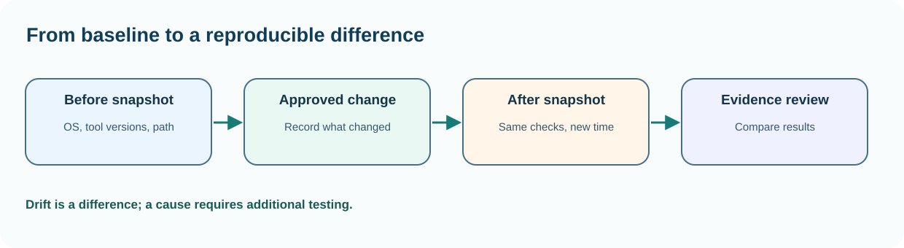

# Chapter 38 — Capture an operating-system baseline and recognise drift

**Bits to Banking · System Administration: From Zero · Umicom Foundation**  
**Audience:** beginners of any age; younger learners should use a supervised computer.  
**Suggested study time:** 50–70 minutes.  
**Before this chapter:** Chapter 37: lab boundaries and working directory.

## The question this chapter answers

**How can I understand and check this part of a computer without accidentally changing something important?**

## Why this matters

When a computer becomes slow after a software change, people often say it was 'fine yesterday'. That observation is useful, but too vague to diagnose. A baseline is a dated description of the machine before a change: OS edition and build, CPU architecture, available storage, installed tools and the task that is expected to work. Drift means the current state no longer matches that reference.

You do not need to capture everything. Hardware serial numbers, user names, network identifiers and private application paths can be sensitive. Record only the data necessary for the exercise and leave confidential details on the authorised machine.

## A useful mental model

Think of a doctor recording temperature, pulse and symptoms before treatment. The system administrator also separates a measurement from an interpretation. 'PowerShell 7 reports 7.x' is an observation; 'this version caused the build failure' is a hypothesis requiring a reproducible test. A useful baseline is small enough to compare later and precise enough to identify which machine and time it describes.



*Figure 38 — The concept and its safe evidence boundary.*

## Key terms, explained before using them

| Term | Meaning |
|---|---|
| **Baseline** | An approved or documented starting condition. |
| **Drift** | A difference between the recorded starting condition and the later system. |
| **Edition** | Product packaging, such as Windows Pro or a Linux distribution variant. |
| **Architecture** | Processor and operating-system execution family such as x64 or ARM64. |
| **Timestamp** | A date and time attached to an observation; include timezone context. |
| **Build ID** | A specific OS or software revision rather than an informal product name. |

## Read this before typing commands

> **Authorisation and safety:** Use your own computer or an explicitly authorised learning environment. Start with an ordinary user account. Commands that install software, change access, restart services or modify networks are outside this exercise unless the text clearly identifies a harmless practice-file operation. You never need to disable a firewall or change system permissions to complete this chapter.

> **Reading code blocks:** Open PowerShell 7 on Windows (`pwsh`) or a terminal on Linux. Type the line inside the block, not the example prompt. Run one command at a time. Some examples contain multiple interactive commands separated by semicolons; verify their results individually. These are interactive commands, **not scripts added to Umicom**.

## Windows — PowerShell 7 practice

Do these steps on Windows. If you use Linux, read them for comparison and continue below. A missing command means that a tool or module may be unavailable; it is not a reason to bypass computer policy.

### Step 1 — Check the PowerShell version

```powershell
$PSVersionTable.PSVersion
```

**Expected result:** A version object displays major, minor and patch information.

**Why this command matters:** This tells you which shell is running, not necessarily which Windows release is installed.

**Safety and troubleshooting:** Windows PowerShell 5.1 and PowerShell 7 can coexist; running one does not automatically replace the other.

### Step 2 — Inspect Windows edition, version and architecture

```powershell
Get-ComputerInfo | Select-Object WindowsProductName, OsVersion, OsArchitecture
```

**Expected result:** Three named fields appear; some values vary by Windows build.

**Why this command matters:** Select-Object limits information to relevant fields instead of exporting the entire machine inventory.

**Safety and troubleshooting:** Some Windows tools require elevated access or modules; a missing field should be recorded as unavailable rather than guessed.

### Step 3 — Read CPU model and logical processors

```powershell
Get-CimInstance Win32_Processor | Select-Object Name, NumberOfCores, NumberOfLogicalProcessors
```

**Expected result:** Processor name, physical cores and logical processor count appear.

**Why this command matters:** A core is a physical execution resource; logical processors may include simultaneous multithreading. The two counts need not be equal.

**Safety and troubleshooting:** Do not infer laptop performance solely from logical processor count.

### Step 4 — Record a timezone-aware timestamp

```powershell
Get-Date -Format o
```

**Expected result:** An ISO-style timestamp with fractional seconds and local offset appears.

**Why this command matters:** A time zone offset helps compare records from different machines. It is essential when investigating build or service events.

**Safety and troubleshooting:** The timestamp is the observation time, not necessarily the time the problem began.

### Step 5 — Record selected native tool versions

```powershell
git --version; cmake --version
```

**Expected result:** Git and CMake versions print when installed.

**Why this command matters:** These semicolon-separated interactive commands do not write scripts. Capture output for your own notebook, and compare the result after tool upgrades.

**Safety and troubleshooting:** If the command is not recognised, write 'not installed or not on PATH', not 'version zero'.

## Linux — terminal practice

Run these in a Linux terminal on an authorised computer or VM. Some distributions do not install the same commands. An unavailable check should be reported as unavailable; do not assume an unobserved result is successful. No command below requires `sudo`.

### Step 1 — Read distribution identity

```bash
cat /etc/os-release
```

**Expected result:** Fields such as NAME and VERSION_ID appear.

**Why this command matters:** A Linux distribution's release is different from the Linux kernel version.

**Safety and troubleshooting:** If this command is unavailable or access is refused, record the result. Do not alter system configuration simply to make the example succeed.

### Step 2 — Read the kernel revision

```bash
uname -r
```

**Expected result:** A kernel release string appears.

**Why this command matters:** Kernel and userland may be upgraded on different schedules; preserve both observations.

**Safety and troubleshooting:** If this command is unavailable or access is refused, record the result. Do not alter system configuration simply to make the example succeed.

### Step 3 — Check the hardware architecture

```bash
uname -m
```

**Expected result:** A string such as x86_64 or aarch64 appears.

**Why this command matters:** The value affects whether a compiled native binary can execute on the system.

**Safety and troubleshooting:** If this command is unavailable or access is refused, record the result. Do not alter system configuration simply to make the example succeed.

### Step 4 — Attach a dated observation

```bash
date -Is
```

**Expected result:** A timezone-aware date appears.

**Why this command matters:** If dates differ unexpectedly between hosts, check time configuration before correlating logs.

**Safety and troubleshooting:** If this command is unavailable or access is refused, record the result. Do not alter system configuration simply to make the example succeed.

## Worked Umicom support scenario

A C23 build worked on Computer A but fails on Computer B. The team records GCC and CMake versions, Windows OS version, target architecture, PATH resolution and the exact configure command. They find that B uses a different compiler selected from PATH. This is evidence of an environment difference; they still need to rerun the build with the intended toolchain before declaring it the root cause.

### A disciplined investigation sequence

1. **Describe the symptom precisely.** Identify what failed and the expected result.
2. **Identify the environment.** Record current account, machine class, working directory and observation time; redact private identifiers.
3. **Run the smallest relevant read-only check.** Choose evidence that distinguishes two possible causes.
4. **Compare results with the requirement.** Missing, blocked or outdated checks are not successful checks.
5. **Separate fact and interpretation.** Label hypotheses explicitly.
6. **Propose, do not silently apply, a change.** State approval, effect, rollback and validation criteria.

## Common mistakes and how to respond

| Incorrect assumption | Better engineering response |
|---|---|
| The CPU model identifies the operating-system architecture. | A machine's CPU capability and installed OS architecture are related but distinct. |
| Yesterday's baseline is proof that nothing changed. | Only the items actually measured are covered; unobserved services or configurations may also change. |
| I should publish the complete Get-ComputerInfo output. | Prefer a short selected-field report and redact personal or organisation-specific values. |

## Practical exercises — try these before opening the answers

1. Make a five-line baseline.
2. Explain two possible causes of build drift.
3. Verify one assumption.

<details>
<summary><strong>Suggested answers and reasoning</strong> — open after attempting the exercises</summary>

1. **Make a five-line baseline.** Include observation time, OS name/version, architecture, shell version and Git version or 'not installed'.
2. **Explain two possible causes of build drift.** Compiler changes, environment PATH order, dependency updates or CMake preset differences.
3. **Verify one assumption.** Run the same version command twice and compare. If it differs, investigate whether you used different shells or executables.

</details>

## Engineering connection: Umicom Framework

Framework and Studio should record exact source commit, selected build preset, compiler identity and test result, not just an application version label. Do not mistake a clean Git status for proof that a build passed; those are separate observations.

## Short support-note template

```text
Observation ID: PRACTICE-____
Observed at (include timezone):
Authorised machine or learning environment:
User-visible symptom:
Command or test (never paste credentials):
Observed result:
What remains unknown:
Proposed next safe check:
Approval required before any change:
```

## References and further study

- https://learn.microsoft.com/powershell/module/microsoft.powershell.management/get-computerinfo
- https://learn.microsoft.com/windows/win32/cimwin32prov/win32-processor

**Course progression:** [Chapter 37](37-plan-a-safe-home-administration-laboratory.md) → **Chapter 38** → [Chapter 39](39-accounts-groups-and-scheduled-work.md).

---

**Safety reminder:** An honest *not available*, *not authorised* or *not run* result is better than a fabricated pass. No real system changes or remote repository writes are required.
