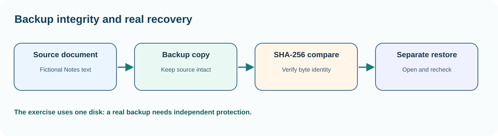

# Chapter 41 — Make and verify a recoverable practice backup

**Bits to Banking · System Administration: From Zero · Umicom Foundation**  
**Audience:** beginners of any age; younger learners should use a supervised computer.  
**Suggested study time:** 65–90 minutes.  
**Before this chapter:** Chapters 7, 14 and 33: practice files, backups and hashes.

## The question this chapter answers

**How can I understand and check this part of a computer without accidentally changing something important?**

## Why this matters

Copying a file is easy. Recovering the correct version after a mistake is harder. A backup exercise must answer four questions: what did we protect, where is the copy, how did we verify it, and can we restore without overwriting the original? A synchronised folder is not automatically an independent backup; accidental deletions can synchronise too.

The lesson uses a harmless Notes document inside your own home directory. We create it explicitly, copy it to another practice folder, compute SHA-256 hashes and restore to a different destination. No production project, bank data or system directory is involved.

## A useful mental model

Treat the original document as a library book, the backup as an independently stored copy, and the hash as a fingerprint of its bytes. Equal SHA-256 hashes provide strong evidence that the two files have identical content; they do not prove that the content was meaningful, authorised or free of malicious instructions. A restore drill proves the copy is usable for the chosen operation.



*Figure 41 — The concept and its safe evidence boundary.*

## Key terms, explained before using them

| Term | Meaning |
|---|---|
| **Source** | The original file or dataset being protected. |
| **Backup** | A retained copy designed to support recovery. |
| **Restore** | The act of recovering data from backup into a usable state. |
| **SHA-256** | A cryptographic hash algorithm that produces a fixed-length digest. |
| **Retention** | How long backup versions are kept. |
| **RPO/RTO** | Maximum tolerable data loss / target time to restore service. |

## Read this before typing commands

> **Authorisation and safety:** Use your own computer or an explicitly authorised learning environment. Start with an ordinary user account. Commands that install software, change access, restart services or modify networks are outside this exercise unless the text clearly identifies a harmless practice-file operation. You never need to disable a firewall or change system permissions to complete this chapter.

> **Reading code blocks:** Open PowerShell 7 on Windows (`pwsh`) or a terminal on Linux. Type the line inside the block, not the example prompt. Run one command at a time. Some examples contain multiple interactive commands separated by semicolons; verify their results individually. These are interactive commands, **not scripts added to Umicom**.

## Windows — PowerShell 7 practice

Do these steps on Windows. If you use Linux, read them for comparison and continue below. A missing command means that a tool or module may be unavailable; it is not a reason to bypass computer policy.

### Step 1 — Create a separate training source folder

```powershell
New-Item -ItemType Directory -Force -Path "$HOME\UmicomLearning\BackupLab\source"
```

**Expected result:** The folder exists inside the account's home profile.

**Why this command matters:** The destination is deliberately outside any Umicom repository. We do not modify source-controlled project files.

**Safety and troubleshooting:** If this folder already contains important files, stop and choose a different practice name.

### Step 2 — Create a small harmless note

```powershell
Set-Content -LiteralPath "$HOME\UmicomLearning\BackupLab\source\notes.txt" -Value "Fictional Umicom Notes practice data"
```

**Expected result:** notes.txt contains one practice line.

**Why this command matters:** This is an interactive command that creates a learning document; it is not a PowerShell application script.

**Safety and troubleshooting:** Set-Content replaces file contents. Only use this exact command in a new practice folder after checking that the name is free.

### Step 3 — Create a backup destination

```powershell
New-Item -ItemType Directory -Force -Path "$HOME\UmicomLearning\BackupLab\backup"
```

**Expected result:** A backup folder exists.

**Why this command matters:** In production, a robust backup would normally be stored on an independent medium or approved storage system. This local exercise teaches the mechanics only.

**Safety and troubleshooting:** A second folder on the same disk does not protect against total disk failure.

### Step 4 — Copy the practice document

```powershell
Copy-Item -LiteralPath "$HOME\UmicomLearning\BackupLab\source\notes.txt" -Destination "$HOME\UmicomLearning\BackupLab\backup\notes.txt"
```

**Expected result:** A second notes.txt appears in backup.

**Why this command matters:** Copy-Item transfers bytes. The operation does not prove that a later restore works; we still check content and hash.

**Safety and troubleshooting:** Check that the destination file does not already contain an important version before copying.

### Step 5 — Compare cryptographic hashes

```powershell
Get-FileHash -Algorithm SHA256 -LiteralPath "$HOME\UmicomLearning\BackupLab\source\notes.txt", "$HOME\UmicomLearning\BackupLab\backup\notes.txt"
```

**Expected result:** Two rows with the same hash should appear.

**Why this command matters:** An equal hash indicates that these two practice files contain identical bytes. Record both paths and the observation time.

**Safety and troubleshooting:** If hashes differ, stop: do not silently overwrite the backup to make the report look successful.

### Step 6 — Restore into a separate review directory

```powershell
New-Item -ItemType Directory -Force -Path "$HOME\UmicomLearning\BackupLab\restored"; Copy-Item -LiteralPath "$HOME\UmicomLearning\BackupLab\backup\notes.txt" -Destination "$HOME\UmicomLearning\BackupLab\restored\notes.txt"
```

**Expected result:** Restored notes.txt exists without replacing the source file.

**Why this command matters:** The same hash check can now compare backup and restored copies. This tests a recovery path independently from the original.

**Safety and troubleshooting:** Stop and investigate any access denied or file-not-found response rather than elevating privileges.

## Linux — terminal practice

Run these in a Linux terminal on an authorised computer or VM. Some distributions do not install the same commands. An unavailable check should be reported as unavailable; do not assume an unobserved result is successful. No command below requires `sudo`.

### Step 1 — Create the practice directories

```bash
mkdir -p "$HOME/UmicomLearning/BackupLab/source" "$HOME/UmicomLearning/BackupLab/backup" "$HOME/UmicomLearning/BackupLab/restored"
```

**Expected result:** Three directories exist in your own home directory.

**Why this command matters:** These directories are test destinations, not production backup storage.

**Safety and troubleshooting:** If this command is unavailable or access is refused, record the result. Do not alter system configuration simply to make the example succeed.

### Step 2 — Create the sample note

```bash
printf '%s\n' 'Fictional Umicom Notes practice data' > "$HOME/UmicomLearning/BackupLab/source/notes.txt"
```

**Expected result:** A small text file is created.

**Why this command matters:** The redirection operator overwrites the named file; run only in a fresh practice folder.

**Safety and troubleshooting:** If this command is unavailable or access is refused, record the result. Do not alter system configuration simply to make the example succeed.

### Step 3 — Copy and compare

```bash
cp -n "$HOME/UmicomLearning/BackupLab/source/notes.txt" "$HOME/UmicomLearning/BackupLab/backup/notes.txt"; sha256sum "$HOME/UmicomLearning/BackupLab/"{source,backup}/notes.txt
```

**Expected result:** Two matching SHA-256 hashes should appear after a successful copy.

**Why this command matters:** cp -n does not overwrite an existing destination. Confirm what happened before interpreting the hash output.

**Safety and troubleshooting:** If this command is unavailable or access is refused, record the result. Do not alter system configuration simply to make the example succeed.

### Step 4 — Restore to a new location

```bash
cp -n "$HOME/UmicomLearning/BackupLab/backup/notes.txt" "$HOME/UmicomLearning/BackupLab/restored/notes.txt"
```

**Expected result:** The restored file can be compared against the backup.

**Why this command matters:** Leave the source untouched so you can distinguish backup verification from restoration.

**Safety and troubleshooting:** If this command is unavailable or access is refused, record the result. Do not alter system configuration simply to make the example succeed.

## Worked Umicom support scenario

An editor accidentally saves the wrong contents into a fictional Notes document. The student does not use a broad restore over the live folder. They identify the approved backup generation, verify its hash and copy it into a separate review directory. After opening the restored document they compare it with the intended version and only then plan any authorised replacement.

### A disciplined investigation sequence

1. **Describe the symptom precisely.** Identify what failed and the expected result.
2. **Identify the environment.** Record current account, machine class, working directory and observation time; redact private identifiers.
3. **Run the smallest relevant read-only check.** Choose evidence that distinguishes two possible causes.
4. **Compare results with the requirement.** Missing, blocked or outdated checks are not successful checks.
5. **Separate fact and interpretation.** Label hypotheses explicitly.
6. **Propose, do not silently apply, a change.** State approval, effect, rollback and validation criteria.

## Common mistakes and how to respond

| Incorrect assumption | Better engineering response |
|---|---|
| A copy on the same disk is a disaster-recovery backup. | It cannot protect against failure of that disk or loss of the whole computer. |
| Matching hashes prove a good recovery plan. | They show matching bytes, but you must test whether the restored application or document works. |
| I should overwrite the original immediately during a drill. | Restore separately first to avoid destroying the remaining good evidence. |

## Practical exercises — try these before opening the answers

1. Explain the difference between copy, backup and restore.
2. Record a three-line verification report.
3. Describe two failures the local drill does not cover.

<details>
<summary><strong>Suggested answers and reasoning</strong> — open after attempting the exercises</summary>

1. **Explain the difference between copy, backup and restore.** A copy is duplication; a backup includes recoverability, retention and independent protection; restoration proves usability.
2. **Record a three-line verification report.** Include original path, backup path, SHA-256 comparison and whether restore succeeded.
3. **Describe two failures the local drill does not cover.** Physical disk loss and loss or theft of the computer; use approved independent storage for real resilience.

</details>

## Engineering connection: Umicom Framework

Real Umicom document, Data Server and configuration backups belong to approved owners and services. A learner's Copy-Item practice is not a replacement for Framework persistence, audit or deployment recovery. Git is revision control, not a complete backup policy.

## Short support-note template

```text
Observation ID: PRACTICE-____
Observed at (include timezone):
Authorised machine or learning environment:
User-visible symptom:
Command or test (never paste credentials):
Observed result:
What remains unknown:
Proposed next safe check:
Approval required before any change:
```

## References and further study

- https://learn.microsoft.com/powershell/module/microsoft.powershell.utility/get-filehash
- https://learn.microsoft.com/powershell/module/microsoft.powershell.management/copy-item

**Course progression:** [Chapter 40](40-understand-disks-volumes-and-free-space.md) → **Chapter 41** → [Chapter 42](42-read-access-control-without-changing-it.md).

---

**Safety reminder:** An honest *not available*, *not authorised* or *not run* result is better than a fabricated pass. No real system changes or remote repository writes are required.
