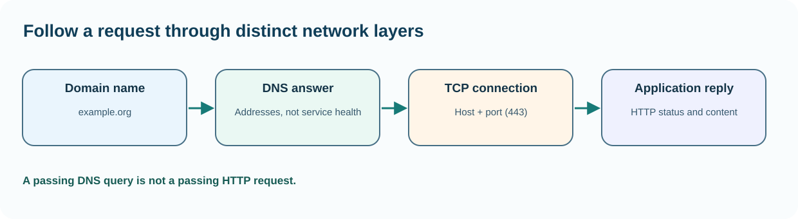

# Chapter 43 — Follow one network request from a name to a port

**Bits to Banking · System Administration: From Zero · Umicom Foundation**  
**Audience:** beginners of any age; younger learners should use a supervised computer.  
**Suggested study time:** 65–85 minutes.  
**Before this chapter:** Chapters 15, 16 and 31: IP addresses, DNS and TCP.

## The question this chapter answers

**How can I understand and check this part of a computer without accidentally changing something important?**

## Why this matters

When an application says 'cannot connect', the problem might be the name, IP route, port, firewall, listening service or application response. These are different layers. A beginner gains confidence by testing them in order instead of changing settings at random. We will use a publicly documented example domain for an optional internet test, and a fictional local Umicom Notes service for explanations.

The lesson does not create a listening server, contact a bank or require any credentials. Internet-dependent tests may be unavailable in a classroom, and their failure is not proof that the learner's computer is broken.

## A useful mental model

A DNS name is like a contact name in a phone's address book; DNS resolution finds one or more network addresses. An IP route decides where to send a packet. A TCP port identifies a service endpoint on that address. A successful TCP connection proves that a transport session could be established; it does not prove the application returned the correct data or authenticated the user.



*Figure 43 — The concept and its safe evidence boundary.*

## Key terms, explained before using them

| Term | Meaning |
|---|---|
| **DNS** | A naming system that maps domains to resource records such as IP addresses. |
| **IP address** | A logical network address assigned to an interface or host. |
| **Gateway** | A router used to reach other networks when necessary. |
| **TCP port** | A numeric service endpoint within a transport connection. |
| **Listener** | A service waiting for incoming connections. |
| **Connection refused** | A failed connection attempt indicating no accepting endpoint or an active refusal, subject to network context. |

## Read this before typing commands

> **Authorisation and safety:** Use your own computer or an explicitly authorised learning environment. Start with an ordinary user account. Commands that install software, change access, restart services or modify networks are outside this exercise unless the text clearly identifies a harmless practice-file operation. You never need to disable a firewall or change system permissions to complete this chapter.

> **Reading code blocks:** Open PowerShell 7 on Windows (`pwsh`) or a terminal on Linux. Type the line inside the block, not the example prompt. Run one command at a time. Some examples contain multiple interactive commands separated by semicolons; verify their results individually. These are interactive commands, **not scripts added to Umicom**.

## Windows — PowerShell 7 practice

Do these steps on Windows. If you use Linux, read them for comparison and continue below. A missing command means that a tool or module may be unavailable; it is not a reason to bypass computer policy.

### Step 1 — Inspect interface configuration

```powershell
Get-NetIPConfiguration | Select-Object InterfaceAlias, IPv4Address, IPv4DefaultGateway
```

**Expected result:** Active interface names, addresses and gateways are shown when the module is available.

**Why this command matters:** A machine can have several interfaces, including VPNs and virtual adapters. The displayed IP may be private and does not need to be posted publicly.

**Safety and troubleshooting:** A missing gateway can be normal for an isolated network or a host-only virtual machine.

### Step 2 — Resolve an example domain

```powershell
Resolve-DnsName example.org
```

**Expected result:** One or more DNS records appear when name resolution is available.

**Why this command matters:** DNS answers may change over time and can differ between networks. Do not copy a sample IP address as a permanent configuration value.

**Safety and troubleshooting:** If the command is not recognised, confirm you are on Windows PowerShell with the DNS client module available.

### Step 3 — Test an HTTPS TCP endpoint

```powershell
Test-NetConnection -ComputerName example.org -Port 443
```

**Expected result:** The result contains a TCP success/failure indicator and connection details.

**Why this command matters:** Port 443 is commonly used by HTTPS. This checks TCP reachability, not certificate validity or application correctness.

**Safety and troubleshooting:** A classroom firewall may block the test intentionally. Do not disable security controls to make it pass.

### Step 4 — Inspect local listening ports without editing them

```powershell
Get-NetTCPConnection -State Listen -ErrorAction SilentlyContinue | Select-Object -First 10 LocalAddress, LocalPort, OwningProcess
```

**Expected result:** Up to ten listening socket records appear.

**Why this command matters:** A socket bound to 127.0.0.1 accepts only loopback traffic. One bound to 0.0.0.0 may accept traffic on multiple IPv4 interfaces subject to firewall rules.

**Safety and troubleshooting:** The list is observational; do not terminate unknown processes from a port number alone.

## Linux — terminal practice

Run these in a Linux terminal on an authorised computer or VM. Some distributions do not install the same commands. An unavailable check should be reported as unavailable; do not assume an unobserved result is successful. No command below requires `sudo`.

### Step 1 — Read network addresses

```bash
ip -brief address
```

**Expected result:** Interface names and assigned addresses appear when iproute2 is installed.

**Why this command matters:** Addresses may come from VPNs or container interfaces, so identify the relevant interface first.

**Safety and troubleshooting:** If this command is unavailable or access is refused, record the result. Do not alter system configuration simply to make the example succeed.

### Step 2 — Inspect routes

```bash
ip route
```

**Expected result:** Routing rules and a default route may be shown.

**Why this command matters:** An isolated VM may deliberately have no route to the internet; that can be the correct security design.

**Safety and troubleshooting:** If this command is unavailable or access is refused, record the result. Do not alter system configuration simply to make the example succeed.

### Step 3 — Resolve a domain

```bash
getent ahosts example.org
```

**Expected result:** Address records appear when resolution succeeds.

**Why this command matters:** A missing answer can reflect network policy, DNS failure or lack of configured resolver; investigate without assuming one cause.

**Safety and troubleshooting:** If this command is unavailable or access is refused, record the result. Do not alter system configuration simply to make the example succeed.

### Step 4 — Test application-level HTTPS headers, if curl is installed

```bash
curl -I https://example.org
```

**Expected result:** HTTP headers or a clear connection/TLS error appear.

**Why this command matters:** Unlike a raw TCP test, this also exercises TLS and HTTP. It does not prove unrelated services work.

**Safety and troubleshooting:** If this command is unavailable or access is refused, record the result. Do not alter system configuration simply to make the example succeed.

## Worked Umicom support scenario

A local native Umicom training server should listen on 127.0.0.1:8765. DNS is irrelevant because the destination is numeric loopback. The learner checks whether the server was started, whether the port is listening, then whether an HTTP request succeeds. If the listener is absent, changing the home router's DNS cannot solve the immediate problem. If it listens on a different port, the client configuration needs review.

### A disciplined investigation sequence

1. **Describe the symptom precisely.** Identify what failed and the expected result.
2. **Identify the environment.** Record current account, machine class, working directory and observation time; redact private identifiers.
3. **Run the smallest relevant read-only check.** Choose evidence that distinguishes two possible causes.
4. **Compare results with the requirement.** Missing, blocked or outdated checks are not successful checks.
5. **Separate fact and interpretation.** Label hypotheses explicitly.
6. **Propose, do not silently apply, a change.** State approval, effect, rollback and validation criteria.

## Common mistakes and how to respond

| Incorrect assumption | Better engineering response |
|---|---|
| DNS succeeded, so the application works. | Resolution proves only part of the path; TCP, TLS and application-level checks remain. |
| Ping fails, so the host is down. | ICMP may be restricted even when the intended TCP service is healthy. |
| A port is listening, so it is safe to expose. | Network exposure requires authentication, authorisation, TLS policy and firewall review. |

## Practical exercises — try these before opening the answers

1. Draw a five-step network path.
2. Distinguish two failure messages.
3. State one privacy precaution.

<details>
<summary><strong>Suggested answers and reasoning</strong> — open after attempting the exercises</summary>

1. **Draw a five-step network path.** Client name → DNS → IP route → TCP endpoint → application response.
2. **Distinguish two failure messages.** Name resolution failure occurs before a destination IP is selected; TCP refusal occurs during transport connection.
3. **State one privacy precaution.** Do not publish internal IP ranges, machine names, VPN adapters or private connection diagnostics unnecessarily.

</details>

## Engineering connection: Umicom Framework

The Umicom Framework web adapter owns listening sockets and network policy. A learner should not add custom sockets to Studio or OS for a simple test when the existing Framework service can report endpoint and health information. Test loopback endpoints first and keep training services off public interfaces.

## Short support-note template

```text
Observation ID: PRACTICE-____
Observed at (include timezone):
Authorised machine or learning environment:
User-visible symptom:
Command or test (never paste credentials):
Observed result:
What remains unknown:
Proposed next safe check:
Approval required before any change:
```

## References and further study

- https://learn.microsoft.com/powershell/module/nettcpip/test-netconnection
- https://www.iana.org/domains/reserved

**Course progression:** [Chapter 42](42-read-access-control-without-changing-it.md) → **Chapter 43** → [Chapter 44](44-understand-firewalls-and-listening-services.md).

---

**Safety reminder:** An honest *not available*, *not authorised* or *not run* result is better than a fabricated pass. No real system changes or remote repository writes are required.
