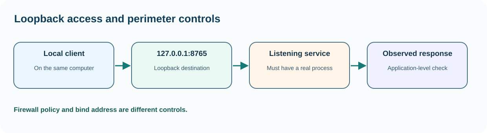

# Chapter 44 — Understand firewalls and listening services without changing rules

**Bits to Banking · System Administration: From Zero · Umicom Foundation**  
**Audience:** beginners of any age; younger learners should use a supervised computer.  
**Suggested study time:** 60–80 minutes.  
**Before this chapter:** Chapter 43: network layers, ports and listeners.

## The question this chapter answers

**How can I understand and check this part of a computer without accidentally changing something important?**

## Why this matters

A firewall decides which network traffic should be allowed or blocked according to policy. New administrators sometimes disable a firewall to test a problem. That approach changes the system's protection and often obscures whether the real issue is incorrect binding, a missing listener or a specific rule. The correct beginner exercise is to inspect state and identify the intended network boundary.

We will not create, delete, disable or relax firewall rules. A lab using a machine you own still deserves a change plan before configuration: which direction, interface, application, port, users and expected rollback apply?

## A useful mental model

A firewall resembles a controlled building entrance. The door may be open for one approved visitor and closed for others. A local program listening on a TCP port is like a desk that accepts requests inside the building. The desk can exist even when an external visitor cannot enter; equally, an open entrance does not help if no desk is staffed.



*Figure 44 — The concept and its safe evidence boundary.*

## Key terms, explained before using them

| Term | Meaning |
|---|---|
| **Inbound rule** | Policy controlling traffic arriving at a machine or network. |
| **Outbound rule** | Policy controlling traffic leaving a machine or network. |
| **Profile** | A set of firewall behaviour for network contexts such as private or public. |
| **Loopback** | Communication with the same machine, often 127.0.0.1 for IPv4. |
| **Bind address** | Address on which a service accepts connections. |
| **Listening socket** | A kernel-managed endpoint waiting for connection attempts. |

## Read this before typing commands

> **Authorisation and safety:** Use your own computer or an explicitly authorised learning environment. Start with an ordinary user account. Commands that install software, change access, restart services or modify networks are outside this exercise unless the text clearly identifies a harmless practice-file operation. You never need to disable a firewall or change system permissions to complete this chapter.

> **Reading code blocks:** Open PowerShell 7 on Windows (`pwsh`) or a terminal on Linux. Type the line inside the block, not the example prompt. Run one command at a time. Some examples contain multiple interactive commands separated by semicolons; verify their results individually. These are interactive commands, **not scripts added to Umicom**.

## Windows — PowerShell 7 practice

Do these steps on Windows. If you use Linux, read them for comparison and continue below. A missing command means that a tool or module may be unavailable; it is not a reason to bypass computer policy.

### Step 1 — Inspect Windows Defender Firewall profiles

```powershell
Get-NetFirewallProfile | Select-Object Name, Enabled, DefaultInboundAction, DefaultOutboundAction
```

**Expected result:** Profiles and enabled/policy values appear where the NetSecurity module is available.

**Why this command matters:** Different profiles may be active under different network classifications. Enabled is a policy observation, not proof every desired connection is allowed.

**Safety and troubleshooting:** Do not execute Set-NetFirewallProfile or disable rules during this educational exercise.

### Step 2 — Show a bounded set of listening TCP endpoints

```powershell
Get-NetTCPConnection -State Listen -ErrorAction SilentlyContinue | Select-Object -First 12 LocalAddress, LocalPort, OwningProcess
```

**Expected result:** Up to twelve records appear.

**Why this command matters:** LocalAddress helps distinguish loopback-only from broader binds. OwningProcess is a PID, not a permanent service name.

**Safety and troubleshooting:** Do not publish sensitive internal endpoint inventories in public chats.

### Step 3 — Inspect one process only if an actual PID was observed

```powershell
Get-Process | Select-Object -First 8 Name, Id, Path
```

**Expected result:** A small process list appears. Some Path properties may be unavailable.

**Why this command matters:** Processes can start/stop and PIDs can be reused. Correlate a port and process at nearly the same time.

**Safety and troubleshooting:** Avoid killing the process; identify its purpose first.

### Step 4 — Check a named local HTTP endpoint only when you started it

```powershell
Test-NetConnection -ComputerName 127.0.0.1 -Port 8765
```

**Expected result:** TCP connectivity reports true if a service is listening and accepting connections there.

**Why this command matters:** A failure is expected when the Umicom training server is not running. It does not prove the firewall is incorrectly configured.

**Safety and troubleshooting:** Do not start an unknown downloaded server merely to get a green result.

## Linux — terminal practice

Run these in a Linux terminal on an authorised computer or VM. Some distributions do not install the same commands. An unavailable check should be reported as unavailable; do not assume an unobserved result is successful. No command below requires `sudo`.

### Step 1 — List local listening TCP ports

```bash
ss -lnt
```

**Expected result:** A table of listening endpoints appears if iproute2 utilities are installed.

**Why this command matters:** A bind to 127.0.0.1 differs from a bind to all interfaces. Without elevated access, process owner information may be restricted.

**Safety and troubleshooting:** If this command is unavailable or access is refused, record the result. Do not alter system configuration simply to make the example succeed.

### Step 2 — Inspect local firewall tooling without modifying it

```bash
command -v ufw; command -v firewall-cmd; command -v nft
```

**Expected result:** Available commands print their locations; absent tools cause no output for that entry.

**Why this command matters:** Linux distributions use different firewall managers. Not finding ufw does not imply the host has no firewall.

**Safety and troubleshooting:** If this command is unavailable or access is refused, record the result. Do not alter system configuration simply to make the example succeed.

### Step 3 — Observe the configured service rather than modifying traffic policy

```bash
ss -lnt | head -n 12
```

**Expected result:** The first twelve lines of listener information appear.

**Why this command matters:** This is enough to discuss TCP listeners without generating a full system inventory.

**Safety and troubleshooting:** If this command is unavailable or access is refused, record the result. Do not alter system configuration simply to make the example succeed.

## Worked Umicom support scenario

A fictional Umicom Notes server starts successfully but is reachable only from the same computer. The learner sees it bound to 127.0.0.1. That design is intentional for the course: the server is not a network service for other computers. Changing firewall rules would not turn a loopback-only socket into a correctly secured external service and would create unnecessary exposure.

### A disciplined investigation sequence

1. **Describe the symptom precisely.** Identify what failed and the expected result.
2. **Identify the environment.** Record current account, machine class, working directory and observation time; redact private identifiers.
3. **Run the smallest relevant read-only check.** Choose evidence that distinguishes two possible causes.
4. **Compare results with the requirement.** Missing, blocked or outdated checks are not successful checks.
5. **Separate fact and interpretation.** Label hypotheses explicitly.
6. **Propose, do not silently apply, a change.** State approval, effect, rollback and validation criteria.

## Common mistakes and how to respond

| Incorrect assumption | Better engineering response |
|---|---|
| Turning off the firewall is the quickest diagnostic. | It changes the security boundary and makes results harder to attribute. Inspect policy and endpoint first. |
| Every listener is an internet-facing service. | The bind address, host route, NAT and firewall determine actual reachability. |
| One blocked test means security is broken. | Some traffic is meant to be blocked. Compare the requirement to the rule and observation. |

## Practical exercises — try these before opening the answers

1. Explain loopback in one sentence.
2. Distinguish port 8765 and IP 127.0.0.1.
3. Define a proposed change review.

<details>
<summary><strong>Suggested answers and reasoning</strong> — open after attempting the exercises</summary>

1. **Explain loopback in one sentence.** Loopback is traffic addressed to the same host, often using 127.0.0.1.
2. **Distinguish port 8765 and IP 127.0.0.1.** The IP selects a network address; the TCP port selects the service endpoint.
3. **Define a proposed change review.** Identify requester, approved purpose, minimum port/direction, scope, test and rollback before touching firewall policy.

</details>

## Engineering connection: Umicom Framework

Umicom Framework should own network listeners and exposure policy. Product applications should request an approved service endpoint rather than creating their own unrestricted sockets or firewall rules. Operational checks must distinguish 'intentionally blocked' from 'failure'.

## Short support-note template

```text
Observation ID: PRACTICE-____
Observed at (include timezone):
Authorised machine or learning environment:
User-visible symptom:
Command or test (never paste credentials):
Observed result:
What remains unknown:
Proposed next safe check:
Approval required before any change:
```

## References and further study

- https://learn.microsoft.com/powershell/module/netsecurity/get-netfirewallprofile
- https://man7.org/linux/man-pages/man8/ss.8.html

**Course progression:** [Chapter 43](43-follow-one-network-request-from-name-to-port.md) → **Chapter 44** → [Chapter 45](45-recognise-service-health-versus-process-state.md).

---

**Safety reminder:** An honest *not available*, *not authorised* or *not run* result is better than a fabricated pass. No real system changes or remote repository writes are required.
