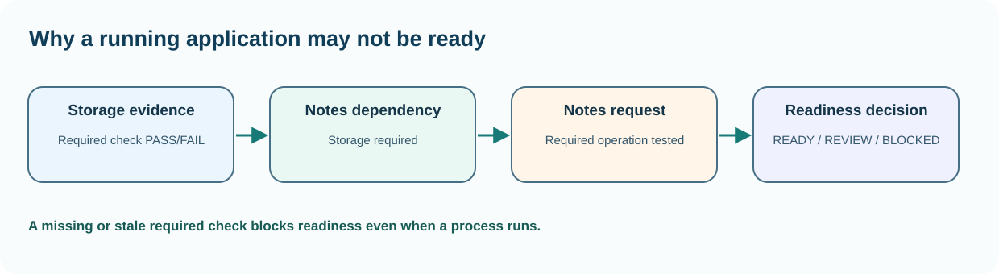

# Chapter 45 — Recognise service health versus process state

**Bits to Banking · System Administration: From Zero · Umicom Foundation**  
**Audience:** beginners of any age; younger learners should use a supervised computer.  
**Suggested study time:** 65–85 minutes.  
**Before this chapter:** Chapters 11, 27 and 28: Windows services, systemd units and logs.

## The question this chapter answers

**How can I understand and check this part of a computer without accidentally changing something important?**

## Why this matters

A process is a running program instance. A service is a managed background workload. 'Running' tells us something about process state, but not whether the service can complete its assigned task. A banking reconciliation engine might still be running while its input queue is blocked. A note-taking service may respond to a health check but fail to save documents because its storage is full.

Professional operators define success in business terms. For a fictional Umicom Notes service, we may require its storage location to be writable, its service to start, and a save-and-read test to succeed. Merely finding a PID is not enough.

## A useful mental model

Imagine a restaurant that has its lights on and employees inside. That is analogous to a running process. A healthy service actually accepts and completes orders. A readiness check asks whether it is suitable to receive work now; a liveness check asks whether it is responsive enough to remain running. These signals should not be conflated or used to create automatic restart loops without clear policies.



*Figure 45 — The concept and its safe evidence boundary.*

## Key terms, explained before using them

| Term | Meaning |
|---|---|
| **Process** | An OS-managed execution instance with resources and an identity. |
| **Service** | A managed, generally long-lived workload exposed through defined operations. |
| **Liveness** | A narrow indication that a workload remains responsive or operating. |
| **Readiness** | Evidence that a service can safely accept its intended work. |
| **Dependency** | A component that must function before another operation can succeed. |
| **Degraded** | Partially functioning state with documented limitations. |

## Read this before typing commands

> **Authorisation and safety:** Use your own computer or an explicitly authorised learning environment. Start with an ordinary user account. Commands that install software, change access, restart services or modify networks are outside this exercise unless the text clearly identifies a harmless practice-file operation. You never need to disable a firewall or change system permissions to complete this chapter.

> **Reading code blocks:** Open PowerShell 7 on Windows (`pwsh`) or a terminal on Linux. Type the line inside the block, not the example prompt. Run one command at a time. Some examples contain multiple interactive commands separated by semicolons; verify their results individually. These are interactive commands, **not scripts added to Umicom**.

## Windows — PowerShell 7 practice

Do these steps on Windows. If you use Linux, read them for comparison and continue below. A missing command means that a tool or module may be unavailable; it is not a reason to bypass computer policy.

### Step 1 — List a small sample of Windows services

```powershell
Get-Service | Select-Object -First 10 Name, Status, DisplayName
```

**Expected result:** Service names and statuses appear.

**Why this command matters:** Stopped may be intentional for services that start on demand. Do not treat every stopped service as an incident.

**Safety and troubleshooting:** Do not run Start-Service or Stop-Service in the shared learning environment.

### Step 2 — Inspect service configuration from the CIM provider

```powershell
Get-CimInstance Win32_Service -Filter "Name='Spooler'" | Select-Object Name, State, StartMode, PathName
```

**Expected result:** When present, a Print Spooler configuration record appears.

**Why this command matters:** The configuration reports a binary path and start mode. It does not establish that printing a document works.

**Safety and troubleshooting:** Spooler can be absent or disabled on server images; that is not automatically a fault.

### Step 3 — Read a bounded service-control event sample

```powershell
Get-WinEvent -FilterHashtable @{LogName='System';ProviderName='Service Control Manager'} -MaxEvents 6 | Select-Object TimeCreated, Id, Message
```

**Expected result:** Recent events appear if available and permitted.

**Why this command matters:** Timestamps and provider names help correlate events with user-visible symptoms. Event IDs are meaningful in the context of their provider.

**Safety and troubleshooting:** Messages can contain private paths or machine names; redact before sharing.

### Step 4 — Record when you observed the status

```powershell
Get-Date -Format o
```

**Expected result:** A timestamp with timezone offset appears.

**Why this command matters:** When a service changes state rapidly, two observations minutes apart may tell very different stories.

**Safety and troubleshooting:** Do not claim the same service state persists indefinitely.

## Linux — terminal practice

Run these in a Linux terminal on an authorised computer or VM. Some distributions do not install the same commands. An unavailable check should be reported as unavailable; do not assume an unobserved result is successful. No command below requires `sudo`.

### Step 1 — Inspect service unit status without modifying it

```bash
systemctl --user list-units --type=service --all --no-pager
```

**Expected result:** User-owned service units appear on hosts with user systemd.

**Why this command matters:** A Linux service may be managed by a system unit rather than a user unit; use authorised scope-specific commands.

**Safety and troubleshooting:** If this command is unavailable or access is refused, record the result. Do not alter system configuration simply to make the example succeed.

### Step 2 — Read recent user-journal entries

```bash
journalctl --user -n 10 --no-pager
```

**Expected result:** Up to ten entries appear when the user journal is available.

**Why this command matters:** A journal entry is evidence of a message, not necessarily proof that the originating process failed.

**Safety and troubleshooting:** If this command is unavailable or access is refused, record the result. Do not alter system configuration simply to make the example succeed.

### Step 3 — Check for a real listening port

```bash
ss -lnt
```

**Expected result:** Listening TCP endpoints appear.

**Why this command matters:** Combine process state with endpoint and application-level tests to evaluate readiness.

**Safety and troubleshooting:** If this command is unavailable or access is refused, record the result. Do not alter system configuration simply to make the example succeed.

## Worked Umicom support scenario

The Umicom Notes training application is marked Running. Students cannot open an existing note. Instead of repeatedly restarting the process, the operator examines the relevant directory permissions, available space, application error and actual read result. A failed dependency explains why a running application is not ready. The corrective action must address that dependency, not just its symptom.

### A disciplined investigation sequence

1. **Describe the symptom precisely.** Identify what failed and the expected result.
2. **Identify the environment.** Record current account, machine class, working directory and observation time; redact private identifiers.
3. **Run the smallest relevant read-only check.** Choose evidence that distinguishes two possible causes.
4. **Compare results with the requirement.** Missing, blocked or outdated checks are not successful checks.
5. **Separate fact and interpretation.** Label hypotheses explicitly.
6. **Propose, do not silently apply, a change.** State approval, effect, rollback and validation criteria.

## Common mistakes and how to respond

| Incorrect assumption | Better engineering response |
|---|---|
| The green Running label proves the system is operational. | It describes lifecycle state; verify the intended operation separately. |
| All failures should trigger automatic restarts. | Restarts can hide data loss or amplify load when storage or databases remain unhealthy. |
| A liveness probe should perform payments or write production data. | Keep probes bounded and safe; separate liveness, readiness and business-transaction verification. |

## Practical exercises — try these before opening the answers

1. List three readiness checks for Notes.
2. Explain when a service can be degraded.
3. Propose an incident response order.

<details>
<summary><strong>Suggested answers and reasoning</strong> — open after attempting the exercises</summary>

1. **List three readiness checks for Notes.** A configured service process, accessible document storage and a successful authorised read-only document request.
2. **Explain when a service can be degraded.** A nonessential feature may fail while required work remains available, with the limitation clearly reported.
3. **Propose an incident response order.** Observe process → check dependencies → test the real operation → record evidence → request approved change.

</details>

## Engineering connection: Umicom Framework

Umicom Framework's existing supervisory, observability and build services should provide production health. The new Update 40 native C23 teaching laboratory combines fictional readiness observations and dependencies; it is not a background monitoring agent or a replacement for Framework.

## Short support-note template

```text
Observation ID: PRACTICE-____
Observed at (include timezone):
Authorised machine or learning environment:
User-visible symptom:
Command or test (never paste credentials):
Observed result:
What remains unknown:
Proposed next safe check:
Approval required before any change:
```

## References and further study

- https://learn.microsoft.com/powershell/module/microsoft.powershell.management/get-service
- https://www.freedesktop.org/software/systemd/man/latest/systemctl.html

**Course progression:** [Chapter 44](44-understand-firewalls-and-listening-services.md) → **Chapter 45** → [Chapter 46](46-plan-updates-with-an-approval-and-rollback-window.md).

---

**Safety reminder:** An honest *not available*, *not authorised* or *not run* result is better than a fabricated pass. No real system changes or remote repository writes are required.
