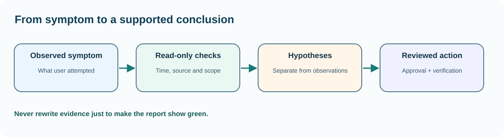

# Chapter 47 — Build an incident timeline from logs and metrics

**Bits to Banking · System Administration: From Zero · Umicom Foundation**  
**Audience:** beginners of any age; younger learners should use a supervised computer.  
**Suggested study time:** 70–95 minutes.  
**Before this chapter:** Chapters 12, 27 and 35: event logs, service states and incident evidence.

## The question this chapter answers

**How can I understand and check this part of a computer without accidentally changing something important?**

## Why this matters

When a problem appears, people remember different details. A timeline replaces those impressions with ordered observations. Each entry should identify when something was seen, which machine or service it concerns, what command or system produced the evidence and whether the result is verified. A good report separates facts, assumptions and proposed next steps.

Logs may contain paths, names, request identifiers and occasionally secrets accidentally printed by applications. Only inspect authorised systems and share the smallest redacted extract needed for investigation. This chapter never asks you to upload real private logs or change logging retention.

## A useful mental model

Think of a sports referee's match record. It records what happened at particular times without inventing reasons. An administrator might record a failed login at 14:02, a service stop event at 14:03 and an application error at 14:04. Those times suggest a sequence, but correlation alone does not prove that the login caused the stop. To establish causation you need a reproducible mechanism and matching evidence.



*Figure 47 — The concept and its safe evidence boundary.*

## Key terms, explained before using them

| Term | Meaning |
|---|---|
| **Log entry** | A timestamped message recorded by a service or operating system. |
| **Metric** | A numeric measurement such as CPU load or queue depth. |
| **Correlation ID** | An identifier used to connect records from the same operation. |
| **Incident timeline** | Ordered evidence describing observations around a problem. |
| **Redaction** | Removal or masking of sensitive values before sharing. |
| **Hypothesis** | A possible explanation not yet established as fact. |

## Read this before typing commands

> **Authorisation and safety:** Use your own computer or an explicitly authorised learning environment. Start with an ordinary user account. Commands that install software, change access, restart services or modify networks are outside this exercise unless the text clearly identifies a harmless practice-file operation. You never need to disable a firewall or change system permissions to complete this chapter.

> **Reading code blocks:** Open PowerShell 7 on Windows (`pwsh`) or a terminal on Linux. Type the line inside the block, not the example prompt. Run one command at a time. Some examples contain multiple interactive commands separated by semicolons; verify their results individually. These are interactive commands, **not scripts added to Umicom**.

## Windows — PowerShell 7 practice

Do these steps on Windows. If you use Linux, read them for comparison and continue below. A missing command means that a tool or module may be unavailable; it is not a reason to bypass computer policy.

### Step 1 — Record your own observation timestamp

```powershell
Get-Date -Format o
```

**Expected result:** A local timestamp with offset appears.

**Why this command matters:** Use it to label the moment you observed the service, not to claim when the problem started.

**Safety and troubleshooting:** Do not compare timestamps from machines with wrong clocks without first noting the uncertainty.

### Step 2 — Inspect a small Application log sample

```powershell
Get-WinEvent -LogName Application -MaxEvents 8 | Select-Object TimeCreated, Id, ProviderName, LevelDisplayName
```

**Expected result:** Up to eight recent event summaries appear.

**Why this command matters:** A summary is safer than distributing full messages. Filter by provider and period when investigating a known incident.

**Safety and troubleshooting:** An error from an unrelated application is not evidence that Umicom is failing.

### Step 3 — Inspect a small process snapshot

```powershell
Get-Process | Sort-Object CPU -Descending | Select-Object -First 8 Name, Id, CPU
```

**Expected result:** The eight processes with the highest accumulated CPU time may appear.

**Why this command matters:** CPU in Get-Process commonly reports accumulated processor seconds, not instant percentage utilisation. Record the metric's meaning.

**Safety and troubleshooting:** Avoid assuming the first row is currently consuming the most CPU.

### Step 4 — Inspect system availability of free space

```powershell
Get-PSDrive -PSProvider FileSystem
```

**Expected result:** Current filesystem capacity information appears.

**Why this command matters:** This can help correlate a write failure with a full target volume, but a single snapshot does not prove the earlier state.

**Safety and troubleshooting:** Do not delete logs or build evidence to create space during a forensic investigation without authorisation.

## Linux — terminal practice

Run these in a Linux terminal on an authorised computer or VM. Some distributions do not install the same commands. An unavailable check should be reported as unavailable; do not assume an unobserved result is successful. No command below requires `sudo`.

### Step 1 — Record an observation time

```bash
date -Is
```

**Expected result:** A timestamp with timezone appears.

**Why this command matters:** Check consistency before comparing it with Windows records.

**Safety and troubleshooting:** If this command is unavailable or access is refused, record the result. Do not alter system configuration simply to make the example succeed.

### Step 2 — Inspect recent journal entries

```bash
journalctl -n 10 --no-pager
```

**Expected result:** Up to ten recent messages appear when authorised.

**Why this command matters:** The system journal may be empty or restricted for ordinary users; record that explicitly.

**Safety and troubleshooting:** If this command is unavailable or access is refused, record the result. Do not alter system configuration simply to make the example succeed.

### Step 3 — Read system uptime

```bash
uptime
```

**Expected result:** Current uptime and load averages are displayed.

**Why this command matters:** Load average is not the same as CPU percentage and must be interpreted relative to resources and workload.

**Safety and troubleshooting:** If this command is unavailable or access is refused, record the result. Do not alter system configuration simply to make the example succeed.

## Worked Umicom support scenario

A fictional Umicom Notes service became unavailable at 10:15. The support worker records the user-visible symptom, checks the process status at 10:18, verifies the storage volume at 10:20 and reviews only the application log covering 10:10–10:22. The report says 'storage has little free space; related save errors were logged' rather than 'the disk definitely caused everything'. A proposed fix is held pending authorisation and a backup check.

### A disciplined investigation sequence

1. **Describe the symptom precisely.** Identify what failed and the expected result.
2. **Identify the environment.** Record current account, machine class, working directory and observation time; redact private identifiers.
3. **Run the smallest relevant read-only check.** Choose evidence that distinguishes two possible causes.
4. **Compare results with the requirement.** Missing, blocked or outdated checks are not successful checks.
5. **Separate fact and interpretation.** Label hypotheses explicitly.
6. **Propose, do not silently apply, a change.** State approval, effect, rollback and validation criteria.

## Common mistakes and how to respond

| Incorrect assumption | Better engineering response |
|---|---|
| The first red error line caused the incident. | Look at provider, time, operation and dependencies before inferring causality. |
| More logs are always better. | Focused, permitted and redacted evidence is more useful and safer than indiscriminate collection. |
| A snapshot metric proves what happened earlier. | Historical claims need retained samples or logs from the relevant period. |

## Practical exercises — try these before opening the answers

1. Create a five-row fictional incident timeline.
2. Explain why CPU seconds are not CPU percent.
3. Prepare a safe report for a peer.

<details>
<summary><strong>Suggested answers and reasoning</strong> — open after attempting the exercises</summary>

1. **Create a five-row fictional incident timeline.** Record time, source, observation, verification status and follow-up; mark assumptions separately.
2. **Explain why CPU seconds are not CPU percent.** Accumulated process time covers a period; utilisation measures a rate over an interval.
3. **Prepare a safe report for a peer.** Remove names, private IPs, tokens and home-directory identifiers while keeping reproducible commands and error categories.

</details>

## Engineering connection: Umicom Framework

Framework observability should provide structured records and bounded context. Studio's Problems panel and OS monitoring should maintain separate facts for process existence, service readiness and successful business operations. Retain evidence needed for audit under approved data-governance rules.

## Short support-note template

```text
Observation ID: PRACTICE-____
Observed at (include timezone):
Authorised machine or learning environment:
User-visible symptom:
Command or test (never paste credentials):
Observed result:
What remains unknown:
Proposed next safe check:
Approval required before any change:
```

## References and further study

- https://learn.microsoft.com/powershell/module/microsoft.powershell.diagnostics/get-winevent
- https://man7.org/linux/man-pages/man1/uptime.1.html

**Course progression:** [Chapter 46](46-plan-updates-with-an-approval-and-rollback-window.md) → **Chapter 47** → [Chapter 48](48-capstone-support-and-verify-a-fictional-umicom-service.md).

---

**Safety reminder:** An honest *not available*, *not authorised* or *not run* result is better than a fabricated pass. No real system changes or remote repository writes are required.
