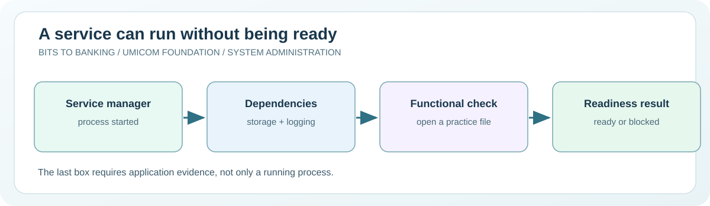

# Chapter 49 — Map managed services and their dependencies

**System Administration From Zero · Stage 4 — Managed Services and Recovery**  
**Author:** Sammy Hegab · Umicom Foundation  
**Study time:** 65–85 minutes  
**Before starting:** Chapters 10–12, 27–28 and 45: processes, services, event logs and readiness  
**Safety level:** observation-only on real systems; any practice writes are confined to a folder owned by the learner.

## What you will achieve

By the end of this chapter, you will be able to explain **map managed services and their dependencies**, identify the difference between an observation and a change, and interpret at least one Windows and one Linux administration result. You will also be able to describe the evidence that an authorised Umicom support engineer would need before taking action.

## Why this matters in everyday computing

When a computer starts, many programmes run without anyone clicking an icon. Some keep the clock, network, printing or logging systems available. These are services. A beginner may recognise a service as ‘running’ in Task Manager and assume it is healthy. A professional administrator asks what that service does, who depends on it, and what evidence would demonstrate that it is functioning correctly.

In this lesson we will observe standard Windows and Linux service managers. We will not start, stop, disable or restart any system services. People sharing your computer may depend on them. The practical example is a fictional Umicom Notes application that needs both document storage and an event log. If its storage requirement fails, showing a green Notes icon would be misleading.

## A mental model you can remember

Think of a school library. The door may be unlocked (process running), but the catalogue may be unavailable (dependency unhealthy). The librarian cannot promise you can borrow a book until both work. Similarly, a background service has a lifecycle, dependencies and a *service-level result*. The operating-system service manager can report whether a process was started, while an application health check must also confirm that it can perform its assigned work.



## New words, without jargon

| Term | Meaning |
|---|---|
| **Service** | A programme managed by the operating system and often started automatically. |
| **Service manager** | The system component that starts, tracks and stops services. |
| **Dependency** | Another service or resource that must be available first. |
| **Unit** | The name used by systemd for a managed service, timer or other object. |
| **Ready** | A service has passed the checks required for its intended work, not merely started. |
| **Read-only inspection** | A command that reports status without requesting a configuration change. |

## Windows practical lesson — PowerShell 7

Open **Windows Terminal → PowerShell**, or search for **PowerShell 7**. Type only the commands inside each box; the example `PS C:\...>` prompt is not part of a command. Unless a step explicitly says otherwise, use your normal non-administrator account. The commands are interactive teaching instructions, not a `.ps1` script.

### Step 1 — Open a regular PowerShell session

```powershell
pwsh
```

**Expected result:** A PowerShell 7 prompt appears. If not installed, follow the installation chapter.

**What it means:** Do not choose Run as Administrator for this exercise. Your normal account is sufficient for many observations.

**If it looks different:** If `pwsh` is unavailable, Windows PowerShell can run the read-only commands while you arrange an approved PowerShell 7 installation.

### Step 2 — Inspect the Event Log service

```powershell
Get-Service -Name EventLog | Select-Object Name, DisplayName, Status, StartType
```

**Expected result:** A table appears; Status is usually Running on a normal Windows installation.

**What it means:** `Get-Service` asks the service manager for its current status; `Select-Object` limits the displayed properties. This does not verify that a particular event was successfully written.

**If it looks different:** A corporate policy may restrict which service information is visible; a refusal is evidence of a boundary, not a reason to elevate automatically.

### Step 3 — Inspect several services without altering them

```powershell
Get-Service | Select-Object -First 8 Name, Status
```

**Expected result:** Eight service records, or fewer on an unusual machine, are shown.

**What it means:** The selection avoids printing the full service catalogue. Service names are identifiers; friendly display names can vary with language.

**If it looks different:** The output order is not a ranked list of importance.

### Step 4 — Find processes without stopping them

```powershell
Get-Process | Select-Object -First 8 ProcessName, Id
```

**Expected result:** You see programme names and process IDs.

**What it means:** A service may run inside a shared host process. A process ID is not a stable service identity and can change after restart.

**If it looks different:** Do not call Stop-Process or Stop-Service in this lesson.

## Linux practical comparison

On a Linux computer or an authorised virtual machine, open a terminal. These are **Bash-compatible commands**; do not type the `$` prompt. A minimal container, Chromebook or non-systemd distribution may have a different set of tools. A missing optional tool should be recorded rather than bypassed.

### Linux step 1 — List currently active services

```bash
systemctl list-units --type=service --state=running --no-pager
```

**Expected result:** Service units appear on a systemd-based Linux system.

**Interpretation:** A minimal Linux container or another init system may not use systemd. That is a platform difference, not a failed course.

### Linux step 2 — Read one service's state

```bash
systemctl status systemd-journald.service --no-pager
```

**Expected result:** A status report appears if the unit exists and is visible.

**Interpretation:** This reads status only. A running logging service is useful, but it does not establish that your own application logs are complete.

### Linux step 3 — Examine dependencies

```bash
systemctl list-dependencies systemd-journald.service --no-pager
```

**Expected result:** A dependency tree appears; exact names depend on the distribution.

**Interpretation:** The tree describes configured unit relations. It does not prove all higher-level application data dependencies are ready.

## Worked support scenario — Umicom Notes

A school's Umicom Notes workstation opens normally, but cannot save a new lesson. The support volunteer sees that the Notes process is running. They check its practice storage folder and find that the folder is read-only. The correct conclusion is ‘process started, service not ready’. They record the finding and ask the authorised administrator to review permissions; they do not disable antivirus or grant broad write permissions.

**Evidence record:** In your own words, describe the issue, the observation time, the command used, what you actually saw, what you have *not* proved, and who would approve a change. Avoid copying usernames, credentials, private filenames, IP addresses or confidential logs into public notes.

## Common mistakes and how to correct them

| Misunderstanding | Better interpretation |
|---|---|
| Running means healthy. | A process can run while a database, folder or dependent service has failed. |
| A Windows service always has its own process. | Some services share processes; do not map service to application state from a PID alone. |
| Restarting is the first diagnostic step. | Restarting may hide evidence or interrupt another user. Observe and record first. |

## Guided practice and suggested responses

**Exercise 1.** Describe two dependencies for Notes.

*Suggested response:* For instance, a writable practice folder and a correctly loaded document index.

**Exercise 2.** Explain status versus readiness.

*Suggested response:* State what Get-Service proves, then name an additional functional check.

**Exercise 3.** Create a support note.

*Suggested response:* Record service name, command, time and observed status, omitting any personal identifiers.

## Questions for discussion

1. Which part of today's map managed services and their dependencies exercise was **read-only**, and how do you know?
2. What does a successful command prove, and what would it *not* prove?
3. Explain **Service** to somebody who has never opened a terminal.
4. If an expected result does not appear, what evidence would you collect before changing anything?
5. How would you explain this issue to a colleague without exposing private data?

## Connection to Umicom Framework and software engineering

The Framework-owned lifecycle and health services should be the source of truth for real Umicom products. The Update 40 C23 readiness laboratory models how a failed prerequisite prevents a dependent service from being labelled ready. This new chapter connects that model to observation commands; it does not reimplement or change the Framework service manager.

## Further reading (optional internet access)

- https://learn.microsoft.com/powershell/module/microsoft.powershell.management/get-service
- https://www.freedesktop.org/software/systemd/man/latest/systemctl.html

## Learning checkpoint

You are ready to proceed if you can explain **the command, its expected output, the boundary of what it proves, and a safe response to unexpected output**. If the exercise needed unavailable administrator access, record *not performed*; do not mark it as passed.

**Next:** [Chapter 50 — Inspect service identities and account boundaries](./50-inspect-service-identities-and-account-boundaries.md).
