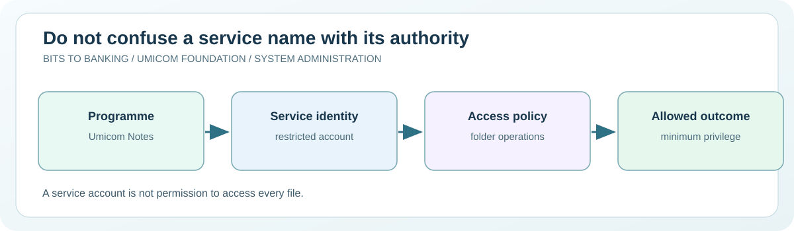

# Chapter 50 — Inspect service identities and account boundaries

**System Administration From Zero · Stage 4 — Managed Services and Recovery**  
**Author:** Sammy Hegab · Umicom Foundation  
**Study time:** 60–80 minutes  
**Before starting:** Chapters 9, 25–26 and 34: identity, groups, least privilege and access control  
**Safety level:** observation-only on real systems; any practice writes are confined to a folder owned by the learner.

## What you will achieve

By the end of this chapter, you will be able to explain **inspect service identities and account boundaries**, identify the difference between an observation and a change, and interpret at least one Windows and one Linux administration result. You will also be able to describe the evidence that an authorised Umicom support engineer would need before taking action.

## Why this matters in everyday computing

A service does not have to run as the same person who is looking at its window. It may use a dedicated operating-system account with access to one folder or resource. That is a useful security boundary. If the service uses an overly powerful account, one defect can affect more of the machine than necessary.

This lesson is about reading those identities safely. We will distinguish the service’s name, the user account under which it runs, and the permissions that account may hold. We will not create service accounts, change logon credentials, edit access-control lists or bypass the permissions on a school or workplace machine.

## A mental model you can remember

Imagine a classroom with different keys. A student can enter the classroom, a librarian can open the book cupboard, and an administrator may manage the whole building. Giving everyone the building master key would be convenient but dangerous. Service identities are similar: grant only the keys needed for that service’s work. An identity is not itself a permission; operating-system policy and file access rules determine what it can do.



## New words, without jargon

| Term | Meaning |
|---|---|
| **Service identity** | The operating-system account or security principal a service runs as. |
| **LocalSystem** | A highly privileged built-in Windows service identity; not a normal user account. |
| **Service account** | An account assigned to a programme for controlled access to resources. |
| **Least privilege** | Give each service only the rights required for its declared duties. |
| **ACL** | Access-control list: rules describing who may perform operations on an object. |
| **Access denied** | The operating system refusing an operation under the current effective permissions. |

## Windows practical lesson — PowerShell 7

Open **Windows Terminal → PowerShell**, or search for **PowerShell 7**. Type only the commands inside each box; the example `PS C:\...>` prompt is not part of a command. Unless a step explicitly says otherwise, use your normal non-administrator account. The commands are interactive teaching instructions, not a `.ps1` script.

### Step 1 — See the logged-in user

```powershell
whoami
```

**Expected result:** The currently signed-in Windows account identity appears.

**What it means:** The user who types a command is not necessarily the account running a background service.

**If it looks different:** Do not post the full account name publicly without checking whether it reveals private details.

### Step 2 — Find one service's configured account

```powershell
Get-CimInstance Win32_Service -Filter "Name='EventLog'" | Select-Object Name, StartName, State
```

**Expected result:** The service account and current state appear if Windows exposes that record.

**What it means:** `StartName` is the configured service identity. It does not by itself prove that the account can access every required file.

**If it looks different:** If the query returns nothing, check the service identifier and the CIM/WMI availability. Do not change security policies.

### Step 3 — Read a practice folder's access rules

```powershell
Get-Acl -LiteralPath "$HOME" | Select-Object Owner, AccessToString
```

**Expected result:** A local ownership summary and access rules may appear.

**What it means:** This is your home directory, not a colleague's data. Do not assume the display includes all effective inheritance, privilege or network-share conditions.

**If it looks different:** On managed machines, some security descriptors may be restricted; record the boundary instead of using elevated tools.

### Step 4 — Check the current privilege context

```powershell
whoami /groups
```

**Expected result:** A list of group memberships is shown.

**What it means:** Membership and effective privileges are different. An administrator account running unelevated does not automatically exercise every administrative right.

**If it looks different:** Long output is normal; focus on the idea of groups and tokens rather than memorising names.

## Linux practical comparison

On a Linux computer or an authorised virtual machine, open a terminal. These are **Bash-compatible commands**; do not type the `$` prompt. A minimal container, Chromebook or non-systemd distribution may have a different set of tools. A missing optional tool should be recorded rather than bypassed.

### Linux step 1 — See your current identity

```bash
id
```

**Expected result:** Numeric user and group IDs with names are displayed.

**Interpretation:** The UID and groups help explain whether a file operation may succeed. Avoid running `sudo` to make this exercise work.

### Linux step 2 — Inspect a service's user property

```bash
systemctl show systemd-journald.service -p User -p Group -p DynamicUser --no-pager
```

**Expected result:** Property names and values appear on a systemd host; empty User can mean the default system identity.

**Interpretation:** A service may use more advanced security constraints. This single command is not a complete permission audit.

### Linux step 3 — Inspect your own directory

```bash
ls -ld "$HOME"
```

**Expected result:** Permission bits, owner and group of your home directory appear.

**Interpretation:** The first character identifies the object type; the next permission characters describe traditional access modes.

## Worked support scenario — Umicom Notes

A fictional Umicom Notes server needs write access only to its authorised document directory. A contributor proposes running it with full administrative privileges to fix an access error. A safer plan first confirms which identity is configured, which directory must be writable and which least-privileged permission should be approved. The contributor documents the diagnosis without changing any real access rules.

**Evidence record:** In your own words, describe the issue, the observation time, the command used, what you actually saw, what you have *not* proved, and who would approve a change. Avoid copying usernames, credentials, private filenames, IP addresses or confidential logs into public notes.

## Common mistakes and how to correct them

| Misunderstanding | Better interpretation |
|---|---|
| The name of a service is its user account. | Service names identify workloads; service identities identify the operating-system security context. |
| An Access Denied message means I should immediately use sudo or Run as Administrator. | First establish the authorised task and ownership. Elevation may make the risk worse. |
| A displayed ACL is the same as effective access. | Inherited rules, deny entries, security tokens and share permissions also matter. |

## Guided practice and suggested responses

**Exercise 1.** Compare two identities.

*Suggested response:* Explain why the service's StartName may differ from whoami.

**Exercise 2.** Identify an unnecessary privilege.

*Suggested response:* Explain why a note-taking service normally should not require permission to install drivers.

**Exercise 3.** Write a permissions escalation request.

*Suggested response:* State the exact folder, needed operation, current account and evidence, without asking for blanket administrator rights.

## Questions for discussion

1. Which part of today's inspect service identities and account boundaries exercise was **read-only**, and how do you know?
2. What does a successful command prove, and what would it *not* prove?
3. Explain **Service identity** to somebody who has never opened a terminal.
4. If an expected result does not appear, what evidence would you collect before changing anything?
5. How would you explain this issue to a colleague without exposing private data?

## Connection to Umicom Framework and software engineering

Umicom Framework's identity, configuration and audit capabilities are responsible for real service security. Bits2Banking teaches the least-privilege analysis rather than creating service accounts through an unreviewed training tool. A future Umicom Notes service should consume Framework storage and service contracts instead of writing arbitrary locations directly.

## Further reading (optional internet access)

- https://learn.microsoft.com/windows/win32/services/service-user-accounts
- https://man7.org/linux/man-pages/man1/id.1.html

## Learning checkpoint

You are ready to proceed if you can explain **the command, its expected output, the boundary of what it proves, and a safe response to unexpected output**. If the exercise needed unavailable administrator access, record *not performed*; do not mark it as passed.

**Next:** [Chapter 51 — Read systemd units and understand service startup order](./51-read-systemd-units-and-service-startup-order.md).
