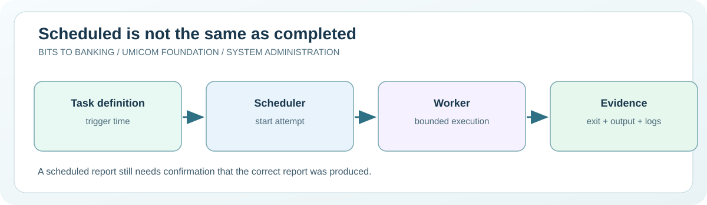

# Chapter 52 — Inspect scheduled tasks, cron and systemd timers

**System Administration From Zero · Stage 4 — Managed Services and Recovery**  
**Author:** Sammy Hegab · Umicom Foundation  
**Study time:** 60–80 minutes  
**Before starting:** Chapters 11, 39 and 46: services, scheduled work and maintenance planning  
**Safety level:** observation-only on real systems; any practice writes are confined to a folder owned by the learner.

## What you will achieve

By the end of this chapter, you will be able to explain **inspect scheduled tasks, cron and systemd timers**, identify the difference between an observation and a change, and interpret at least one Windows and one Linux administration result. You will also be able to describe the evidence that an authorised Umicom support engineer would need before taking action.

## Why this matters in everyday computing

Computers can run work at a particular time: make a backup, generate a daily report or check a service. Windows uses Task Scheduler; Linux commonly uses cron or systemd timers. These tools are useful, but a scheduled job that starts is not the same as a job that finishes correctly.

This chapter teaches observation, not installing background automation. We will inspect local task catalogues safely and learn about identity, triggering conditions, last-run outcomes and what happens when a machine was switched off at the expected time.

## A mental model you can remember

Imagine a wall calendar that says ‘check library returns at 17:00’. Writing the appointment does not prove somebody did the work. A scheduler records the intention to start a job. The job's output, exit status, logs and business evidence decide whether the work was completed. A reliable administrator must know who owns each job, when it should run and how an interrupted run is recovered.



## New words, without jargon

| Term | Meaning |
|---|---|
| **Trigger** | An event or timetable that requests a job start. |
| **Scheduled task** | A Windows definition for a command launched under specified conditions. |
| **cron** | Traditional Unix-like time-based job scheduler. |
| **systemd timer** | A unit that triggers another systemd unit on a time or event schedule. |
| **Exit code** | A number returned by a programme to indicate its completion status. |
| **Missed run** | A scheduled occurrence that was not executed, for example while the computer was off. |

## Windows practical lesson — PowerShell 7

Open **Windows Terminal → PowerShell**, or search for **PowerShell 7**. Type only the commands inside each box; the example `PS C:\...>` prompt is not part of a command. Unless a step explicitly says otherwise, use your normal non-administrator account. The commands are interactive teaching instructions, not a `.ps1` script.

### Step 1 — List a small sample of registered tasks

```powershell
Get-ScheduledTask | Select-Object -First 8 TaskName, State, TaskPath
```

**Expected result:** A sample of scheduled tasks and their states appears.

**What it means:** These are definitions, not proof that the associated programmes completed successfully.

**If it looks different:** If Get-ScheduledTask is unavailable on a non-Windows host, skip the Windows section.

### Step 2 — Inspect one existing task without executing it

```powershell
Get-ScheduledTask | Select-Object -First 1 TaskName, TaskPath
```

**Expected result:** One task name and path are displayed; copy them into your private study notes.

**What it means:** Before using `Get-ScheduledTaskInfo`, choose a task visible to your account and pass its actual name and path, not an invented example.

**If it looks different:** Do not press Run or disable a system task while learning.

### Step 3 — Check the current clock

```powershell
Get-Date -Format o
```

**Expected result:** An ISO-style timestamp including your local timezone offset appears.

**What it means:** Schedulers interpret time zones and daylight saving rules. Record both the intended timetable and effective local time.

**If it looks different:** The exercise does not create a task or write a script.

### Step 4 — Look at the configured tasks' states

```powershell
Get-ScheduledTask | Group-Object State | Select-Object Name, Count
```

**Expected result:** A count by visible task state appears.

**What it means:** Ready is a scheduler state, not evidence that task output was useful.

**If it looks different:** Counts differ across machines and organisations.

## Linux practical comparison

On a Linux computer or an authorised virtual machine, open a terminal. These are **Bash-compatible commands**; do not type the `$` prompt. A minimal container, Chromebook or non-systemd distribution may have a different set of tools. A missing optional tool should be recorded rather than bypassed.

### Linux step 1 — List timer units

```bash
systemctl list-timers --all --no-pager
```

**Expected result:** The next and previous trigger times appear when systemd timers exist.

**Interpretation:** A timer describes scheduling; check the triggered service separately if you need completion evidence.

### Linux step 2 — Inspect your own cron table

```bash
crontab -l
```

**Expected result:** Your personal cron entries appear or a message says there is no crontab.

**Interpretation:** An empty crontab is normal. Do not edit system crontabs or use sudo for this lesson.

### Linux step 3 — Read the local date and timezone

```bash
date --iso-8601=seconds
```

**Expected result:** The current timestamp appears on GNU/Linux; another Unix may support different options.

**Interpretation:** Compare the timezone with the scheduler display. Do not change the system clock as an exercise.

## Worked support scenario — Umicom Notes

A team expects a daily Umicom Notes report, but none appeared on Monday. The workstation was powered off on Sunday night. The support volunteer checks the scheduled trigger, the last attempted run and whether a report file was produced. They do not add an unapproved extra trigger or write an automatic rescheduling script. They document whether the issue was a missed start or a failed programme.

**Evidence record:** In your own words, describe the issue, the observation time, the command used, what you actually saw, what you have *not* proved, and who would approve a change. Avoid copying usernames, credentials, private filenames, IP addresses or confidential logs into public notes.

## Common mistakes and how to correct them

| Misunderstanding | Better interpretation |
|---|---|
| Task State Ready means yesterday's report succeeded. | Ready often means eligible to run; inspect last-run evidence and output separately. |
| A scheduled job always runs after a computer turns back on. | Recovery and missed-run behaviour depend on scheduler and task settings. |
| Tasks are always safe to run manually. | A job may transmit payments, modify files or contact production systems. Never trigger one without authorisation. |

## Guided practice and suggested responses

**Exercise 1.** Write a hypothetical task contract.

*Suggested response:* Include purpose, owner, trigger, input, output, success signal and retry policy.

**Exercise 2.** Explain a missed-run scenario.

*Suggested response:* Describe how you would distinguish a powered-off host from a failed job.

**Exercise 3.** Check your timezone.

*Suggested response:* Use the read-only date command and identify its offset without changing the clock.

## Questions for discussion

1. Which part of today's inspect scheduled tasks, cron and systemd timers exercise was **read-only**, and how do you know?
2. What does a successful command prove, and what would it *not* prove?
3. Explain **Trigger** to somebody who has never opened a terminal.
4. If an expected result does not appear, what evidence would you collect before changing anything?
5. How would you explain this issue to a colleague without exposing private data?

## Connection to Umicom Framework and software engineering

Real scheduled processing in Umicom should use approved Framework scheduler/task services and durable event histories rather than new PowerShell or Python background scripts. A TMS end-of-day task requires business completeness, not merely a successful process start. The teaching examples never schedule real financial operations.

## Further reading (optional internet access)

- https://learn.microsoft.com/powershell/module/scheduledtasks/get-scheduledtask
- https://www.freedesktop.org/software/systemd/man/latest/systemd.timer.html

## Learning checkpoint

You are ready to proceed if you can explain **the command, its expected output, the boundary of what it proves, and a safe response to unexpected output**. If the exercise needed unavailable administrator access, record *not performed*; do not mark it as passed.

**Next:** [Chapter 53 — Understand configuration, environments and secret boundaries](./53-understand-configuration-environments-and-secret-boundaries.md).
