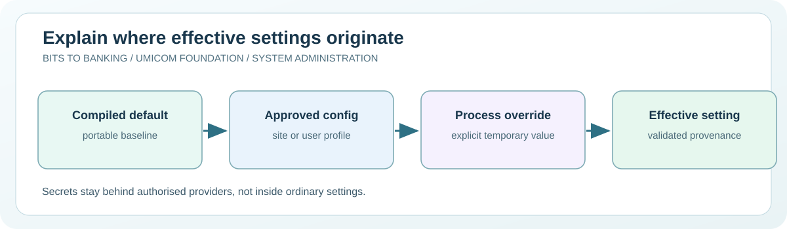

# Chapter 53 — Understand configuration, environments and secret boundaries

**System Administration From Zero · Stage 4 — Managed Services and Recovery**  
**Author:** Sammy Hegab · Umicom Foundation  
**Study time:** 70–90 minutes  
**Before starting:** Chapters 9, 34 and 46: permissions, secrets and controlled changes  
**Safety level:** observation-only on real systems; any practice writes are confined to a folder owned by the learner.

## What you will achieve

By the end of this chapter, you will be able to explain **understand configuration, environments and secret boundaries**, identify the difference between an observation and a change, and interpret at least one Windows and one Linux administration result. You will also be able to describe the evidence that an authorised Umicom support engineer would need before taking action.

## Why this matters in everyday computing

Two copies of the same application can behave differently even when their source code is identical. One may connect to a training database while another has no configured storage directory. Settings come from configuration files, operating-system environment variables, command-line options or a managed service. Knowing which input wins is essential for repeatable administration.

Students should distinguish a configuration value, a credential and a secret reference. A path to a practice folder may be ordinary configuration. A password, private key or access token is confidential. This lesson uses only a harmless temporary variable and never asks the learner to print real environment secrets or commit credentials to Git.

## A mental model you can remember

Think of a school timetable. A general term timetable is the default, a classroom notice is a local setting, and a teacher's explicitly approved change may override the normal plan. Applications likewise need a documented order of configuration sources. An administrator must know which source supplied each effective value and whether a restart or revalidation is needed. A secret is more like a key to the building: it should not be copied onto the timetable.



## New words, without jargon

| Term | Meaning |
|---|---|
| **Configuration** | Settings that influence a programme without changing its compiled code. |
| **Environment variable** | A named value a process may inherit when it starts. |
| **Precedence** | The documented rule deciding which configuration source overrides another. |
| **Secret** | Sensitive information such as a password, token or private key. |
| **Secret reference** | An identifier that lets an authorised provider retrieve a secret without storing it in ordinary configuration. |
| **Process scope** | Settings visible to a running process and, commonly, children it launches. |

## Windows practical lesson — PowerShell 7

Open **Windows Terminal → PowerShell**, or search for **PowerShell 7**. Type only the commands inside each box; the example `PS C:\...>` prompt is not part of a command. Unless a step explicitly says otherwise, use your normal non-administrator account. The commands are interactive teaching instructions, not a `.ps1` script.

### Step 1 — Read your current directory

```powershell
Get-Location
```

**Expected result:** PowerShell prints the folder against which relative paths are interpreted.

**What it means:** Many applications use an explicit work directory so that opening a shortcut from elsewhere does not change file resolution.

**If it looks different:** Do not assume a program writes only to the current directory.

### Step 2 — Show environment variable names, not sensitive values

```powershell
Get-ChildItem Env: | Select-Object -First 10 Name
```

**Expected result:** The names of ten or fewer environment variables are listed.

**What it means:** Displaying names is safer than publishing the entire environment. Some real variable values contain credentials.

**If it looks different:** Do not paste a complete environment dump into a public issue.

### Step 3 — Set a harmless value in the current shell

```powershell
$env:UMICOM_LEARNING_MODE = 'practice'
```

**Expected result:** The variable exists for this PowerShell process and children started afterward.

**What it means:** This is an interactive lesson command, not a saved PowerShell script or a permanent machine setting.

**If it looks different:** A new terminal window may not inherit this particular shell's temporary value.

### Step 4 — Read back the practice variable

```powershell
$env:UMICOM_LEARNING_MODE
```

**Expected result:** The value practice is printed.

**What it means:** Observe that reading a benign variable differs from exposing an authentication token.

**If it looks different:** If empty, rerun the preceding command in the same shell.

### Step 5 — Remove only the practice variable

```powershell
Remove-Item Env:UMICOM_LEARNING_MODE
```

**Expected result:** There is normally no output; the value is removed from this shell.

**What it means:** This is an intentionally bounded clean-up step. Do not use wildcards or remove system variables.

**If it looks different:** Get-ChildItem Env: helps confirm the learning variable is gone.

## Linux practical comparison

On a Linux computer or an authorised virtual machine, open a terminal. These are **Bash-compatible commands**; do not type the `$` prompt. A minimal container, Chromebook or non-systemd distribution may have a different set of tools. A missing optional tool should be recorded rather than bypassed.

### Linux step 1 — Show the configured search path

```bash
printf '%s\n' "$PATH" | tr ':' '\n' | head -n 5
```

**Expected result:** A few command search directories are listed.

**Interpretation:** PATH is a configuration value, not automatically a secret; still consider whether paths identify private locations before sharing.

### Linux step 2 — Set a temporary harmless variable

```bash
export UMICOM_LEARNING_MODE=practice
```

**Expected result:** This value becomes available in the current shell and newly launched child processes.

**Interpretation:** The command changes only your current shell, not a global /etc environment file.

### Linux step 3 — Remove your temporary variable

```bash
unset UMICOM_LEARNING_MODE
```

**Expected result:** The practice setting is removed from the current shell.

**Interpretation:** Avoid modifying configuration files or setting permanent variables in this chapter.

## Worked support scenario — Umicom Notes

A student starts a fictional Umicom Notes demo by clicking its icon. It cannot locate its data folder. Running from a developer terminal works. The problem might be a relative path or an environment variable available only inside the terminal. A robust solution is a Framework-owned, inspectable configuration source and a path independent of the current working directory, not a hidden script that changes PATH globally.

**Evidence record:** In your own words, describe the issue, the observation time, the command used, what you actually saw, what you have *not* proved, and who would approve a change. Avoid copying usernames, credentials, private filenames, IP addresses or confidential logs into public notes.

## Common mistakes and how to correct them

| Misunderstanding | Better interpretation |
|---|---|
| An environment variable is always safe to print. | Some values contain access tokens and passwords; inspect names or redact values deliberately. |
| Running a command permanently changes all user accounts. | Process-scope changes normally affect only the current process and its children. |
| A configuration file is a place to store every credential. | Sensitive secrets belong behind authorised credential-provider boundaries, not ordinary source-controlled files. |

## Guided practice and suggested responses

**Exercise 1.** Draw a configuration precedence diagram.

*Suggested response:* Use compiled defaults, approved application settings and an explicit per-run override, noting which source wins.

**Exercise 2.** Explain why shortcuts sometimes behave differently.

*Suggested response:* Contrast starting an application from a repository folder with starting it from a desktop icon.

**Exercise 3.** Identify three things never to commit.

*Suggested response:* Examples include tokens, passwords and private signing keys.

## Questions for discussion

1. Which part of today's understand configuration, environments and secret boundaries exercise was **read-only**, and how do you know?
2. What does a successful command prove, and what would it *not* prove?
3. Explain **Configuration** to somebody who has never opened a terminal.
4. If an expected result does not appear, what evidence would you collect before changing anything?
5. How would you explain this issue to a colleague without exposing private data?

## Connection to Umicom Framework and software engineering

Umicom Framework owns reusable configuration, identity and secret-provider contracts. Applications should ask those services for effective settings and keep their Data Server and resource paths independent of the shell's current directory. The course uses an interactive variable only to explain the mechanism; no implementation scripts are introduced.

## Further reading (optional internet access)

- https://learn.microsoft.com/powershell/module/microsoft.powershell.core/about/about_environment_variables
- https://www.freedesktop.org/software/systemd/man/latest/systemd.exec.html

## Learning checkpoint

You are ready to proceed if you can explain **the command, its expected output, the boundary of what it proves, and a safe response to unexpected output**. If the exercise needed unavailable administrator access, record *not performed*; do not mark it as passed.

**Next:** [Chapter 54 — Plan software upgrades as controlled changes](./54-plan-software-upgrades-as-controlled-changes.md).
