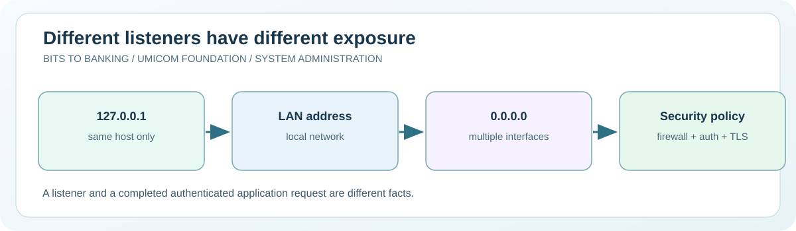

# Chapter 56 — Check local listeners and understand network exposure

**System Administration From Zero · Stage 4 — Managed Services and Recovery**  
**Author:** Sammy Hegab · Umicom Foundation  
**Study time:** 70–90 minutes  
**Before starting:** Chapters 15, 16, 31, 43–44 and 49: IP addresses, ports, listeners and services  
**Safety level:** observation-only on real systems; any practice writes are confined to a folder owned by the learner.

## What you will achieve

By the end of this chapter, you will be able to explain **check local listeners and understand network exposure**, identify the difference between an observation and a change, and interpret at least one Windows and one Linux administration result. You will also be able to describe the evidence that an authorised Umicom support engineer would need before taking action.

## Why this matters in everyday computing

An application can listen only to its own computer, to one network interface, or to every available interface. These choices change who may reach it. A local teaching HTTP server often binds to 127.0.0.1 so only programmes on the same host can connect. That is much safer for an unfinished educational server than accepting traffic from a whole network.

We will inspect listeners and firewall status without opening ports, changing firewall rules or connecting to unapproved hosts. Students will learn why an open TCP port is not proof that an application is secure, authenticated or producing the expected content.

## A mental model you can remember

Think of doors in a building. A door between two rooms inside one house resembles a loopback listener. A door onto the street resembles a service bound to an external network interface. A firewall resembles a guard checking whether visitors can pass. A visible door does not tell you whether everyone entering is authorised or whether the correct work happens inside.



## New words, without jargon

| Term | Meaning |
|---|---|
| **Loopback** | Traffic addressed to the same host, commonly 127.0.0.1 or ::1. |
| **Listening socket** | A network endpoint waiting for connections. |
| **Bind address** | The address on which a service accepts incoming connections. |
| **Wildcard address** | An address such as 0.0.0.0 that accepts connections for multiple IPv4 interfaces. |
| **Firewall profile** | A collection of traffic-control rules for a network context. |
| **Exposure** | Which other computers or users may reach a service, subject to routing and policy. |

## Windows practical lesson — PowerShell 7

Open **Windows Terminal → PowerShell**, or search for **PowerShell 7**. Type only the commands inside each box; the example `PS C:\...>` prompt is not part of a command. Unless a step explicitly says otherwise, use your normal non-administrator account. The commands are interactive teaching instructions, not a `.ps1` script.

### Step 1 — Inspect listening TCP endpoints

```powershell
Get-NetTCPConnection -State Listen | Select-Object -First 12 LocalAddress, LocalPort, OwningProcess
```

**Expected result:** Up to twelve listening endpoints are shown, subject to system permissions.

**What it means:** LocalAddress shows the bind scope. `127.0.0.1` is loopback; `0.0.0.0` is a wildcard, not necessarily evidence of external reachability.

**If it looks different:** If Get-NetTCPConnection is not available, note your Windows environment and do not install unapproved network tools.

### Step 2 — Read firewall profile state

```powershell
Get-NetFirewallProfile | Select-Object Name, Enabled
```

**Expected result:** A row for each available profile shows its enabled state.

**What it means:** This command reads policy. It does not show every individual rule or prove a service can be reached from a different network.

**If it looks different:** Do not disable a firewall to troubleshoot a training service.

### Step 3 — Check your own local TCP connection capability

```powershell
Test-NetConnection -ComputerName 127.0.0.1 -Port 8765
```

**Expected result:** TcpTestSucceeded is True only if a listener accepts the tested connection at that moment.

**What it means:** No server is started by this command. A False result is expected if you have not launched the previously taught local server.

**If it looks different:** Do not substitute a bank, school gateway or colleague's IP without their permission.

### Step 4 — Find the loopback address information

```powershell
Get-NetIPAddress -AddressFamily IPv4 | Where-Object IPAddress -eq '127.0.0.1' | Select-Object InterfaceAlias, IPAddress
```

**Expected result:** A loopback record may appear.

**What it means:** The address 127.0.0.1 refers to the local host from the computer running the command.

**If it looks different:** Different interface labels are normal.

## Linux practical comparison

On a Linux computer or an authorised virtual machine, open a terminal. These are **Bash-compatible commands**; do not type the `$` prompt. A minimal container, Chromebook or non-systemd distribution may have a different set of tools. A missing optional tool should be recorded rather than bypassed.

### Linux step 1 — List TCP listeners

```bash
ss -ltn
```

**Expected result:** Local addresses and ports are displayed if the ss tool is installed.

**Interpretation:** The -l flag requests listening sockets, -t selects TCP, and -n uses numeric addresses instead of name lookup.

### Linux step 2 — Inspect one loopback listener if available

```bash
ss -ltn '( sport = :8765 )'
```

**Expected result:** A matching listener appears only if a process is actually bound to TCP 8765.

**Interpretation:** No output is a legitimate observation; do not create a server merely to make a screenshot match.

### Linux step 3 — Read high-level firewall tool availability

```bash
command -v ufw || command -v firewall-cmd
```

**Expected result:** The name of an installed firewall front-end may appear, or neither may be present.

**Interpretation:** Do not change firewall policy during an introductory network exercise.

## Worked support scenario — Umicom Notes

A student runs the prior Bits2Banking C23 HTTP laboratory at 127.0.0.1:8765 and it works in a browser on the same computer. Another computer cannot connect. This is the intended isolation, not necessarily a fault. To publish a production service requires approved network design, authentication, TLS, reverse-proxy policy and security review—not simply changing the bind address to 0.0.0.0.

**Evidence record:** In your own words, describe the issue, the observation time, the command used, what you actually saw, what you have *not* proved, and who would approve a change. Avoid copying usernames, credentials, private filenames, IP addresses or confidential logs into public notes.

## Common mistakes and how to correct them

| Misunderstanding | Better interpretation |
|---|---|
| 0.0.0.0 is a destination I can connect to. | It is normally a wildcard bind address, not a remote server's address. |
| A port is open, therefore my application is healthy. | A listener may accept a connection while returning errors or unauthorised data. |
| Disabling the firewall is a harmless test. | It can expose other services. Inspect and seek approval for narrowly scoped rules instead. |

## Guided practice and suggested responses

**Exercise 1.** Classify three bind addresses.

*Suggested response:* Contrast 127.0.0.1, ::1 and 0.0.0.0.

**Exercise 2.** Explain the difference between network and application success.

*Suggested response:* A successful TCP connection does not prove an HTTP response is valid.

**Exercise 3.** Write a safe escalation note.

*Suggested response:* If a corporate listener must become remotely available, identify the service owner and required security review rather than changing configuration yourself.

## Questions for discussion

1. Which part of today's check local listeners and understand network exposure exercise was **read-only**, and how do you know?
2. What does a successful command prove, and what would it *not* prove?
3. Explain **Loopback** to somebody who has never opened a terminal.
4. If an expected result does not appear, what evidence would you collect before changing anything?
5. How would you explain this issue to a colleague without exposing private data?

## Connection to Umicom Framework and software engineering

Umicom Framework's network and security contracts should govern a production listener. The earlier Bits2Banking HTTP server is a loopback educational laboratory and must not be presented as a hardened public TLS service. Keep future runtime functionality in Framework C23, with applications using existing provider contracts.

## Further reading (optional internet access)

- https://learn.microsoft.com/powershell/module/nettcpip/get-nettcpconnection
- https://man7.org/linux/man-pages/man8/ss.8.html

## Learning checkpoint

You are ready to proceed if you can explain **the command, its expected output, the boundary of what it proves, and a safe response to unexpected output**. If the exercise needed unavailable administrator access, record *not performed*; do not mark it as passed.

**Next:** [Chapter 57 — Design backup retention and recovery evidence](./57-design-backup-retention-and-recovery-evidence.md).
