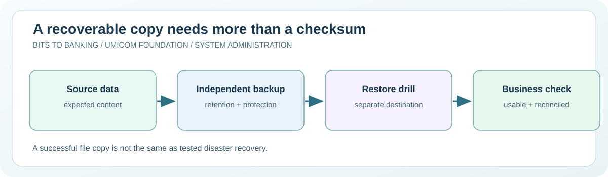

# Chapter 57 — Design backup retention and recovery evidence

**System Administration From Zero · Stage 4 — Managed Services and Recovery**  
**Author:** Sammy Hegab · Umicom Foundation  
**Study time:** 65–85 minutes  
**Before starting:** Chapters 14, 33 and 41: creating a practice backup and performing a restore  
**Safety level:** observation-only on real systems; any practice writes are confined to a folder owned by the learner.

## What you will achieve

By the end of this chapter, you will be able to explain **design backup retention and recovery evidence**, identify the difference between an observation and a change, and interpret at least one Windows and one Linux administration result. You will also be able to describe the evidence that an authorised Umicom support engineer would need before taking action.

## Why this matters in everyday computing

A backup copy is useful only if it still exists when needed and contains the information the user expects. Backup strategies therefore include where copies are stored, which copies are retained, how access is controlled and how restoration is tested. An old backup may lack recent edits; a checksum may confirm byte equality without proving a document is useful.

This lesson uses only the learner's own practice folder. We will verify files and write a simple inventory. We will not read, copy or remove data belonging to another user, and we will not connect to cloud storage, a NAS or a production database without explicit permission.

## A mental model you can remember

Imagine keeping important class notes. One copy in your school bag can be damaged or lost. A second copy in the same bag does not protect against losing the entire bag. Keeping a copy elsewhere helps, but only if you can open it when needed. The familiar 3-2-1 principle is a useful starting point: three copies, on two types of media, with one off-site; modern policies may additionally require immutability, offline isolation and tested recovery.



## New words, without jargon

| Term | Meaning |
|---|---|
| **Retention** | How long a backup remains available before approved expiry. |
| **Recovery point objective (RPO)** | The maximum acceptable amount of data loss measured backward in time. |
| **Recovery time objective (RTO)** | The targeted time to restore an acceptable service. |
| **Integrity hash** | A digest that helps compare file bytes when produced and trusted appropriately. |
| **Immutable backup** | A backup protected from unauthorised modification or deletion under a defined policy. |
| **Restore drill** | A planned test that recovers data and checks it can be used. |

## Windows practical lesson — PowerShell 7

Open **Windows Terminal → PowerShell**, or search for **PowerShell 7**. Type only the commands inside each box; the example `PS C:\...>` prompt is not part of a command. Unless a step explicitly says otherwise, use your normal non-administrator account. The commands are interactive teaching instructions, not a `.ps1` script.

### Step 1 — Prepare a private practice directory

```powershell
New-Item -ItemType Directory -Force -Path "$HOME\UmicomLearning\BackupStudy"
```

**Expected result:** The folder is created if absent; existing practice material is retained.

**What it means:** Use the learner's home folder rather than a shared C:\ system directory.

**If it looks different:** If your computer restricts your home folder, choose another authorised location.

### Step 2 — Write a harmless practice note

```powershell
Set-Content -LiteralPath "$HOME\UmicomLearning\BackupStudy\notes.txt" -Value 'Umicom Notes practice record - version 1'
```

**Expected result:** A small text file is created in the practice directory.

**What it means:** Set-Content overwrites a file of the same name. Only run this command in the dedicated training directory and after checking for an existing practice file.

**If it looks different:** If you want to preserve a previous practice note, choose a new filename before writing.

### Step 3 — Copy to a second named practice file

```powershell
Copy-Item -LiteralPath "$HOME\UmicomLearning\BackupStudy\notes.txt" -Destination "$HOME\UmicomLearning\BackupStudy\notes-copy.txt"
```

**Expected result:** The second file appears; this teaches a copy, not a full backup strategy.

**What it means:** Both files are on the same filesystem and may be lost together. A genuine backup has independent failure boundaries.

**If it looks different:** If notes-copy.txt already exists, inspect it and choose a new destination instead of using -Force.

### Step 4 — Compare hashes before a restore

```powershell
Get-FileHash -Algorithm SHA256 -LiteralPath "$HOME\UmicomLearning\BackupStudy\notes.txt","$HOME\UmicomLearning\BackupStudy\notes-copy.txt" | Select-Object Path, Hash
```

**Expected result:** Both hashes should match when the two files contain identical bytes.

**What it means:** This supports byte equality; it does not establish that the file was complete or that a database snapshot is consistent.

**If it looks different:** If hashes differ, do not overwrite the source. Investigate which copy contains the expected content.

## Linux practical comparison

On a Linux computer or an authorised virtual machine, open a terminal. These are **Bash-compatible commands**; do not type the `$` prompt. A minimal container, Chromebook or non-systemd distribution may have a different set of tools. A missing optional tool should be recorded rather than bypassed.

### Linux step 1 — Create a private practice directory

```bash
mkdir -p "$HOME/UmicomLearning/BackupStudy"
```

**Expected result:** A directory is available under your home folder.

**Interpretation:** The directory should contain only the training files you own.

### Linux step 2 — Create a practice note

```bash
printf '%s\n' 'Umicom Notes practice record - version 1' > "$HOME/UmicomLearning/BackupStudy/notes.txt"
```

**Expected result:** The note contains one line of fictional text.

**Interpretation:** Redirection overwrites an existing file, so perform this only in your known practice folder.

### Linux step 3 — Copy and compare fingerprints

```bash
cp "$HOME/UmicomLearning/BackupStudy/notes.txt" "$HOME/UmicomLearning/BackupStudy/notes-copy.txt" && sha256sum "$HOME/UmicomLearning/BackupStudy/notes.txt" "$HOME/UmicomLearning/BackupStudy/notes-copy.txt"
```

**Expected result:** Two identical SHA-256 values appear if the copied bytes match.

**Interpretation:** The && means the checksum step runs only when the copy succeeds. Neither command provides offsite redundancy.

## Worked support scenario — Umicom Notes

A volunteer maintains a fictional course catalogue with daily changes. The backup plan keeps last week's copy and yesterday's copy, but the restore requirement is to lose no more than one hour. The observed schedule cannot satisfy that RPO. Rather than claiming coverage, the volunteer reports the gap, proposes an approved higher-frequency strategy, and plans a restore drill that tests both content and permissions.

**Evidence record:** In your own words, describe the issue, the observation time, the command used, what you actually saw, what you have *not* proved, and who would approve a change. Avoid copying usernames, credentials, private filenames, IP addresses or confidential logs into public notes.

## Common mistakes and how to correct them

| Misunderstanding | Better interpretation |
|---|---|
| Two copies on one disk satisfy disaster recovery. | One disk failure can remove both copies. |
| A matching checksum proves business correctness. | It proves selected bytes match a reference; a corrupted original can be copied perfectly. |
| Backups can be tested by opening a list of filenames. | A successful restore requires actual usable data and checks against expected results. |

## Guided practice and suggested responses

**Exercise 1.** Choose an RPO and RTO for a fictional school portal.

*Suggested response:* Explain separately how much data loss and downtime are acceptable.

**Exercise 2.** Design a retention sketch.

*Suggested response:* Record a daily, weekly and off-site copy with access controls and a scheduled restore test.

**Exercise 3.** Verify your practice note.

*Suggested response:* Explain the two matching hashes and the limitations of that result.

## Questions for discussion

1. Which part of today's design backup retention and recovery evidence exercise was **read-only**, and how do you know?
2. What does a successful command prove, and what would it *not* prove?
3. Explain **Retention** to somebody who has never opened a terminal.
4. If an expected result does not appear, what evidence would you collect before changing anything?
5. How would you explain this issue to a colleague without exposing private data?

## Connection to Umicom Framework and software engineering

The Data Server owns persistence for Umicom-managed application data, while Framework backup/recovery and audit contracts should govern production evidence. A source-code Git commit is not a substitute for restoring a database, configuration and authorised secrets. No new backup implementation or Python/PowerShell automation is introduced by the lesson.

## Further reading (optional internet access)

- https://learn.microsoft.com/powershell/module/microsoft.powershell.utility/get-filehash
- https://www.cisa.gov/secure-our-world/back-up-your-data

## Learning checkpoint

You are ready to proceed if you can explain **the command, its expected output, the boundary of what it proves, and a safe response to unexpected output**. If the exercise needed unavailable administrator access, record *not performed*; do not mark it as passed.

**Next:** [Chapter 58 — Rehearse restoration and document rollback](./58-rehearse-restoration-and-document-rollback.md).
