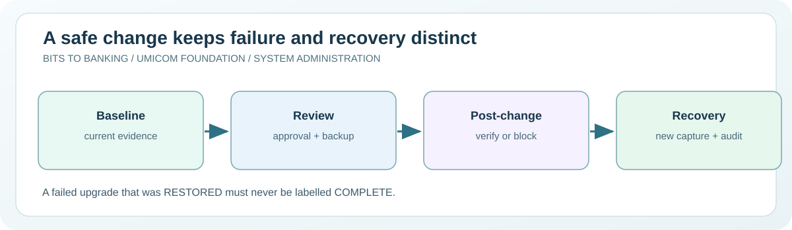

# Chapter 60 — Capstone: plan, review and recover a fictional Umicom Notes change

**System Administration From Zero · Stage 4 — Managed Services and Recovery**  
**Author:** Sammy Hegab · Umicom Foundation  
**Study time:** 95–120 minutes  
**Before starting:** Chapters 37–59 and the Update 40 service-readiness demonstration  
**Safety level:** observation-only on real systems; any practice writes are confined to a folder owned by the learner.

## What you will achieve

By the end of this chapter, you will be able to explain **capstone: plan, review and recover a fictional umicom notes change**, identify the difference between an observation and a change, and interpret at least one Windows and one Linux administration result. You will also be able to describe the evidence that an authorised Umicom support engineer would need before taking action.

## Why this matters in everyday computing

You have learned to locate an operating system, read service status, inspect permissions and network listeners, verify backups and communicate an incident. The final Stage 4 assignment joins those skills into one coherent example rather than twelve isolated commands. The situation is deliberately fictional, but the reasoning mirrors professional administration.

Your team proposes a routine Umicom Notes upgrade. Before beginning, it must confirm an authorised reviewer, backup evidence, a documented recovery route and a baseline in which Notes and storage are ready. After the simulated change, storage checks fail. The safe response is to mark the change for rollback, record an independent restored observation and leave the incident distinct from a successfully completed upgrade. No actual application, service or repository will be modified.

## A mental model you can remember

Imagine a pilot checklist: before departure, confirm the aircraft and route; during flight, observe instruments; if a required safety signal fails, follow the approved contingency rather than pretending the original plan succeeded. For an administrator, each stage has its own evidence: before-change readiness, authorisation, change execution, after-change checks and, if required, restoration checks. A final green label is not credible if intermediate failures were erased.



## New words, without jargon

| Term | Meaning |
|---|---|
| **Change record** | A specific, reviewable description of the proposed work and its identity. |
| **Baseline capture** | A numbered observation of requirements before a change. |
| **Maker/checker** | A model in which one person proposes work and a different authorised person reviews it. |
| **Verification gate** | A condition that must pass before a workflow can move on. |
| **Rollback required** | A state indicating that failed verification needs approved recovery. |
| **Restored** | A state where independently collected evidence shows a recovery condition, not a claim the upgrade succeeded. |

## Windows practical lesson — PowerShell 7

Open **Windows Terminal → PowerShell**, or search for **PowerShell 7**. Type only the commands inside each box; the example `PS C:\...>` prompt is not part of a command. Unless a step explicitly says otherwise, use your normal non-administrator account. The commands are interactive teaching instructions, not a `.ps1` script.

### Step 1 — Open the learning repository

```powershell
Set-Location "C:\umicom\Umicom-Bits2Banking"
```

**Expected result:** The current folder becomes the learning repository if it was cloned there.

**What it means:** If your own repository has a different location, use it. No Git checkout or pull is required for this capstone.

**If it looks different:** Stop if the folder does not exist; do not create an empty imitation of the repository.

### Step 2 — Check Git state without changing it

```powershell
git status --short
```

**Expected result:** No output indicates the working tree is clean; otherwise edited paths are listed.

**What it means:** This is a source-control observation, not an application health check.

**If it looks different:** Do not stage, reset or clean files simply to make the output empty.

### Step 3 — Prepare the C23 laboratory

```powershell
cmake -S ".\labs\native\maintenance-review" -B ".\output\learning-build\maintenance-review" -G Ninja -DCMAKE_C_COMPILER="C:\msys64\ucrt64\bin\gcc.exe" -DBUILD_TESTING=ON
```

**Expected result:** CMake reports configuration and generation success if Updates 39–41 and the compiler are present.

**What it means:** This creates build output only; no Windows service or Git repository history is changed.

**If it looks different:** A missing earlier C23 laboratory must be merged rather than bypassed with placeholder code.

### Step 4 — Build the executable model

```powershell
cmake --build ".\output\learning-build\maintenance-review" --parallel 2
```

**Expected result:** Ninja compiles the three linked C23 teaching libraries and their test targets.

**What it means:** The `--parallel 2` limit keeps resource use moderate for older laptops.

**If it looks different:** Do not continue to test if compilation fails; first read the actual error.

### Step 5 — Run the verification suite

```powershell
ctest --test-dir ".\output\learning-build\maintenance-review" --no-tests=error --output-on-failure
```

**Expected result:** All registered tests should pass; a failure means the batch is not accepted on that machine.

**What it means:** The suite includes previous evidence/readiness regression cases and the new maintenance-review cases.

**If it looks different:** Not Run is not the same as Passed. Preserve the output when asking for assistance.

### Step 6 — Run the fictional incident demonstration

```powershell
& ".\output\learning-build\maintenance-review\btb-maintenance-review-demo.exe"
```

**Expected result:** The demo reports ROLLBACK_REQUIRED, then RESTORED with distinct capture identifiers.

**What it means:** RESTORED is not COMPLETE: it means the simulated recovery checks passed, not that the upgrade succeeded.

**If it looks different:** The executable never restores files or changes a real service.

## Linux practical comparison

On a Linux computer or an authorised virtual machine, open a terminal. These are **Bash-compatible commands**; do not type the `$` prompt. A minimal container, Chromebook or non-systemd distribution may have a different set of tools. A missing optional tool should be recorded rather than bypassed.

### Linux step 1 — Configure the native laboratory

```bash
cmake -S labs/native/maintenance-review -B output/learning-build/maintenance-review -G Ninja -DCMAKE_C_COMPILER=gcc -DBUILD_TESTING=ON
```

**Expected result:** CMake creates a build directory when the prerequisites are present.

**Interpretation:** Run from the checked-out Bits2Banking root.

### Linux step 2 — Build the model

```bash
cmake --build output/learning-build/maintenance-review --parallel 2
```

**Expected result:** The C23 sources are compiled.

**Interpretation:** No system service or package manager is involved.

### Linux step 3 — Run the complete training suite

```bash
ctest --test-dir output/learning-build/maintenance-review --no-tests=error --output-on-failure
```

**Expected result:** Registered CTest cases pass or report exact failures.

**Interpretation:** Record the test count and compiler version as acceptance evidence.

## Worked support scenario — Umicom Notes

A fictional maintenance ticket reads: ‘Upgrade Umicom Notes document storage on Friday after class’. The operator records a 40-character sample revision, a READY baseline and a verified practice backup. A different reviewer label approves the *training plan*. After the hypothetical change, the storage check becomes FAILURE and the Notes service is blocked through its dependency. The model refuses to mark the upgrade COMPLETE. After an independently captured passing restoration, the record becomes RESTORED. The tutor concludes that the recovery path was modelled successfully, while the upgrade remains unsuccessful and real host acceptance remains untested.

**Evidence record:** In your own words, describe the issue, the observation time, the command used, what you actually saw, what you have *not* proved, and who would approve a change. Avoid copying usernames, credentials, private filenames, IP addresses or confidential logs into public notes.

## Common mistakes and how to correct them

| Misunderstanding | Better interpretation |
|---|---|
| Passing native tests proves production services were changed successfully. | These tests cover an offline state machine, not a host upgrade or a recovered bank database. |
| The same person can always approve their own change. | Separation of duties may be required; the classroom model uses distinct labels but does not authorise anyone. |
| Restored means the new version is accepted. | Restored records a recovery condition after a failed update, which must stay visible. |

## Guided practice and suggested responses

**Exercise 1.** Write your complete change request.

*Suggested response:* Include the fictional workload, scope, source revision, backup, reviewer, before/after checks, failure condition and recovery plan.

**Exercise 2.** Run the native C23 test cases.

*Suggested response:* Explain the difference between a failed verification test and a simulation in which a failed service is correctly detected.

**Exercise 3.** Present a one-page support report.

*Suggested response:* Describe what the offline lab proves, what it cannot prove, and which steps would need real authorised Framework/OS validation later.

## Questions for discussion

1. Which part of today's capstone: plan, review and recover a fictional umicom notes change exercise was **read-only**, and how do you know?
2. What does a successful command prove, and what would it *not* prove?
3. Explain **Change record** to somebody who has never opened a terminal.
4. If an expected result does not appear, what evidence would you collect before changing anything?
5. How would you explain this issue to a colleague without exposing private data?

## Connection to Umicom Framework and software engineering

The standalone educational C23 code must not become a parallel production change manager. Umicom Framework already owns module supervision, service configuration, security, audit and delivery contracts. The programme teaches the decision model through copied readiness evidence, preserves earlier source and leaves the actual Framework, Applications, Kernel and OS repositories untouched.

## Further reading (optional internet access)

- https://learn.microsoft.com/windows-server/administration/windows-commands/sc
- https://www.freedesktop.org/software/systemd/man/latest/systemctl.html

## Learning checkpoint

You are ready to proceed if you can explain **the command, its expected output, the boundary of what it proves, and a safe response to unexpected output**. If the exercise needed unavailable administrator access, record *not performed*; do not mark it as passed.

**Next:** Use the Stage 4 workbook and the accompanying C23 maintenance-review laboratory before progressing to professional platform administration.
