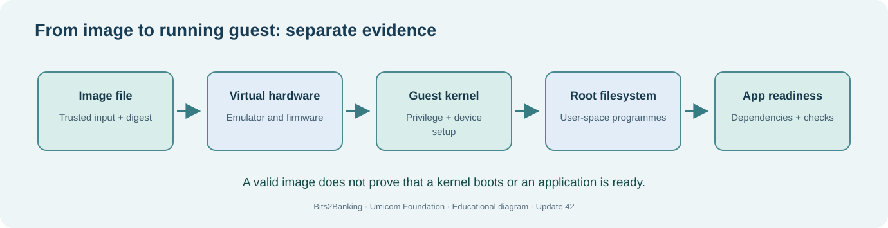

# Chapter 62 — Prepare a disposable virtual-machine laboratory

**Bits to Banking · System Administration From Zero · Stage 5 · Umicom Foundation**  
**Audience:** First-time computer users, older learners, new contributors and returning professionals.  
**Practical mode:** Read-only observation by default; any exercise that writes uses a clearly identified private training directory.  
**Implementation policy:** New Umicom executable functionality uses C23 or Assembly. PowerShell and Linux terminal commands here are interactive instructions, not implementation scripts.

## The problem we are solving

**What should be checked before downloading an operating-system image or making a virtual disk?**

A safe VM laboratory begins with a **plan**, not an installation command. Choose a host folder you own, a trustworthy operating-system source, a reasonable memory budget, a virtual disk that contains no personal data, and a method of saving your progress. Keep a plain-text record of the image filename, its download source, the published checksum if one exists, the guest architecture, and when the image was acquired.

An **ISO image** is commonly a representation of installation media. A **virtual disk image** is where a guest stores its installed system and data. These are different objects. An ISO is often read-only in normal use. A guest disk is mutable and should be a separate file created for practice. A **checksum** can detect accidental corruption; comparing a hash with a checksum displayed on the same untrusted page does not, by itself, prove origin or authenticity. Prefer the distributor's official download and verification instructions.

Avoid enabling host-folder sharing, USB passthrough, clipboard integrations or bridged networking by default. Every additional connection gives the guest access to more of the real system. You can enable a specific capability after understanding and approving it.



## Words you need before you continue

- **ISO image** — A file containing installation-media content.
- **Virtual disk** — A file the guest sees as a disk drive.
- **SHA-256** — A cryptographic digest used to compare file contents.
- **Network mode** — A setting controlling how the guest connects to networks and the host.

## Worked Umicom example

A trainee plans a small guest used to test a fictional Umicom Notes service. They write a one-page checklist: host architecture x86-64; approved guest OS; download hash recorded; private virtual disk; no shared folders; disposable account; snapshots and backups clearly distinguished. The checklist itself prevents accidental installation onto the family computer.

## Before touching your computer

Read each command all the way through. Check the directory or filename first. A **command** is something you type in the terminal; the command output is the evidence you interpret. If a step requires a file or application that is not installed, record **not available** and continue with the conceptual part. Do not invent a result and do not try a more powerful command merely to make the exercise appear to pass.

> **Safety boundary:** Never use a bare disk device path (`/dev/sda`, `\.\PhysicalDrive0`) in an educational exercise. Do not execute commands that partition, format or write a real disk. Ask an adult or system owner before changing firmware settings on a shared computer.

## Windows — PowerShell 7, step by step

Start Windows Terminal and select **PowerShell**, or use **PowerShell 7** directly. Confirm with `$PSVersionTable.PSVersion`. The prompt ending in `>` is where you enter the command; **do not type the prompt itself**. Commands are shown exactly, except for placeholders such as `YOUR_APPROVED_LINUX.iso`, which must be replaced with a real filename before execution.

### 1. Prepare a named practice location

```powershell
Set-Location "$HOME"
New-Item -ItemType Directory -Path "UmicomLearning" -Force | Out-Null
New-Item -ItemType Directory -Path "$HOME\UmicomLearning\VMs" -Force | Out-Null
Get-ChildItem "$HOME\UmicomLearning"
```

**Expected result and interpretation:** The VMs folder exists beneath your own profile. No system directory or service was changed.

### 2. Check an image only if you have obtained it safely

```powershell
Test-Path "$HOME\Downloads\YOUR_APPROVED_LINUX.iso"
Get-FileHash -Algorithm SHA256 -LiteralPath "$HOME\Downloads\YOUR_APPROVED_LINUX.iso"
```

**Expected result and interpretation:** Run the second command only when the first returns True and replace the placeholder with a real filename. Compare the hash against the distributor’s official value.


## Linux — terminal, step by step

Open the distribution's Terminal application. The examples assume an ordinary, non-root account. Linux paths use `/` and case-sensitive names on most filesystems; a Windows path beginning `C:\` must not be pasted unchanged into Linux commands.

### 1. Prepare a private workspace

```bash
mkdir -p "$HOME/UmicomLearning/VMs"
ls -ld "$HOME/UmicomLearning/VMs"
```

**Expected result and interpretation:** A private learning location exists. Check the permissions printed by ls.

### 2. Inspect a previously downloaded image

```bash
sha256sum "$HOME/Downloads/YOUR_APPROVED_LINUX.iso"
```

**Expected result and interpretation:** Replace the placeholder; do not run it for a nonexistent path. The digest should match the official download record.


## Guided practice laboratory

1. Create only the practice directory; do not create a disk image yet.
2. Write a checklist with source URL, expected SHA-256, guest architecture, planned RAM, guest disk path and network mode.
3. Identify which checklist values need checking again if the machine changes.
4. Explain why choosing an ISO matching x86-64 does not automatically make it bootable in a RISC-V guest.

**Keep evidence:** Note the date, selected environment, commands entered, expected outcomes and actual outcomes. Omit passwords, tokens, private patient/customer details and unnecessary machine identifiers. A missing or failed step belongs in your report; it is not a reason to hide the error.

## Common problems and how to investigate

| Symptom | Safe investigation |
|---|---|
| Get-FileHash: path does not exist | Check Get-Location, Downloads directory and exact filename. No need to use administrator privileges. |
| Published hash does not match | Do not boot or install the image. Check the source and redownload from an authoritative publisher. |

Never substitute `git reset --hard`, `git clean -fd`, broad permission changes, service shutdown or force-push for diagnosis. Those operations can discard unrelated work.

## Review questions with suggested answers

1. **What is the difference between ISO and guest disk?**

   *Answer:* The ISO typically provides installation media; the guest disk stores the guest’s changing installation and data.

2. **Why choose a private practice directory?**

   *Answer:* It prevents exercise files from being confused with system data and makes cleanup reviewable.

3. **Does a matching hash prove a file is trustworthy?**

   *Answer:* It proves equality with that hash; the hash source itself must be authenticated.


## How this fits into Umicom

We keep the responsibilities clear. **Umicom Kernel** owns privileged boot and hardware behaviour. **Umicom OS** composes the operating-system environment. **Umicom Framework** owns reusable C23/Assembly services, build, VCS, security and application lifecycle contracts. **Bits2Banking** owns the teaching material and isolated laboratories. A lesson should not be mistaken for proof that a production system is ready.

**Next:** 63 — Understand QEMU and the Umicom Kernel boot boundary.
