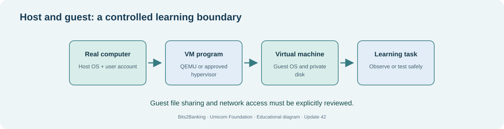

# Chapter 66 — Design safe learner accounts and permission boundaries

**Bits to Banking · System Administration From Zero · Stage 5 · Umicom Foundation**  
**Audience:** First-time computer users, older learners, new contributors and returning professionals.  
**Practical mode:** Read-only observation by default; any exercise that writes uses a clearly identified private training directory.  
**Implementation policy:** New Umicom executable functionality uses C23 or Assembly. PowerShell and Linux terminal commands here are interactive instructions, not implementation scripts.

## The problem we are solving

**Why do professional administrators avoid practising every command as an administrator?**

A **user account** identifies a human or service. **Permissions** specify what that identity may read or change. An **administrator** can usually alter system-wide settings, installed services and sensitive files. These powers are useful for maintenance but inappropriate for routine study. **Least privilege** means granting only the capabilities required for a task.

For a safe Umicom learning laboratory, ordinary commands should run using an ordinary account inside a directory owned by that user. Virtual machines can have distinct learner accounts. A student can practise inspecting files, using Git, compiling C23 and running local demonstrations without system-level privileges.

Identity is not the same as process name. A service may run as a system account or as a restricted user even when its executable is identical. Before changing permissions, ask which identity will execute the process, who owns the files and which exact action is blocked. Changing access for “Everyone” or setting broad executable permissions should never be a reflexive workaround.



## Words you need before you continue

- **Principal** — An identity that can be granted permissions.
- **Least privilege** — Giving an identity only the access it needs.
- **ACL** — Access-control list describing permissions for users and groups.
- **Elevation** — Temporarily gaining stronger privileges for a permitted operation.

## Worked Umicom example

Umicom Notes displays “access denied” when writing to `C:\Program Files`. This does not mean the application needs administrator mode. The right solution is to identify the intended writable user-data location, the calling identity and the Framework path contract.

## Before touching your computer

Read each command all the way through. Check the directory or filename first. A **command** is something you type in the terminal; the command output is the evidence you interpret. If a step requires a file or application that is not installed, record **not available** and continue with the conceptual part. Do not invent a result and do not try a more powerful command merely to make the exercise appear to pass.

> **Safety boundary:** Do not use `sudo`, `runas`, `icacls /grant`, `chmod -R 777`, registry permission changes or account-creation commands as a beginner exercise. Read first; obtain permission for an authorised change later.

## Windows — PowerShell 7, step by step

Start Windows Terminal and select **PowerShell**, or use **PowerShell 7** directly. Confirm with `$PSVersionTable.PSVersion`. The prompt ending in `>` is where you enter the command; **do not type the prompt itself**. Commands are shown exactly, except for placeholders such as `YOUR_APPROVED_LINUX.iso`, which must be replaced with a real filename before execution.

### 1. Identify the current account

```powershell
whoami
whoami /groups
```

**Expected result and interpretation:** You should see your account name and group memberships. This does not change permissions.

### 2. Inspect permissions on your practice folder

```powershell
Get-Acl "$HOME\UmicomLearning" | Format-List Owner, Access
```

**Expected result and interpretation:** The owner and access rules are shown for the named folder. It is safe to stop if the folder does not exist.


## Linux — terminal, step by step

Open the distribution's Terminal application. The examples assume an ordinary, non-root account. Linux paths use `/` and case-sensitive names on most filesystems; a Windows path beginning `C:\` must not be pasted unchanged into Linux commands.

### 1. Read the identity and group memberships

```bash
id
groups
```

**Expected result and interpretation:** UID, primary group and supplementary groups are displayed.

### 2. Inspect a private directory

```bash
ls -ld "$HOME/UmicomLearning"
stat "$HOME/UmicomLearning"
```

**Expected result and interpretation:** Ownership, mode and metadata are reported; no rights are changed.


## Guided practice laboratory

1. Record your current identity privately; do not publish account or group details unnecessarily.
2. Inspect permissions on one folder you own.
3. Explain why an application binary and its user-data directory usually need different write permissions.
4. Design an account policy for a fictional Notes service: read installation files, write only private user data, no administrator privileges.

**Keep evidence:** Note the date, selected environment, commands entered, expected outcomes and actual outcomes. Omit passwords, tokens, private patient/customer details and unnecessary machine identifiers. A missing or failed step belongs in your report; it is not a reason to hide the error.

## Common problems and how to investigate

| Symptom | Safe investigation |
|---|---|
| Get-Acl cannot locate the path | Create or use your own existing practice directory; do not switch to a system folder. |
| Linux group list looks different than Windows | They are different security models. Compare ownership and effective access, not just group names. |

Never substitute `git reset --hard`, `git clean -fd`, broad permission changes, service shutdown or force-push for diagnosis. Those operations can discard unrelated work.

## Review questions with suggested answers

1. **What is least privilege?**

   *Answer:* Allow only the specific operations necessary for the task.

2. **Does access denied mean permissions should be opened widely?**

   *Answer:* No. Diagnose the intended identity and storage location first.

3. **Why avoid compiling as root?**

   *Answer:* Compiler mistakes and build tools would gain unnecessary control over the host.


## How this fits into Umicom

We keep the responsibilities clear. **Umicom Kernel** owns privileged boot and hardware behaviour. **Umicom OS** composes the operating-system environment. **Umicom Framework** owns reusable C23/Assembly services, build, VCS, security and application lifecycle contracts. **Bits2Banking** owns the teaching material and isolated laboratories. A lesson should not be mistaken for proof that a production system is ready.

**Next:** 67 — Configure reproducible C23 toolchains.
