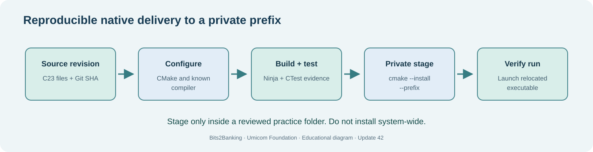

# Chapter 68 — Stage a release in a private directory without system-wide installation

**Bits to Banking · System Administration From Zero · Stage 5 · Umicom Foundation**  
**Audience:** First-time computer users, older learners, new contributors and returning professionals.  
**Practical mode:** Read-only observation by default; any exercise that writes uses a clearly identified private training directory.  
**Implementation policy:** New Umicom executable functionality uses C23 or Assembly. PowerShell and Linux terminal commands here are interactive instructions, not implementation scripts.

## The problem we are solving

**How can learners practise installation while keeping their actual operating system unchanged?**

In software delivery, **staging** means placing a built application into a controlled directory before wider release. A **prefix** specifies the destination root for files installed by a CMake project. A **private installation** places them under a folder you own, not under Windows system directories or Linux `/usr/local`.

The new Update 42 laboratory provides a small executable with an explicit CMake install rule. It deliberately does not register a Windows service, create Start-menu shortcuts, change the registry or write global configuration. Students can observe what CMake copies and prove that the program runs from the staged location.

Before staging, verify the build and tests. After staging, inspect the exact files created and run the relocated demonstration. This is stronger evidence than a console message saying “installed”: a real running executable at the chosen location is a separate observation. It still does not qualify an enterprise installer or prove other operating systems will run the binary.



## Words you need before you continue

- **Stage** — A controlled copy of build output prepared for review.
- **Install prefix** — The root directory where an installer or build tool places files.
- **Relocation** — Running software correctly after moving it to its installation location.
- **Portable** — Designed to run without relying on undeclared machine-specific state.

## Worked Umicom example

A student gets all automated tests passing, stages the teaching executable to `C:\umicom\learning-stage-update42\bin` and launches it by its full path. They then record which executable ran and what it printed. A successful staging exercise is **not** evidence that an Umicom Studio Windows installer bundles every GTK DLL or that Umicom OS boots.

## Before touching your computer

Read each command all the way through. Check the directory or filename first. A **command** is something you type in the terminal; the command output is the evidence you interpret. If a step requires a file or application that is not installed, record **not available** and continue with the conceptual part. Do not invent a result and do not try a more powerful command merely to make the exercise appear to pass.

> **Safety boundary:** The `cmake --install` command writes files. Run it only against the named practice prefix, which you have verified is appropriate. Do not use a system prefix or administrator rights for this exercise.

## Windows — PowerShell 7, step by step

Start Windows Terminal and select **PowerShell**, or use **PowerShell 7** directly. Confirm with `$PSVersionTable.PSVersion`. The prompt ending in `>` is where you enter the command; **do not type the prompt itself**. Commands are shown exactly, except for placeholders such as `YOUR_APPROVED_LINUX.iso`, which must be replaced with a real filename before execution.

### 1. Build the native Update 42 laboratory

```powershell
Set-Location "C:\umicom\Umicom-Bits2Banking"
$env:Path = "C:\msys64\ucrt64\bin;$env:Path"
cmake -S ".\labs\native\deployment-rehearsal" -B ".\output\learning-build\deployment-rehearsal" -G Ninja -DCMAKE_C_COMPILER="C:\msys64\ucrt64\bin\gcc.exe" -DBUILD_TESTING=ON
cmake --build ".\output\learning-build\deployment-rehearsal" --parallel 2
ctest --test-dir ".\output\learning-build\deployment-rehearsal" --no-tests=error --output-on-failure
```

**Expected result and interpretation:** The build finishes and CTest reports the full test count with no failures before the install exercise.

### 2. Stage only inside a named practice prefix

```powershell
Test-Path "C:\umicom\learning-stage-update42"
cmake --install ".\output\learning-build\deployment-rehearsal" --prefix "C:\umicom\learning-stage-update42"
Get-ChildItem "C:\umicom\learning-stage-update42\bin"
```

**Expected result and interpretation:** Check the path first. If it already contains unrelated material, choose a different practice prefix instead of overwriting it.


## Linux — terminal, step by step

Open the distribution's Terminal application. The examples assume an ordinary, non-root account. Linux paths use `/` and case-sensitive names on most filesystems; a Windows path beginning `C:\` must not be pasted unchanged into Linux commands.

### 1. Configure, build and verify

```bash
cmake -S labs/native/deployment-rehearsal -B output/learning-build/deployment-rehearsal -G Ninja -DBUILD_TESTING=ON
cmake --build output/learning-build/deployment-rehearsal --parallel 2
ctest --test-dir output/learning-build/deployment-rehearsal --no-tests=error --output-on-failure
```

**Expected result and interpretation:** The local executable and tests are built and run without `sudo`.

### 2. Stage into your own home directory

```bash
cmake --install output/learning-build/deployment-rehearsal --prefix "$HOME/umicom-learning-stage"
ls -l "$HOME/umicom-learning-stage/bin"
```

**Expected result and interpretation:** A copy of the demonstration appears in the private `bin` folder.


## Guided practice laboratory

1. Confirm CTest passes before the install command.
2. Read the exact destination prefix aloud and check that it is a private training directory.
3. Stage the program, list installed files and run the staged demonstration.
4. Explain how installing to `/usr/local` or `C:\Program Files` would change the safety and permission requirements.

**Keep evidence:** Note the date, selected environment, commands entered, expected outcomes and actual outcomes. Omit passwords, tokens, private patient/customer details and unnecessary machine identifiers. A missing or failed step belongs in your report; it is not a reason to hide the error.

## Common problems and how to investigate

| Symptom | Safe investigation |
|---|---|
| cmake --install: no install target | The CMake project must declare install rules. Check the laboratory’s CMakeLists.txt; do not improvise copying unknown binary dependencies. |
| Staged executable cannot start | Record the exact error, check runtime dependencies and never assume that a successful copy establishes portability. |

Never substitute `git reset --hard`, `git clean -fd`, broad permission changes, service shutdown or force-push for diagnosis. Those operations can discard unrelated work.

## Review questions with suggested answers

1. **What does an install prefix do?**

   *Answer:* Sets the root location for installation outputs.

2. **Should the student use Run as administrator?**

   *Answer:* No, not for a private staging exercise.

3. **Are passed tests enough to claim deployment success?**

   *Answer:* No. Staging, runtime and operational checks provide separate evidence.


## How this fits into Umicom

We keep the responsibilities clear. **Umicom Kernel** owns privileged boot and hardware behaviour. **Umicom OS** composes the operating-system environment. **Umicom Framework** owns reusable C23/Assembly services, build, VCS, security and application lifecycle contracts. **Bits2Banking** owns the teaching material and isolated laboratories. A lesson should not be mistaken for proof that a production system is ready.

**Next:** 69 — Inspect runtime dependencies and relocation.
