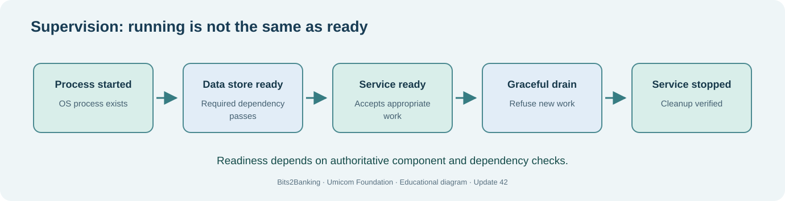

# Chapter 70 — Understand supervised application startup, shutdown and readiness

**Bits to Banking · System Administration From Zero · Stage 5 · Umicom Foundation**  
**Audience:** First-time computer users, older learners, new contributors and returning professionals.  
**Practical mode:** Read-only observation by default; any exercise that writes uses a clearly identified private training directory.  
**Implementation policy:** New Umicom executable functionality uses C23 or Assembly. PowerShell and Linux terminal commands here are interactive instructions, not implementation scripts.

## The problem we are solving

**How do we tell the difference between a process existing and an application being ready to serve users?**

A **process** is a running program. A **service** is a managed background workload. A **service manager** may supervise starting, stopping and restarting services, but not every application is installed as a service. A **health check** asks whether a process or capability is functioning; a **readiness check** asks whether it is safe to accept new work.

Imagine an Umicom Notes API with a local data store. Its process may start successfully but fail to open the store. The service exists, yet it should not report readiness. Conversely, a process intentionally shutting down may remain alive while draining work; its readiness should change before it exits. These are normal states, not contradictions.

Keep **startup order**, **dependency failure** and **graceful shutdown** distinct. The Umicom Framework Master Controller and Slave Controllers own application lifecycle policy. The OS service manager owns process supervision. A GUI button does not override a shared service's authoritative state. The beginner exercises below only inspect, never stop services.



## Words you need before you continue

- **Liveness** — Evidence that a process responds or is running.
- **Readiness** — Evidence that required dependencies are ready to accept work.
- **Service manager** — Operating-system component that supervises configured services.
- **Drain** — Stop accepting new work while completing or cancelling existing work safely.

## Worked Umicom example

The GUI reports “Umicom Notes ready,” but a required file provider failed. The correct report is NOT READY. Update 40’s educational service-readiness graph models this distinction: dependent work must remain blocked until its required provider passes.

## Before touching your computer

Read each command all the way through. Check the directory or filename first. A **command** is something you type in the terminal; the command output is the evidence you interpret. If a step requires a file or application that is not installed, record **not available** and continue with the conceptual part. Do not invent a result and do not try a more powerful command merely to make the exercise appear to pass.

> **Safety boundary:** Do not execute Stop-Service, Restart-Service, systemctl stop, kill, or service restart as an introductory exercise. A shared machine may depend on these workloads.

## Windows — PowerShell 7, step by step

Start Windows Terminal and select **PowerShell**, or use **PowerShell 7** directly. Confirm with `$PSVersionTable.PSVersion`. The prompt ending in `>` is where you enter the command; **do not type the prompt itself**. Commands are shown exactly, except for placeholders such as `YOUR_APPROVED_LINUX.iso`, which must be replaced with a real filename before execution.

### 1. Observe a familiar application process

```powershell
Get-Process | Select-Object -First 10 Name, Id, CPU
```

**Expected result and interpretation:** The sample shows running processes with their identifiers and CPU time. The result alone does not establish readiness.

### 2. Read service state, not change it

```powershell
Get-Service -Name Spooler -ErrorAction SilentlyContinue | Select-Object Name, Status, StartType
```

**Expected result and interpretation:** The Print Spooler service may be absent, stopped or disabled. This is an observation, not a suggested change.


## Linux — terminal, step by step

Open the distribution's Terminal application. The examples assume an ordinary, non-root account. Linux paths use `/` and case-sensitive names on most filesystems; a Windows path beginning `C:\` must not be pasted unchanged into Linux commands.

### 1. Observe user services

```bash
systemctl --user --no-pager list-units --type=service --state=running
```

**Expected result and interpretation:** The user service manager lists running units when available. A minimal container may lack systemd.

### 2. Read current process information

```bash
ps -eo pid,comm,stat --sort=pid | head -n 12
```

**Expected result and interpretation:** Process states are displayed; do not infer application-level health solely from the STAT column.


## Guided practice laboratory

1. Find a running process without changing it.
2. Find a service and note whether its displayed status is running, stopped or unknown.
3. Draw the dependency chain: process alive → data store ready → Notes API ready → user request admitted.
4. Describe how a graceful shutdown changes readiness before the process exits.

**Keep evidence:** Note the date, selected environment, commands entered, expected outcomes and actual outcomes. Omit passwords, tokens, private patient/customer details and unnecessary machine identifiers. A missing or failed step belongs in your report; it is not a reason to hide the error.

## Common problems and how to investigate

| Symptom | Safe investigation |
|---|---|
| systemctl --user cannot connect to bus | The environment may not run systemd as a user manager. Record that the check was unavailable instead of assuming the service is dead. |
| A process shows CPU zero | It may be idle or waiting. CPU time alone is not a failure diagnosis. |

Never substitute `git reset --hard`, `git clean -fd`, broad permission changes, service shutdown or force-push for diagnosis. Those operations can discard unrelated work.

## Review questions with suggested answers

1. **Does Running mean Ready?**

   *Answer:* No; a service may lack required dependencies.

2. **What does drain mean?**

   *Answer:* Stop new admissions and resolve existing work under the component’s ownership policy.

3. **Why have one controller responsible for lifecycle?**

   *Answer:* So multiple views cannot independently and inconsistently change authoritative service state.


## How this fits into Umicom

We keep the responsibilities clear. **Umicom Kernel** owns privileged boot and hardware behaviour. **Umicom OS** composes the operating-system environment. **Umicom Framework** owns reusable C23/Assembly services, build, VCS, security and application lifecycle contracts. **Bits2Banking** owns the teaching material and isolated laboratories. A lesson should not be mistaken for proof that a production system is ready.

**Next:** 71 — Diagnose a failed launch and choose safe recovery.
