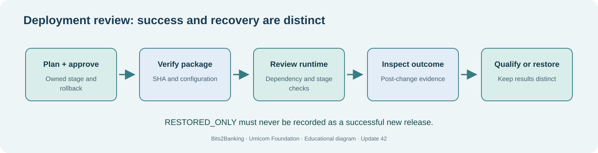

# Chapter 71 — Diagnose a failed launch and plan recovery without guesswork

**Bits to Banking · System Administration From Zero · Stage 5 · Umicom Foundation**  
**Audience:** First-time computer users, older learners, new contributors and returning professionals.  
**Practical mode:** Read-only observation by default; any exercise that writes uses a clearly identified private training directory.  
**Implementation policy:** New Umicom executable functionality uses C23 or Assembly. PowerShell and Linux terminal commands here are interactive instructions, not implementation scripts.

## The problem we are solving

**What should you do when an installed application fails immediately or starts but is unusable?**

A professional incident investigation starts with the earliest reliable evidence. Record **what was attempted**, **which executable and revision were involved**, **what actually happened**, and **which stage failed**. Avoid making multiple changes at once; otherwise you cannot tell which action helped or harmed.

Classify the failure: (1) command/executable not found, (2) loader cannot find a library, (3) application initialisation fails, (4) a dependency is unavailable, (5) the program works but its interface is unusable, or (6) tests fail despite a successful launch. Each category has different evidence and a different owner.

A **rollback** is not simply copying an old file over a new file. It requires a known earlier release, compatible state, a safe change procedure and independent post-recovery checks. In a database-backed system, schema and data compatibility can prevent a trivial binary rollback. Our lessons practise planning and evidence collection, not automatic restoration of real services.



## Words you need before you continue

- **Incident** — An unexpected condition affecting a service or expected operation.
- **Root cause** — The underlying reason for a failure, distinguished from an observed symptom.
- **Mitigation** — An action that limits impact before a full repair.
- **Rollback** — A controlled return to an approved earlier state, verified afterward.

## Worked Umicom example

Umicom Studio fails when launched by desktop icon. Its debug-shell launch works because a toolchain folder is on PATH. Record the exact launch method, environment differences and missing DLL message. Fix packaging in the shared Framework and verify by double-click after installing a tested release; do not instruct every user to use PowerShell.

## Before touching your computer

Read each command all the way through. Check the directory or filename first. A **command** is something you type in the terminal; the command output is the evidence you interpret. If a step requires a file or application that is not installed, record **not available** and continue with the conceptual part. Do not invent a result and do not try a more powerful command merely to make the exercise appear to pass.

> **Safety boundary:** Do not solve a failing launch by disabling antivirus, relaxing directory permissions, deleting configuration, force-resetting Git or overwriting runtime DLLs. Escalate changes to the responsible system owner.

## Windows — PowerShell 7, step by step

Start Windows Terminal and select **PowerShell**, or use **PowerShell 7** directly. Confirm with `$PSVersionTable.PSVersion`. The prompt ending in `>` is where you enter the command; **do not type the prompt itself**. Commands are shown exactly, except for placeholders such as `YOUR_APPROVED_LINUX.iso`, which must be replaced with a real filename before execution.

### 1. Record the currently selected executable

```powershell
Get-Command pwsh, git, cmake -ErrorAction SilentlyContinue | Select-Object Name, Source
```

**Expected result and interpretation:** This records selected tool paths and can reveal an unexpected installation.

### 2. Inspect recent Application events without changing Windows

```powershell
Get-WinEvent -LogName Application -MaxEvents 8 -ErrorAction SilentlyContinue | Select-Object TimeCreated, Id, ProviderName, LevelDisplayName
```

**Expected result and interpretation:** Any visible recent events may help establish a timeline. Absence of an event is not proof that no failure occurred.


## Linux — terminal, step by step

Open the distribution's Terminal application. The examples assume an ordinary, non-root account. Linux paths use `/` and case-sensitive names on most filesystems; a Windows path beginning `C:\` must not be pasted unchanged into Linux commands.

### 1. Read recent user journal records

```bash
journalctl --user -n 12 --no-pager
```

**Expected result and interpretation:** When a user journal is available, the most recent entries appear. Logs are evidence, not permission to take action.

### 2. Inspect a trusted executable path

```bash
command -v cmake
file "$(command -v cmake)"
```

**Expected result and interpretation:** The tool and file type are reported if the commands are available.


## Guided practice laboratory

1. Write an incident report for a fictional Notes executable that cannot find a DLL.
2. Identify the likely failure stage (loader before application main).
3. List the non-destructive checks you would run first: path, revision, imports, private stage and event logs.
4. Propose a rollback plan with a named baseline and independent readiness verification.

**Keep evidence:** Note the date, selected environment, commands entered, expected outcomes and actual outcomes. Omit passwords, tokens, private patient/customer details and unnecessary machine identifiers. A missing or failed step belongs in your report; it is not a reason to hide the error.

## Common problems and how to investigate

| Symptom | Safe investigation |
|---|---|
| No obvious event log entry | Look for process output, program-specific logs and build provenance. An absent log is still useful evidence but not closure. |
| Old version also fails | The root cause may be a shared dependency, data incompatibility or environment condition; do not claim a successful rollback. |

Never substitute `git reset --hard`, `git clean -fd`, broad permission changes, service shutdown or force-push for diagnosis. Those operations can discard unrelated work.

## Review questions with suggested answers

1. **Which error should be investigated first?**

   *Answer:* The earliest reliable failure at a specific boundary, not simply the last message on screen.

2. **Does restoring a binary prove a service is recovered?**

   *Answer:* No. Run independent functional/readiness checks.

3. **Why record exact revision IDs?**

   *Answer:* So the reported behaviour can be reproduced against known code and dependency versions.


## How this fits into Umicom

We keep the responsibilities clear. **Umicom Kernel** owns privileged boot and hardware behaviour. **Umicom OS** composes the operating-system environment. **Umicom Framework** owns reusable C23/Assembly services, build, VCS, security and application lifecycle contracts. **Bits2Banking** owns the teaching material and isolated laboratories. A lesson should not be mistaken for proof that a production system is ready.

**Next:** 72 — Capstone: staged Umicom Notes deployment.
