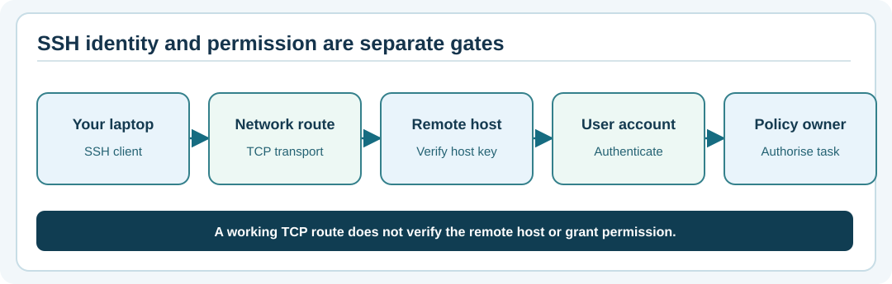

# Chapter 75 — SSH clients, host keys and safe first contact

**Bits to Banking · System Administration From Zero · Stage 6 · Umicom Foundation**  
**Prerequisite:** Chapters 73–74.  
**Safety:** Do not connect to an unknown host. Only use an authorised training server whose identity was independently provided.

## What SSH actually provides

**Secure Shell (SSH)** is a protocol commonly used for secure terminal sessions, file transfer and controlled administration. An SSH client (such as `ssh`) runs on your computer; a server such as `sshd` runs on the remote host. SSH encrypts their conversation, but encryption alone is insufficient if the client connects to an impostor.

For that reason, the server presents a **host key**, and the client associates the host's identity with that key. The short fingerprint displayed by SSH helps an administrator compare the host's key with a trusted value obtained **through a separate reliable channel**, such as a secured asset register or direct confirmation from the authorised owner. Merely copying a fingerprint from the same unverified connection does not independently establish identity.



## Terms that are often confused

| Term | What it proves or represents |
|---|---|
| SSH **host key** | Identity of the remote SSH server, when independently verified. |
| User **authentication key** | Your own account authentication key pair, if that method is enabled. |
| `known_hosts` | Your client's remembered host-key observations. It is not the server's user database. |
| `authorized_keys` | One server-side mechanism permitting specific public keys for a user. |
| Password / passphrase | A secret that may authenticate an account or protect a private key. |

Host authentication occurs before you should trust a remote login prompt. If a known host's key changes unexpectedly, **stop**. It can mean a legitimate server rebuild, an administrator-initiated rotation, a DNS problem or an attempted interception. Do not automatically bypass the warning.

## Windows PowerShell — practise without connecting

**Step 1.** See whether the OpenSSH client is available:

```powershell
Get-Command ssh, ssh-keygen -ErrorAction SilentlyContinue |
    Select-Object Name, Source
ssh -V
```

**Expected:** Executable paths and a version if installed. You need not enable the *OpenSSH Server* Windows feature for this lesson.

**Step 2.** Ask SSH to display how it would interpret a fictional destination **without opening a network connection**:

```powershell
ssh -G learner@notes.training.invalid |
    Select-String -Pattern '^(hostname|user|port|stricthostkeychecking) '
```

`-G` prints the effective configuration and exits. This example uses a non-real `.invalid` domain. Config values reflect your installed OpenSSH and user configuration. Do not publish the full output if it contains private paths or host aliases.

**Step 3.** If you already have a `known_hosts` file, find its path but do not alter it:

```powershell
Test-Path "$HOME\.ssh\known_hosts"
```

No file is required for completion. Absence is normal on a machine that has never made a trusted SSH connection.

## Linux terminal — read configuration

```bash
command -v ssh
ssh -V
ssh -G learner@notes.training.invalid | grep -E '^(hostname|user|port|stricthostkeychecking) '
```

These commands use your current SSH configuration. Never replace a known host-key mismatch with `-o StrictHostKeyChecking=no`, and never delete `known_hosts` wholesale as a workaround.

## Optional instructor-supervised connection

Only after an instructor supplies an actual approved hostname, expected host-key fingerprint, and a student account, the command shape is:

```powershell
ssh student@APPROVED_TRAINING_HOST
```

`APPROVED_TRAINING_HOST` is a placeholder; **do not paste this line unchanged and expect a login**. If prompted to trust a new host, independently compare its fingerprint with the approved one. If they differ or the trusted fingerprint is unknown, cancel. Successful host verification does not grant permission to use `sudo` or change configuration.

## Why `ssh-keyscan` is not enough

`ssh-keyscan` can fetch what a network endpoint *claims* is its host key. The tool does not prove the response came from the intended host. It may be useful to inventory keys once independent trust exists, but it must not be used alone to suppress the first-connection identity check.

## Practice and expected answers

Describe the difference between an SSH client's identity and the server's host identity. Explain what you would do if the connection reports **REMOTE HOST IDENTIFICATION HAS CHANGED**. Correct answer: stop, record the observed warning without sensitive values, contact the responsible operator through a separate channel, and follow an approved host-key rotation procedure. Do not delete all known host keys.

**Next:** Chapter 76 — protecting SSH authentication keys in a private practice directory.
