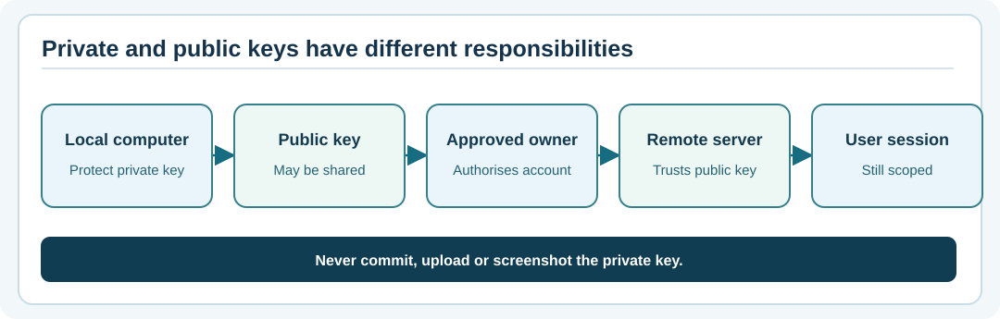

# Chapter 76 — SSH public keys, private keys and safe handling

**Bits to Banking · System Administration From Zero · Stage 6 · Umicom Foundation**  
**Prerequisite:** Chapter 75.  
**Safety:** Create *only a disposable training key* in a separate practice directory you own. Never upload the private key to GitHub.

## Why key pairs are useful

Some SSH deployments authenticate a user with **public-key cryptography**. The user holds a **private key**, and the remote service stores or otherwise trusts the corresponding **public key**. The private key is like a unique signing tool: it must remain secret, even if an attacker knows the public key. A **passphrase** encrypts the private-key file at rest; it does not replace account authorisation, MFA policy or host verification.

A public key is intended for distribution to approved access systems. A private key is not. Never copy it into a repository, a support ticket, a screenshot, a classroom assignment or a chat message.



## Vocabulary

| Word | Meaning |
|---|---|
| **Ed25519** | A widely used public-key signature algorithm supported by modern OpenSSH installations. |
| **Private key** | Secret key material; only you or an approved secure key manager should have access. |
| **Public key** | Corresponding data that can be given to an authorised server. |
| **Fingerprint** | Short identifier derived from a key; compare against a trusted source. |
| **Passphrase** | A secret protecting a locally stored private key. |
| **Key rotation** | Replacing credentials using an authorised, recorded process. |

## Windows — create a disposable example in your own folder

**Step 1.** Open PowerShell 7 and create a learning folder if appropriate:

```powershell
$Practice = Join-Path $HOME "UmicomLearning\ssh-keys"
Test-Path -LiteralPath $Practice
New-Item -ItemType Directory -Path $Practice -Force
Get-Location
```

`New-Item` **writes to your home directory**. Check the chosen path first. It is not a system configuration command.

**Step 2.** Check that the proposed key filename does not exist:

```powershell
$Key = Join-Path $Practice "practice_ed25519"
Test-Path -LiteralPath $Key
Test-Path -LiteralPath "$Key.pub"
```

Both should report `False` before proceeding. If either exists, stop and choose a fresh name rather than overwrite it.

**Step 3.** Create the new practice key pair:

```powershell
ssh-keygen -t ed25519 -f $Key -C "umicom-training-only"
```

OpenSSH may ask for a passphrase twice. Use a passphrase you can remember for this short-lived practice exercise; do not paste a real work credential. If Ed25519 is unsupported by your approved environment, stop and consult the instructor; do not weaken security to complete the worksheet.

**Step 4.** Inspect **only the public key's** fingerprint:

```powershell
ssh-keygen -lf "$Key.pub"
Get-ChildItem -LiteralPath $Practice | Select-Object Name, Length
```

Expected: one `practice_ed25519` private file and one `practice_ed25519.pub` public file. Never run `Get-Content $Key` to paste private-key content into documentation.

## Linux — the same isolation idea

From a normal terminal:

```bash
mkdir -p "$HOME/UmicomLearning/ssh-keys"
ls -la "$HOME/UmicomLearning/ssh-keys"
```

Verify that `practice_ed25519` and `practice_ed25519.pub` are absent. If they are, create the new training pair:

```bash
ssh-keygen -t ed25519 -f "$HOME/UmicomLearning/ssh-keys/practice_ed25519" -C "umicom-training-only"
ssh-keygen -lf "$HOME/UmicomLearning/ssh-keys/practice_ed25519.pub"
```

OpenSSH normally creates private-key files with restrictive permissions. Observe permissions using `ls -l` rather than applying broad recursive changes.

## Do not confuse key creation with server access

A key pair on your laptop does not grant remote access by itself. The **remote owner** must approve the account, key, target machine, and allowed activity. The server's own host key must be checked separately. There is no step in this lesson for copying the practice public key into a real server; that is an authorised administration task for a later supervised environment.

## Git and Umicom warning

Before any `git add -A`, check whether you accidentally created keys inside a Git repository:

```powershell
git status --short
```

This command works only if your current folder is inside a Git repository. Training keys should stay **outside** it. `.gitignore` is not a guarantee that a previously committed secret has disappeared from history. If you accidentally publish a real credential, stop and contact the responsible administrator for immediate revocation and replacement.

## Review questions

1. Which file may an authorised remote account receive? **Answer:** The public key, not the private key.
2. Why use a separate training directory? **Answer:** To prevent accidental Git commits and avoid touching production credentials.
3. Does a passphrase replace permission checks? **Answer:** No.
4. Should you run `ssh-keygen` using Administrator/root for this exercise? **Answer:** No.

**Next:** Chapter 77 — dedicated service identities and least privilege.
