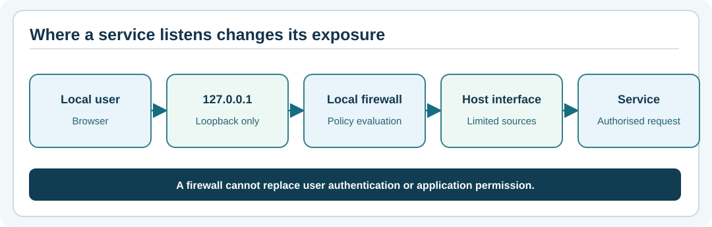

# Chapter 78 — Firewalls, network profiles and controlled exposure

**Bits to Banking · System Administration From Zero · Stage 6 · Umicom Foundation**  
**Prerequisite:** Chapter 74: IP addresses, ports and listeners.  
**Safety:** All commands are observations. Do not disable a firewall or open ports for this exercise.

## A firewall is a policy gate, not an application login

A **firewall** decides which network traffic is permitted according to its policy: addresses, protocols, ports, interfaces and sometimes application identities. It does not normally verify that a human has permission to edit Umicom configuration or access a treasury record. An administrator must consider firewall policy alongside authentication, host identity, service privileges, application controls and logging.

Consider a local HTTP teaching service bound to `127.0.0.1:8765`. Even if a firewall allows external TCP on that port, a loopback-only listener is not a service listening on the public interface. Conversely, a service bound to a wildcard address may be exposed through other routes unless appropriate controls prevent access. **Listener, route and firewall** are separate questions.



## Important words

| Term | Meaning |
|---|---|
| **Inbound rule** | Controls traffic arriving at an interface or host. |
| **Outbound rule** | Controls traffic leaving an interface or host. |
| **Network profile** | Category such as Domain, Private or Public used by Windows firewall policy. |
| **Allowlist** | Explicit set of permitted identities, sources, ports or actions. |
| **Deny by default** | Unlisted requests are refused rather than quietly granted. |
| **Egress** | Traffic leaving a network or device. |

A rule set can be complex and overlapping. The first rule a novice sees is not necessarily the effective rule for a connection.

## Windows PowerShell — inspect without changing settings

**Step 1.** Inspect the firewall profiles:

```powershell
Get-NetFirewallProfile |
    Select-Object Name, Enabled, DefaultInboundAction, DefaultOutboundAction
```

**Expected:** Typically one row for each Windows firewall profile. Do not infer a complete risk assessment from these four columns; third-party filters, enterprise policies and network placement can also affect traffic. Some environments may deny read access to certain settings.

**Step 2.** Check which network profiles Windows currently recognises:

```powershell
Get-NetConnectionProfile |
    Select-Object Name, NetworkCategory, InterfaceAlias
```

**Expected:** Local interface details. A Public network category is not an error; changing it to Private merely to make something reachable is unsafe.

**Step 3.** If you are authorised to inspect a specific rule, query it by its actual name instead of dumping thousands of rules:

```powershell
Get-NetFirewallRule | Select-Object -First 10 DisplayName, Enabled, Direction, Action
```

This is a read-only inventory, not proof that a connection is reachable from a particular source.

## Linux — know your distribution before choosing tools

Different distributions may use `nftables`, `firewalld`, `ufw` or another policy manager. Inspect installed commands first:

```bash
command -v nft
command -v firewall-cmd
command -v ufw
```

An absent command is normal on some systems. Where policy allows read-only inspection by the current account, try:

```bash
nft list ruleset
```

This may return **permission denied**. Record that result rather than automatically escalating with `sudo`. Enterprise firewall policies may also be enforced on a separate gateway or cloud network security group.

## A practical network-exposure decision

Imagine a classroom Notes system that needs to be accessed only from the student's own laptop. The correct solution may be to keep it on loopback and use the local browser. Publishing an open port on a school or office network would add risk without advancing the lesson.

If a team later needs remote access, its change proposal must name the requesting group, approved source addresses, destination interface, exact protocol/port, application authentication, expected logging, expiry and rollback. A firewall change alone must never become the approval for all those concerns.

## Guided exercise

Without changing any settings, list one firewall profile, one local listener from Chapter 74, and whether it binds to loopback, a private address or a wildcard. Write a short assessment with **known** and **unknown** facts. Example: “The service listens on loopback. I have not performed an external reachability test. I cannot claim it is reachable from other devices.”

## Problems and safer answers

| Symptom | Avoid | Better observation |
|---|---|---|
| Connection timed out | Turning the firewall off. | Verify target, DNS, listener, routes and authorised rules separately. |
| `nft` missing | Installing random firewall packages. | Read your distribution's approved policy documentation. |
| Service works on localhost but not a phone | Binding publicly without review. | Determine whether remote access is intended at all. |

## Review questions

1. Does permitting TCP 22 authorise any SSH user to log in? **No:** SSH authentication and OS authorisation still apply.
2. Why does the Public network profile exist? **Answer:** It supplies a security posture suitable for untrusted networks.
3. Should a beginner disable a firewall to test a tutorial? **No.**

**Next:** Chapter 79 — distinguish DNS resolution, routing and TCP connectivity.
