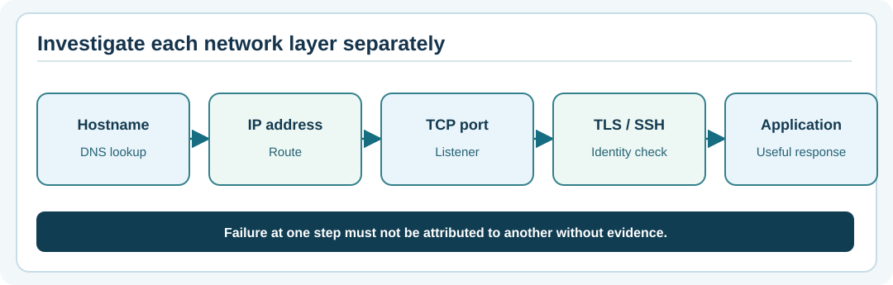

# Chapter 79 — Trace DNS, routes and a TCP connection without guessing

**Bits to Banking · System Administration From Zero · Stage 6 · Umicom Foundation**  
**Prerequisite:** Chapters 74 and 78.  
**Safety:** Use read-only local checks and approved test destinations; do not sweep or probe unrelated networks.

## One symptom can have many different causes

A browser says “This site can't be reached.” The problem might be a mistyped address, DNS lookup failure, network route, firewall restriction, service not listening, TLS certificate error or a functioning service that rejects your application request. Changing one setting without locating the failing stage can make matters worse.

Think of a letter's journey: first find the recipient's address (**DNS**); then find a route to that address (**IP routing**); then establish the intended conversation (**TCP**); then verify the server identity and encryption (**TLS** for HTTPS); finally ask the application to do useful work (**HTTP/service readiness**).



## Vocabulary and evidence

| Stage | What it asks | What it does *not* prove |
|---|---|---|
| DNS | Can a name be resolved to address records? | That the service is up. |
| Routing | Is there a path for packets to the destination? | That the correct application answers. |
| TCP connect | Did a listener accept a connection? | That TLS or application login is valid. |
| TLS | Can the connection establish authenticated encryption? | That the application transaction succeeds. |
| Application response | Did the requested operation return a meaningful result? | That all business processing is healthy. |

## Windows PowerShell — three small read-only checks

**Step 1.** Read a DNS record for a public example domain:

```powershell
Resolve-DnsName example.org -Type A
```

`example.org` is reserved for documentation. An internet connection is required for a live public lookup; if none is available, note *network lookup not run* instead of claiming success.

**Step 2.** Read your computer's routing summary:

```powershell
Get-NetRoute -AddressFamily IPv4 |
    Select-Object -First 12 DestinationPrefix, NextHop, InterfaceAlias
```

A `0.0.0.0/0` route is the general default IPv4 route. You are reading a snapshot, not installing or changing routes.

**Step 3.** Test a known HTTPS port only when internet access is permitted:

```powershell
Test-NetConnection -ComputerName example.org -Port 443
```

If `TcpTestSucceeded` is false, continue diagnosis in order. Do not conclude which intermediate control blocked the connection from that single result.

## Linux — equivalent observations

```bash
getent ahostsv4 example.org
ip -4 route
```

`getent` uses configured name-resolution facilities; `ip route` shows the IPv4 routing table. For a permitted public HTTPS check, one option is:

```bash
curl -I --connect-timeout 5 https://example.org/
```

`curl` may not be installed, and some networks require a proxy. `-I` sends a HEAD request; some servers handle HEAD differently from GET. A successful HTTPS response proves only that this particular request path worked at that moment.

## A useful diagnostic ladder for Umicom Notes

Suppose the Notes teaching website is intended to run locally at `http://127.0.0.1:8765/`. First inspect the process and listening socket on your own computer. Next request that specific loopback URL. If the service is absent, look at its startup output. Do **not** inspect public DNS for `127.0.0.1`, as it is already a numeric address. Do **not** change a firewall rule before checking the listener.

If a later authorised deployment uses a DNS name and HTTPS, also check the certificate host name, expiry and issuing chain (Chapter 80). A reachable port with a mismatched certificate remains a failure, not a partial success to suppress.

## Guided exercise

Write a short incident report for this fictional observation:

> DNS resolves the expected hostname. TCP times out. The operator has not checked the remote listener or the approved firewall policy.

Correct conclusion: DNS was observed working, TCP was not established, and the failure could lie in routes, filters, host reachability or listening state. Request the missing evidence; do not disable the firewall or restart a service on a guess.

## Common mistakes

Avoid assuming `ping` must succeed; many hosts intentionally refuse ICMP echo requests. Avoid treating a DNS address as a trusted identity. Avoid pasting raw diagnostic output publicly when it includes internal names, addresses or network topology.

## Review questions

1. Does DNS resolution prove a service is healthy? **No.**
2. What does a route describe? **How traffic is directed toward an address range.**
3. Why collect evidence in order? **Each step separates plausible failure categories and prevents unnecessary changes.**

**Next:** Chapter 80 — HTTPS certificates, identities and expiry.
