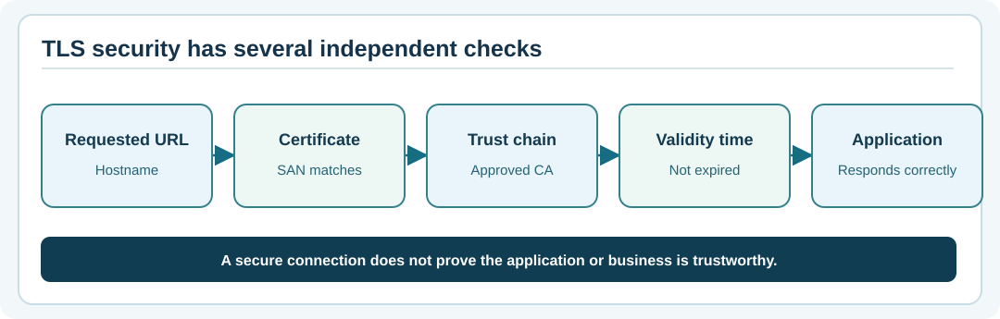

# Chapter 80 — Understand HTTPS, TLS certificates and trust

**Bits to Banking · System Administration From Zero · Stage 6 · Umicom Foundation**  
**Prerequisite:** Chapter 79: DNS, TCP and application responses.  
**Safety:** Inspect public documentation domains or a permitted training endpoint; never disable certificate validation as a shortcut.

## Why a padlock is not the entire security story

When a browser uses an `https://` address, it normally establishes a **Transport Layer Security (TLS)** connection. TLS protects network traffic and, when correctly validated, authenticates the server identity for the requested hostname. A certificate is a signed document binding key information to names and validity dates under a chain of trust. The user's browser or client still needs to enforce hostname matching, certificate validity and trusted issuing authorities.

An HTTPS padlock does **not** prove that the website is honest, authorised to receive your organisation's data or correctly implements Umicom payments. It indicates properties of the connection, not the business or its operator.



## Terms to remember

| Term | Beginner explanation |
|---|---|
| **Certificate** | Signed identity information presented for a service. |
| **Certificate authority (CA)** | Trusted issuer that signs certificates under defined policies. |
| **Common Name / SAN** | Names listed in a certificate; clients primarily use Subject Alternative Name. |
| **Expiry** | Date beyond which a certificate should no longer be accepted as valid. |
| **Private key** | Secret material corresponding to the certificate's public key. |
| **TLS handshake** | Initial exchange that agrees on encryption and establishes identities. |

The SSH host key studied earlier serves a related identity purpose but uses different trust and certificate mechanisms. Do not confuse an SSH host-key fingerprint with a website certificate chain.

## Windows — inspect a known HTTPS URL

Open PowerShell 7 and check that `curl.exe` exists:

```powershell
Get-Command curl.exe -ErrorAction SilentlyContinue
```

Now, **only if external network checks are permitted**, request the HTTP response headers for the public example domain:

```powershell
curl.exe --head --connect-timeout 5 --max-time 15 https://example.org/
```

If it succeeds, `curl.exe` has completed an HTTPS connection under its configured TLS trust policy and returned response headers. A network proxy or security appliance may affect the path. A failure could reflect DNS, TCP, TLS, proxy policy or the HTTP server. Do **not** append `-k` / `--insecure` to silence a certificate error.

For a web browser, inspect the site-information or connection-information panel. Modern browsers present the certificate details differently; look for the actual hostname, issuer, validity dates and security warnings.

## Linux — inspect without saving secrets

```bash
command -v curl
curl --head --connect-timeout 5 --max-time 15 https://example.org/
```

Optionally, if an approved OpenSSL executable is available, a qualified instructor can demonstrate certificate inspection. Be aware that `openssl s_client` reports handshake details but does **not** necessarily fail its process exit code on all certificate-verification errors unless verification options are specified correctly. Do not use its output alone as proof of complete endpoint verification.

## A fictional Umicom example

The Umicom Notes training service is published at `https://notes.example.org` in a lesson diagram. This is a documentation-style name, not an actual deployed service. If the certificate is valid for `www.example.org` but not the requested `notes.example.org`, the connection should fail hostname validation. The correct response is to repair the server certificate or DNS configuration through an approved change—not teach students to ignore warnings.

If a TLS certificate changes during scheduled renewal, retain evidence of the planned change, valid new certificate, service restart (if required), and a fresh connection test. A certificate renewal that disrupts application readiness remains an operational incident even if the new certificate is cryptographically valid.

## Guided exercise

Sketch four gates for an HTTPS connection: resolve the name, connect over TCP, validate TLS identity, then receive an application response. Write a different possible failure for each gate. For TLS, use “certificate expired” or “name mismatch”, not “server down”.

## Troubleshooting table

| Symptom | Safe explanation | Next step |
|---|---|---|
| Certificate has expired | Validity time failed. | Ask the service owner for a controlled renewal. |
| Name mismatch | Certificate does not represent the requested hostname. | Check approved hostname and certificate configuration. |
| `curl: (60)` | Trust or certificate verification problem. | Keep validation enabled; retain the exact error without secrets. |
| HTTPS succeeds but Notes operation fails | Application or business workflow may be broken. | Inspect authorised application health separately. |

## Review questions

1. Why is `curl --insecure` not a routine fix? **It removes server-certificate verification and hides identity failures.**
2. Does HTTPS prove an organisation is trustworthy? **No.**
3. Which name should be checked? **The hostname requested by the client.**

**Next:** Chapter 81 — careful SFTP and approved file transfer.
