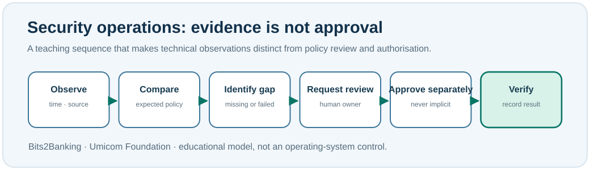

# Chapter 85 — Security operations in everyday system administration

**Bits to Banking · System Administration From Zero · Stage 7**  
**Author:** Sammy Hegab · Umicom Foundation · UK English  
**Prerequisite:** Chapters 73–84 (services, networking and safe remote access).

## Why this matters

An Umicom Notes window may open successfully even though the underlying service is running under an account that has not been reviewed. **Available** does not automatically mean **secure**. A system administrator must distinguish what is observed from what is required and what remains unknown. This chapter is about understanding and investigating, not changing production settings.

**Security operations** is the ongoing work of reviewing identities, permissions, configurations, software updates, monitoring, incidents and recovery. It is not one antivirus product or a one-time installation. Three common goals are **confidentiality** (only authorised readers can see information), **integrity** (information and actions remain correct and traceable) and **availability** (authorised users can use the service). A working service may still fail the first two goals.



## What does an administrator actually do?

An **observation** records what a tool reported at a specific time. A **policy** states what the organisation expects. An **exception** identifies a difference between the two. An **approval** is a decision made by someone authorised to accept or resolve that difference. A program exiting with code zero cannot supply human permission by itself.

For example, suppose a training service reports that it is running, but nobody has inspected its service-account permissions. Record: *service status observed; access review not completed*. Do **not** record *system secure*. A good incident note contains the system, observation time, command or source, actual result, expected result, uncertainty and responsible owner.

## Windows: open PowerShell 7 and observe

1. Open **Windows Terminal**, select a **PowerShell** tab, or find **PowerShell 7** in Windows Search. If only *Windows PowerShell* is available, you can still read most of these commands while preparing to install PowerShell 7.
2. Type one line at a time. Press Enter. These are read-only checks.

```powershell
pwsh --version
Get-Date
whoami
Get-Service | Select-Object -First 5 Name, Status, StartType
```

`Get-Date` is a timestamp. `whoami` prints the local account identity. `Get-Service` lists service observations; your first five entries will differ from another computer. The command does not prove that a remote service is healthy or authorised. If `pwsh` is not recognised, you are likely running an older shell or the new shell is not installed or on PATH; keep reading rather than guessing a corrective system command.

## Linux: open a terminal and observe

```bash
date -Is
id
systemctl --failed --no-pager
```

`id` shows your current identity and groups. `systemctl` applies on distributions with systemd and may be unavailable in a container or another init system. No listed failed units is useful **but not proof that every application works**.

## Guided practice: an Umicom Notes evidence card

On paper or in your personal notes, create columns named *check*, *expected*, *observed*, *time*, and *status*. Add three checks: application process running, access controls reviewed, and a backup independently restored. Where you have not performed a check, enter **Not verified**. The discipline of leaving missing evidence visibly missing is more valuable than inventing a pass.

Imagine the team wants to restart Umicom Bank. Who approves it? Which user-facing business operation will be tested afterwards? What happens if transaction processing remains blocked? These are separate questions from whether the process is alive.

### If a check fails

Do not run PowerShell as Administrator simply to make a warning disappear. Read the error, identify whether the command exists, whether permissions permit the observation and whether the tool targets the correct machine. Do not paste unredacted machine identities or private log data into a public discussion.

## Review questions and suggested answers

**1. What is the difference between a healthy process and a secure service?** A process may be running while permissions, data integrity, dependencies or security controls remain incorrect.

**2. Can an automated check approve changing a bank account?** No. Health evidence and authority are separate. The authorised owner and control process make consequential decisions.

**3. What should you record when a probe is not available?** The command attempted, its actual error or limitation, time, owner and required follow-up. Do not mark the check as passed.

**Umicom connection:** Umicom Framework owns reusable identity, service and observability contracts; Umicom OS composes operating-system services. Bits2Banking provides review exercises, not production authorisation.

**Next:** Chapter 86 — accounts, role changes and controlled offboarding.
