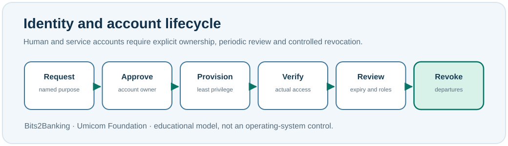

# Chapter 86 — User accounts, role changes and safe offboarding

**Bits to Banking · System Administration From Zero · Stage 7**  
**Prerequisite:** Chapter 85. **Safety:** Do not create, disable, rename or delete real users in this exercise.

## A question from everyday support

A contributor stops working on the Umicom Bank project and joins the education team. Should their former administrative permissions remain active? **No automatic assumption should be made.** Access must follow their current responsibilities, and the responsible owner must review what remains necessary.

An **account** is a digital identity that a computer or application recognises. A **human account** belongs to a person; a **service account** is used by software to perform a limited job; an **emergency account** has special recovery arrangements and should be tightly governed. Access is granted through permissions and roles, not simply because an account exists.



## Understand the account lifecycle

A useful lifecycle is **request → approve → provision → verify → periodically review → disable/revoke**. Administrators also call this *joiner, mover and leaver management*: a newcomer needs initial access, a mover's old permissions must be reassessed, and a leaver's access should be withdrawn promptly under the organisation's rules.

An approval is not just a name typed in a spreadsheet. A serious review records who requested the access, who approved it, the business purpose, the permission scope, when it expires and which evidence confirms the resulting state. Service accounts deserve the same care because an unnoticed scheduled process can stop working if its identity is changed incorrectly.

## Windows PowerShell: inspect without changing

Open PowerShell 7. Run these lines individually:

```powershell
whoami
Get-LocalUser | Select-Object Name, Enabled, LastLogon
Get-LocalGroup | Select-Object -First 8 Name
```

`Get-LocalUser` reads **local** account information only. A corporate Windows machine may also use Active Directory or cloud identities not shown here. The command may be unavailable or restricted on some installations. If that happens, record the limitation rather than claiming that there are no accounts. Account names and logon times can be sensitive: do not publish raw output.

## Linux terminal: inspect without changing

```bash
id
getent passwd | head -n 8
getent group | head -n 8
```

`getent` consults the system's configured identity sources. Output includes system and service entries, not only people who can sign in. An entry in the list does not imply interactive logon permission. `head` limits how much is displayed; it does not change the accounts.

## Worked exercise: the Umicom support role matrix

Draw a table with three fictional identities: `NotesReader`, `NotesMaintainer` and `NotesService`. List permissions *read notes*, *edit training notes*, *approve a deployment* and *access a private database*. Give each identity only those permissions necessary for its stated job. A reader normally cannot approve deployments; a background service does not need a person's broad GitHub permissions. The real approval matrix would be owned by the service and security teams, not by a student.

Next, draw a leaver scenario. The administrator must identify downstream systems, ask the access owner to approve removal, execute changes only under authority, and verify that authorised users and scheduled tasks continue to function. A rushed deletion without dependency analysis can create an outage. A delayed deletion can preserve unnecessary access. Both are control failures.

## Troubleshooting

If you receive **Access denied**, ask which observation was blocked and who owns the account system. Do not use another user's credentials to bypass it. If `Get-LocalUser` displays no domain accounts, remember the tool's scope; do not assume the directory is empty.

## Questions and answers

**Why separate a service identity from a personal account?** To limit privileges, attribute work correctly and reduce the impact of a compromised or departing human account.

**What changes when someone moves teams?** The requested role, justification, approvals and entitlements must be reviewed, including permission removal as well as addition.

**How is disabling different from deleting?** Disabling normally blocks use while retaining a record; deletion removes an identity object, with potentially wider effects. Actual behaviour depends on the identity system and policy.

**Umicom connection:** Repository membership, Framework permissions and OS accounts are separate layers. Having push access to Bits2Banking does not grant permission to change Umicom Bank or operate a production server.

**Next:** Chapter 87 — groups, ACLs and permission review.
