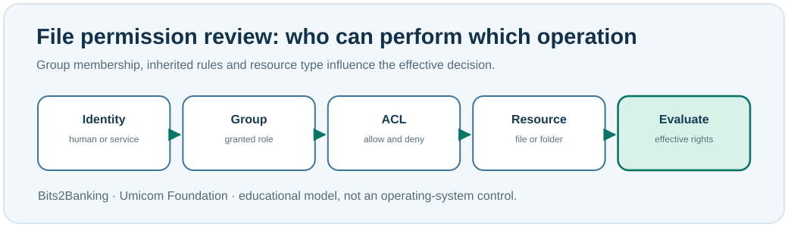

# Chapter 87 — Groups, ACLs and safe permission review

**Bits to Banking · System Administration From Zero · Stage 7**  
**Prerequisite:** Chapter 86. **Safety:** All commands below inspect permissions; they do not change them.

## Why two people may see different behaviour

Two contributors open the same Umicom Notes folder. One can read a file and the other can edit it. The difference may be explained by **access controls**. A **permission** is a permitted operation, such as reading, writing or executing. A **group** gathers identities that share a role. An **access-control list (ACL)** contains rules associated with a resource; the system evaluates them when a user requests access.

On Windows, common NTFS permissions include Read, Modify and Full control. On Linux, a basic listing shows `r` for read, `w` for write and `x` for execute/traverse for the owner, group and others. On a **directory**, `x` controls traversal/search; it does not mean that every file inside is executable. Extended ACLs and other mechanisms can add more conditions than the basic permission characters show.



## Why inheritance matters

Some permissions are inherited from a parent directory. This saves administrators from repeating a rule for thousands of files, but an overly broad inherited rule can unintentionally expose sensitive content. The correct response to **Permission denied** is to establish the intended owner and authorised access. It is not to grant everyone full control or to start every program as an administrator.

For an application repository, Git file history and operating-system permissions are different systems. Git records the contents and selected file attributes of tracked files; it does not model a complete Windows NTFS ACL.

## Windows PowerShell observation

```powershell
whoami /groups
Get-Acl -LiteralPath $HOME | Select-Object Owner, AccessToString
```

The first command shows your security groups; the second reads permissions on your home directory. An abbreviated display may not show every effective permission. You can inspect the whole object using `Format-List *` on your own practice folder, but never publish a raw directory ACL containing personal account identifiers.

## Linux terminal observation

```bash
id -Gn
stat -c '%A %U:%G %n' "$HOME"
command -v getfacl
```

`id -Gn` lists your groups. `stat` shows a concise owner/group and mode summary. `getfacl`, if installed, can show extended filesystem ACLs. Do not assume the command is available on every distribution or that the basic mode includes every access rule.

## A practical permission worksheet

Create a **paper** matrix with rows `training notes`, `release configuration` and `audit report`, and columns Reader, Editor and Approver. Give the minimum privileges for each role. Then ask which changes need review before being made. In a sensitive application, being able to edit a file is not necessarily the same as being authorised to approve a payment or production release.

Write the following fictional incident: *A trainee received Access denied when writing to the release directory. They recorded the intended action, requested authorised access review and continued working on a local training copy.* Explain why this is a better result than changing a system-wide ACL.

## Common mistakes

Avoid `chmod -R 777`, `chown -R` and broad `icacls /grant` examples. They can silently change many objects, expose information or break processes. **Do not run permission-changing commands on the Umicom repositories in this lesson.** A denied write may be a correctly functioning security control.

## Check yourself

**What is a group?** A managed collection of identities to which permissions can be assigned.

**Why can inheritance be both useful and risky?** It reduces repetitive configuration while potentially propagating unintended access.

**Is filesystem write permission enough to authorise a bank transaction?** No. The application also requires business authorisation and audit controls.

**Umicom connection:** Framework authorisation and OS filesystem permissions complement each other. The Data Server remains the authority for Umicom-owned persistent business state.

**Next:** Chapter 88 — configuration, overrides and safe defaults.
