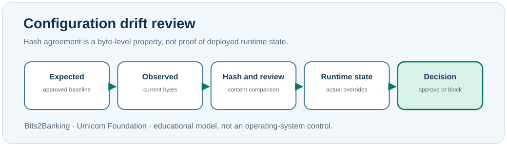

# Chapter 89 — Configuration baselines, drift and SHA-256

**Bits to Banking · System Administration From Zero · Stage 7**  
**Prerequisite:** Chapter 88; keep the `notes-training.conf` practice file available.

## What is a baseline?

A **configuration baseline** is an agreed description of how a service should be set up. **Drift** means that the observed settings no longer match that baseline. This may be the result of an approved change, a mistaken edit, an incorrect environment override or unauthorised activity. A mismatch is evidence of **difference**, not proof of its cause.

Imagine an Umicom Notes service expected to listen only on loopback. A colleague claims its configuration has not changed. How can we test that claim without starting the server or touching production? One method is to compare the **exact bytes** of two approved copies. The SHA-256 algorithm produces a fixed-length hexadecimal digest of file content. If even one byte changes, the digest will almost certainly change. However, matching digests do not prove that the contents are safe or that a process has loaded the file.



## Windows PowerShell 7 — a harmless baseline exercise

Ensure you completed Chapter 88. Then enter these commands, one at a time:

```powershell
$Practice = Join-Path $HOME 'UmicomLearning\SecurityOps'
$Current = Join-Path $Practice 'notes-training.conf'
$Baseline = Join-Path $Practice 'notes-training.baseline.conf'
Test-Path -LiteralPath $Current
Copy-Item -LiteralPath $Current -Destination $Baseline
Get-FileHash -Algorithm SHA256 -LiteralPath $Current
Get-FileHash -Algorithm SHA256 -LiteralPath $Baseline
```

`Test-Path` should return `True`. **Stop if it returns False**, because the copy has no source. After copying, the two hash values should match. We deliberately compare the same practice content. If the baseline filename already exists, inspect it before overwriting it; a trusted production baseline must never be casually overwritten.

Now edit only `notes-training.conf` in Notepad and change `log_level=info` to `log_level=debug`. Save it and repeat the last two commands. The hashes should now differ. The original baseline is unchanged. A SHA-256 mismatch is a reason to investigate, not permission to replace a running service file.

## Linux terminal — the same exercise

```bash
SRC="$HOME/UmicomLearning/SecurityOps/notes-training.conf"
BASE="$HOME/UmicomLearning/SecurityOps/notes-training.baseline.conf"
test -f "$SRC" && echo 'Practice file exists'
cp "$SRC" "$BASE"
sha256sum "$SRC" "$BASE"
```

The copy command replaces the destination if it exists. Use these exact personal practice paths only after inspecting them. Edit your source file with a text editor, recalculate the digests and explain the difference. `sha256sum` is common on GNU/Linux; alternatives may be required elsewhere.

## Why a file digest is only one piece of evidence

Consider three separate questions: **Are the bytes the same?** **Is this the approved configuration?** **Is the running service using this configuration?** The first may be answered with a file digest. The second requires identity, source revision and approval evidence. The third requires controlled runtime inspection, which is not performed by this class.

A stronger record includes the approved commit or release, file path, SHA-256, capture time, configuration schema version, reviewer and environment. Do not put customer identifiers or secret values into public records.

## Practice and suggested answers

Record the two hashes before and after your own edit. Describe the actual byte-level change. **Question:** A file hash matches; can you conclude the service uses those settings? **Answer:** No, because it might load another file or accept a higher-priority override.

**Question:** If a digest differs, should you restore immediately? **Answer:** Not without an authorised plan; first identify whether the change was approved and what processes depend on it.

**Troubleshooting:** If `Get-FileHash` reports a missing path, check `Get-Location`, `Get-ChildItem $Practice` and `Test-Path`. Do not run a blanket file search over confidential directories or use administrator permission to bypass an error.

**Umicom connection:** The Framework owns configuration and deployment verification contracts. A training SHA-256 observation is not a replacement for its approved security, persistence or provenance services.

**Next:** Chapter 90 — controlled updates and patch management.
