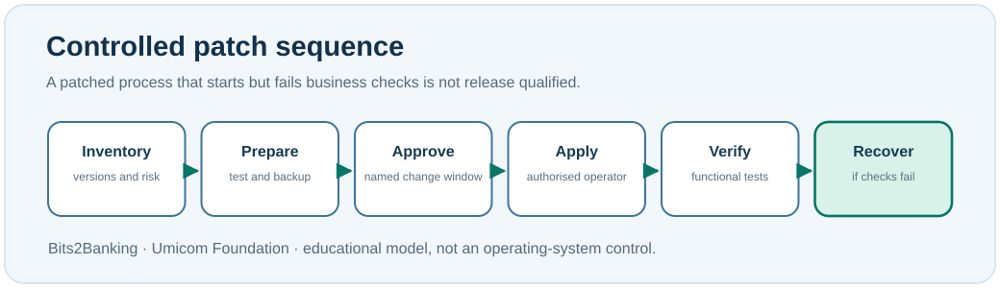

# Chapter 90 — Updates, patches and maintenance windows

**Bits to Banking · System Administration From Zero · Stage 7**  
**Prerequisite:** Chapters 89 and earlier backup/recovery lessons. **Safety:** The exercises display update information; they install nothing.

## Why not immediately upgrade a critical system?

A **patch** is a software change, often made to correct a defect or vulnerability. **Patch management** ensures relevant changes are identified, assessed, tested, approved and applied in an appropriate time frame. Unpatched systems may remain exposed to known security flaws, so avoiding updates altogether is not a safe strategy. On a critical banking or hospital system, however, an untested upgrade can also interrupt essential functions.

An administrator must consider both sides: the risk of delaying an important security fix and the risk of disrupting a service during installation. A **maintenance window** is an agreed time interval and scope for approved work. It is not permission to perform unrelated changes.



## Step-by-step: what needs approval?

First, determine the current operating-system, package and application versions. Second, identify exactly which change addresses which problem. Third, determine dependencies and compatibility, including C23 toolchains, GTK4 runtime libraries and database adapters where relevant. Fourth, preserve a recoverable baseline. Fifth, run the update in a separate controlled test environment if available. Sixth, obtain approval. Only then can a qualified operator apply a production change and verify the business function.

A successful installer or restart is **not** enough. If Umicom Bank starts but cannot reconcile a payment, its business processing is not healthy. A failed change followed by restoration is correctly recorded as *failed and restored*, never relabelled *successful*.

## Windows PowerShell 7: inspect current update information

```powershell
winget --version
winget upgrade
Get-HotFix | Select-Object -First 8 HotFixID, InstalledOn
```

`winget upgrade` lists candidate application updates and may consult package sources. It is not the command to install every update; **do not add `--all`** in this exercise. `Get-HotFix` is not a complete inventory of every Windows update technology. If winget is not installed, record that fact rather than claiming the system has no available updates.

## Linux: identify the package manager and inspect candidates

```bash
cat /etc/os-release
command -v apt
apt list --upgradable 2>/dev/null | head -n 10
```

The `apt` example applies to Debian/Ubuntu systems; another distribution may use `dnf` or a different manager. The package list depends on the machine's metadata; a list that shows no updates is not automatically proof that the machine is up to date. Do not run `sudo apt upgrade`, `dnf upgrade`, a kernel update or any production restart for this lesson.

## Worked Umicom example

A maintainer proposes replacing a library used by Umicom Studio IDE. The current version starts correctly, and the proposed version compiles. But a new test reports that editor autosave no longer works. Record the failure, identify the affected release and stop promotion. If a pre-existing version is restored, run a separate autosave test and log that recovery as an independent result.

For a critical Umicom Kernel change, a userspace unit test cannot substitute for QEMU boot evidence. For a banking application, a GUI smoke test cannot substitute for ledger and settlement control checks. The right test depends on the component's responsibilities.

## Guided exercise: write a change plan

On paper, choose a fictional update to Umicom Notes. Fill in: request identifier, purpose, component and version, owner, approver, backup/restore location (a **fictional label**), change window, pre-change checks, expected post-change result, rollback trigger and independent recovery verification. No computer settings need to change.

**Question:** What is an acceptance test? **Answer:** A test demonstrating the actual service capability required after the change, such as correctly saving and reopening a Notes document.

**Question:** Why must a rollback be recorded separately? **Answer:** Recovery of the earlier state is not proof that the attempted upgrade succeeded.

**Troubleshooting:** If the package-manager command is missing, inspect the host and operating system. Do not install a new package manager on an organisation-managed device without permission.

**Umicom connection:** Use Framework build, test, deployment and revision-evidence contracts. Real package installation belongs to approved OS tooling and the responsible deployment owners, not to a standalone Bits2Banking script.

**Next:** Chapter 91 — endpoints, firewalls and interpreted security evidence.
