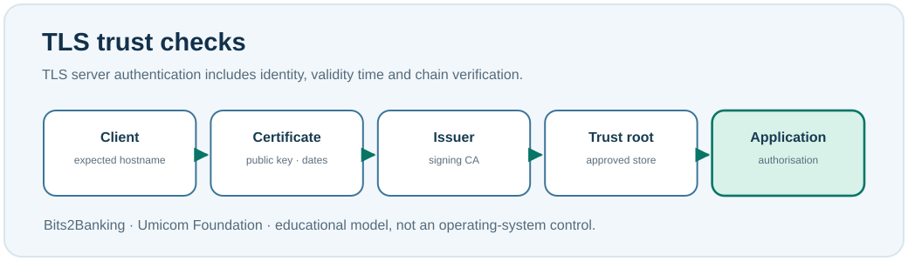

# Chapter 93 — Certificate expiry, trust and system-clock checks

**Bits to Banking · System Administration From Zero · Stage 7**  
**Prerequisite:** Chapters 75, 80 and 92. **Safety:** Observe local certificate metadata only; never export private keys or bypass identity warnings.

## Why can HTTPS fail when no application code changed?

HTTPS normally uses **TLS** to protect data in transit and authenticate the server being contacted. A web server presents a **digital certificate** that binds an identity, normally including an expected hostname, to a public key. The related **private key** must remain protected by its authorised owner. The client checks the certificate's identity, permitted usage, time validity and its relationship to a trusted certificate authority (CA). A secure connection requires more than encrypted bytes: the intended server must also be authenticated.

Certificates contain validity dates. An expired certificate, an incorrect hostname or an untrusted issuing chain can cause a connection to fail even when the server executable is working. An inaccurate client system clock can also make a currently valid certificate appear expired or not yet valid. However, simply changing the clock cannot make an otherwise untrusted certificate legitimate.



## Windows PowerShell: read local certificate metadata

```powershell
Get-Date
Get-ChildItem Cert:\CurrentUser\My | Select-Object -First 5 Subject, NotBefore, NotAfter, Thumbprint
Get-Command openssl -ErrorAction SilentlyContinue
```

The `Cert:\CurrentUser\My` location is your personal certificate store. It may be empty, which is normal. These commands do not export private keys. A thumbprint is a digest of a certificate, not a password, but subject names can include identifying information; do not share raw output publicly without review.

## Linux: inspect the local clock and installed tools

```bash
date -Is
openssl version
ls -ld /etc/ssl/certs
```

The commands do not claim to validate any particular remote host. `openssl` may not be installed and a Linux trust store can be in a different location. Ask the authorised system owner which TLS client and certificate-policy provider should be used for a managed environment.

## Worked scenario: Umicom Notes endpoint identity

Two authorised testers report different results for a fictional HTTPS service. One sees a certificate time error; the other connects normally. A careful investigator records each client's date, timezone, intended hostname and certificate result, then checks whether the certificate chain and server configuration match the expected service. They do not disable TLS verification to obtain a green status.

A trustworthy certificate-management plan records the service owner, issuer, validity dates, renewal process, certificate deployment path, monitoring threshold and recovery procedure. Alerts should arrive **before** a certificate expires. A renewed certificate must be installed and verified at the correct endpoint—not merely created somewhere on disk.

## Practice exercise

Draw a diagram with the following labels: *browser/client*, *service hostname*, *server certificate*, *issuing CA*, *trusted root*, *system clock*. Trace which checks are performed by the client before it trusts the server. Then create a fictional calendar entry for a certificate expiring on an imaginary date and select an advance-renewal window.

**Question:** Is an HTTPS connection safe merely because it is encrypted? **Answer:** No; authenticating the intended peer and enforcing application authorisation are also required.

**Question:** Does reading a certificate store prove the identity of a remote service? **Answer:** No. You must verify the certificate presented by the actual endpoint against the expected identity and trust policy.

**Question:** What should you do when a client reports a changed or untrusted certificate? **Answer:** Stop, document the warning and verify identity through the approved independent process. Do not click through it or install an unknown trusted root.

### What not to do

Do not use options that disable certificate validation, export private keys, copy key stores into public repositories or lower security settings to work around an error. An apparent application outage may be a correctly functioning trust check.

**Umicom connection:** TLS provider selection and service identity are Framework-owned boundaries. This beginner lesson inspects metadata, not a replacement certificate engine.

**Next:** Chapter 94 — audit records and incident timelines.
