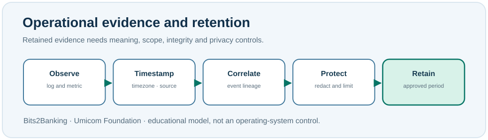

# Chapter 94 — Logs, audit, alerts, retention and privacy

**Bits to Banking · System Administration From Zero · Stage 7**  
**Prerequisite:** Chapters 83, 85 and 93. **Safety:** Use only authorised logs; do not publish private messages or credentials.

## What should we preserve when a service fails?

A **log** records something observed by a program or operating system. A **metric** is a measurement such as CPU usage, active requests or request duration. An **alert** is a notification generated by a rule or observation. An **audit event** is a record intended to support accountability for an important action, such as an access grant, configuration change or approval of a financial transfer.

These records have different purposes. A process can remain online while the application generates failed-payment audit events. A monitoring alert can be noisy or delayed. Absence of an alert does not prove an operation succeeded. A useful incident timeline combines time, source, observed state, responsible owner and the next safe investigative action.



## Observation is not interpretation

Suppose an Umicom Bank workstation reports “report access denied” at 03:07 while a separate monitor reports that its process is running. The **observations** are an access denial and a running process. A possible **hypothesis** is incorrect permissions, but the logs do not by themselves prove which rule or person caused the issue. A professional report separates those statements so an investigator can test the hypothesis.

Logs can also contain personal data: account IDs, user names, hostnames, addresses and sometimes sensitive request fields. **Redaction** removes or masks content that an audience must not receive. **Retention** determines how long evidence should remain available under a defined policy. Keeping everything forever can violate privacy and storage requirements; deleting incident evidence prematurely can destroy the ability to investigate.

## Windows PowerShell 7: read a few recent event headers

```powershell
Get-Date
Get-WinEvent -LogName Application -MaxEvents 5 | Select-Object TimeCreated, Id, LevelDisplayName, ProviderName
Get-WinEvent -ListLog Application | Select-Object LogName, MaximumSizeInBytes
```

The example reads local Application events. These may have nothing to do with Umicom. Do not claim that an arbitrary Event ID is a financial-system failure. Some event sources or metadata may require permissions. If access is denied, record **Not verified** and ask the relevant administrator; do not elevate just to silence an error.

## Linux: read a small, recent journal window

```bash
date -Is
journalctl --since '10 minutes ago' --no-pager -n 10
journalctl --disk-usage
```

The journal may include private or unrelated service information, and some entries are restricted. `--disk-usage` reports journal storage use, not the retention policy itself. Do not publish raw journal output from a shared system.

## Create a fictional incident timeline

Draw a table with *time with timezone*, *source*, *observation*, *known limitation* and *next owner*. Fill it with three **invented** events: `03:05:00+00:00 — GUI process running`; `03:07:00+00:00 — report request rejected`; `03:10:00+00:00 — reviewer requests permission check`. Mark the system identifiers fictional and explicitly state that these are not actual production events.

Add a fourth entry, *payment processing state not checked*. This practice prevents a common error: presenting an incomplete incident report as if it covered every important business process.

## Review and troubleshooting

**Question:** What is the difference between a log and an audit event? **Answer:** Both may contain observations, but audit events have additional accountability, integrity and retention requirements tied to consequential actions.

**Question:** Can a fresh passing test prove that a system was healthy yesterday? **Answer:** No. A new test is evidence about its actual execution time and scope.

**Question:** Why is a shared screenshot risky? **Answer:** It may expose people, infrastructure details, secrets or private operational events.

Do not clear Windows Event Logs or purge Linux journals as part of this exercise. Preserve the original evidence if a real incident is in progress.

**Umicom connection:** The Framework owns structured logging and durable audit services, while the Data Server is the persistence authority for Umicom-owned financial state. Studio and OS views display those records without rewriting their provenance.

**Next:** Chapter 95 — rollback and independently verified recovery.
