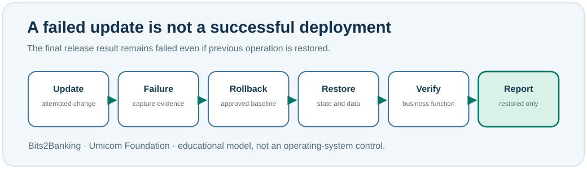

# Chapter 95 — Rollback, restoration and independent recovery verification

**Bits to Banking · System Administration From Zero · Stage 7**  
**Prerequisite:** Chapters 89–94 and the earlier backup-and-restore lessons. **Safety:** Use only personal fictional files; never overwrite a production application.

## Why is a backup not enough?

A **backup** is a preserved copy of information for later recovery. A **restore** retrieves information from that copy. A **rollback** returns a software or configuration change to an earlier approved state. **Recovery verification** tests whether the restored system actually performs its required functions. A copied file or running process may still be insufficient to establish that a service works.

For an Umicom Notes example, a correct restore test should reopen the restored document and prove that it contains the expected information. For Umicom Bank, the test may also need to reconcile ledger balances, payments and external obligations. The impact determines the required checks; there is no universal “the files came back, therefore everything is healthy” rule.

Two common recovery planning terms are **RPO (Recovery Point Objective)**—the maximum tolerable data-loss period—and **RTO (Recovery Time Objective)**—the target duration to restore service. A backup directory alone proves neither. A properly recorded restore drill contains start/end times, selected recovery point, actual restored material, validation outcome and independent reviewer.



## Windows PowerShell 7: restore only a practice file

Complete Chapters 88–89 so the harmless baseline file exists. Run:

```powershell
$Practice = Join-Path $HOME 'UmicomLearning\SecurityOps'
$Baseline = Join-Path $Practice 'notes-training.baseline.conf'
$Restored = Join-Path $Practice 'notes-training-restored.conf'
Test-Path -LiteralPath $Baseline
Copy-Item -LiteralPath $Baseline -Destination $Restored
Get-FileHash -Algorithm SHA256 -LiteralPath $Baseline
Get-FileHash -Algorithm SHA256 -LiteralPath $Restored
```

Stop if `Test-Path` is False. Confirm an existing destination is safe to replace before executing the copy. The two hashes should match. This proves the byte-level equality of two local training files; it does **not** demonstrate a real application restart or an independently approved recovery.

## Linux terminal: compare a practice restore

```bash
BASE="$HOME/UmicomLearning/SecurityOps/notes-training.baseline.conf"
REST="$HOME/UmicomLearning/SecurityOps/notes-training-restored.conf"
test -f "$BASE" && echo 'Practice baseline available'
cp "$BASE" "$REST"
sha256sum "$BASE" "$REST"
```

The commands run against your own example. Do not copy binaries into `/usr/bin`, overwrite live configuration under `/etc`, or touch customer storage while following an introductory lesson.

## Worked example: failed release followed by a verified restore

A new Umicom Notes build starts but cannot save. The maintainer records the failed save operation, stops promotion and returns to the previously approved release under change control. Then another reviewer verifies startup, save, close and reopen, and the related backup task. The final record is **change failed; previous release restored and verified**. It is *not* “the upgrade passed”.

The distinction matters because future risk analysis must still know that the new version was defective. Losing that fact would invite the same problem in a later release.

## Learner workbook task

Write two separate evidence cards. The first records *restored file bytes match baseline* with the digests and time. The second records *application business function verified*, marked **Not run** because this classroom command did not launch a real Notes application. Explain which additional authorised test would be needed to close the second card.

**Question:** If a backup hash matches, is service recovery proven? **Answer:** No. Files may be identical while dependencies or business operations remain broken.

**Question:** Why retain evidence of the original failed change? **Answer:** To support remediation, root-cause analysis, release decisions and future regression prevention.

**Troubleshooting:** If the baseline is missing, revisit Chapter 89 instead of recreating it from an unknown production source. If access is denied, investigate ownership of the practice directory; do not use administrator permission as a shortcut.

**Umicom connection:** Previous educational C23 models distinguish successful maintenance, rollback required and restored-only. Update 44 composes the existing models without implementing any real rollback tool.

**Next:** Chapter 96 — your complete Stage 7 review capstone.
