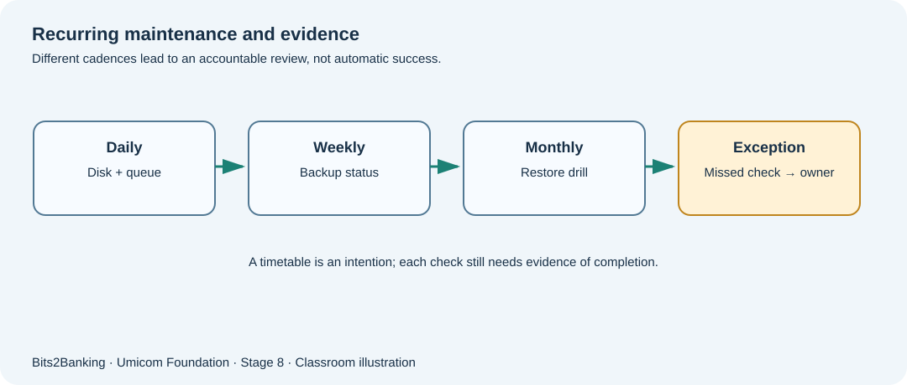

# Chapter 97 — Recurring maintenance: what should happen every day, week and month?

**Bits to Banking · System Administration From Zero · Stage 8**  
**Prerequisites:** Course Chapters 1–96 provide optional foundation; this lesson explains new terms before use.  
**Audience:** Beginners, returning professionals, and supervised young learners.  
**Safety:** Read-only observations on a computer you own or are permitted to use. Never copy real secrets into exercises.

## What we are going to learn

Every system needs a mixture of continuous checks, periodic maintenance and occasional changes. A schedule is a promise to check something; it is not proof that a task completed.



## Understand the idea before typing

A beginner may assume that a computer keeps itself healthy once it is switched on. In practice, a notes service can have enough storage today but run out next week; a backup can succeed on Monday but be unreadable on Friday. Separate **observation** (looking), **decision** (deciding whether anything is wrong) and **action** (changing something). Begin with read-only checks, record who will review them, and avoid unattended changes until the organisation has tested approvals and recovery.

A schedule should state *what is checked, who checks it, where evidence is stored, the maximum acceptable delay and what happens on failure*. A missed check must be reported as missing, not silently counted as successful. “The task was scheduled” is different from “the task ran” and different again from “the expected business outcome occurred.”

## New terms explained

| Term | Plain-English meaning |
|---|---|
| **Cadence** | How often a check is planned: every hour, day or month. |
| **Check** | An observation, such as reading available disk space. |
| **Maintenance** | A controlled activity that keeps a system usable, such as testing a restore. |
| **Owner** | The person or team accountable for acting on a result. |
| **Missed run** | A scheduled check that was expected but did not produce evidence. |


## Windows laboratory — PowerShell 7

Open **Windows Terminal → PowerShell** or search for **PowerShell**. The prompt looks like `PS C:\Users\...>`; do **not** type the prompt itself. On Windows PowerShell 5.1, read-only commands may still work, but the project teaches PowerShell 7. Type the commands one line at a time:

```powershell
Get-Date
Get-Location
Get-PSDrive -PSProvider FileSystem
Get-Process | Select-Object -First 5 Name, Id
```

**What to expect:** `Get-Date` shows the local wall clock; it can be affected by time-zone and clock changes. `Get-PSDrive` lists filesystems that PowerShell knows about. `Get-Process` reads a sample of active processes, not a service-readiness test. The exact names, counts and times on your computer will differ; no precise output is assumed.

## Linux laboratory — terminal

Open your Linux terminal (for example a disposable virtual machine). These commands are read-only. If a command is unavailable, note your distribution and ask the instructor before installing anything.

```bash
date
pwd
df -h
ps -eo pid,comm --sort=pid | head -n 6
```

**What to expect:** `df -h` reports filesystem usage. `ps` lists processes. `head -n 6` limits output; it does not alter processes. Where the guest uses a different `ps` implementation, use `ps -ef | head`.

## Worked Umicom case study

A fictional Umicom Notes classroom service needs a daily disk check, a weekly review of backup evidence and a monthly supervised restore drill. The daily check runs at 09:00, but the administrator goes on leave. Without an assigned deputy, the checks may stop even while the computer stays running. The correct plan assigns a primary and alternate owner, explains where the observations will appear, and records missed checks as exceptions. The *monthly restore drill* must occur in a practice environment; never overwrite the live notes database to prove a backup.

## What if something goes wrong?

| Observation | Safe response |
|---|---|
| The scheduled task has a green icon | Look for actual start, exit result and expected evidence; the scheduler display alone is insufficient. |
| A check was missed | Record Not Run, investigate permissions/scheduler/host availability, and arrange an authorised retry. |
| Time stamps appear out of order | Check time zone and clocks; preserve original times and identify their source. |

## Guided learner exercise

1. Make a three-row table: daily disk check, weekly backup-status review and monthly independent restore drill. Give each an owner, evidence field and failure response.
2. Use only the read-only commands above. Record one observation and clearly label it “local machine observation”, not a production Umicom service result.
3. Explain why the existence of a timer is insufficient evidence of completion.

## Self-check and suggested answers

**Answer 1:** A task may be misconfigured, disabled, blocked by permissions or unable to write its result; schedules are intentions.

**Answer 2:** Evidence should show both an execution result and a meaningful outcome, such as an independently readable restored practice document.

## What this proves — and what it does not

These exercises teach how to collect observations and describe decisions. They are not a certification of any real Umicom deployment. A command completing successfully does not automatically mean that a business operation finished. In live work, only an authorised owner should change service configuration, scheduled jobs, firewall policy, backup retention or credentials, after impact assessment and recovery planning. New reusable monitoring or scheduling software belongs in **Umicom Framework**, preferably implemented in C23 or Assembly rather than new PowerShell/Python scripts.

**Further reading:** [Stage 8 overview](stage-8-index.md) · [Safe command reference](stage-8-safe-command-reference.md) · [Stage 8 glossary](stage-8-glossary.md).
