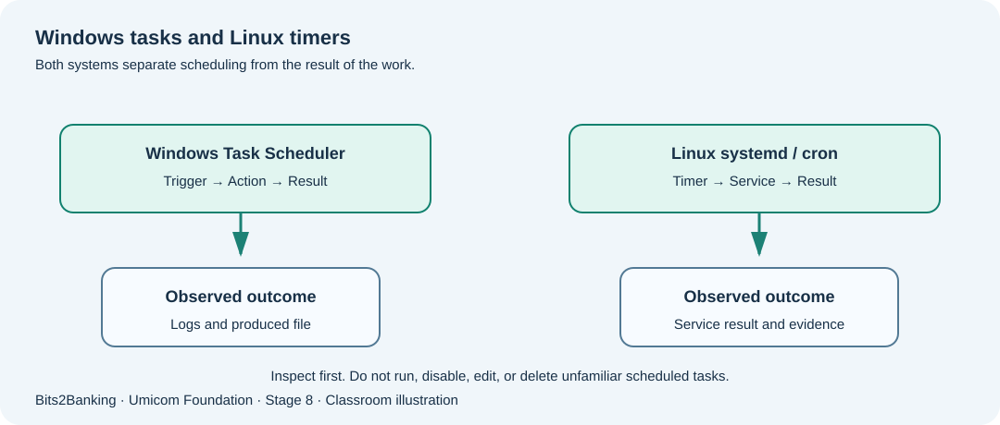

# Chapter 99 — Linux cron and systemd timers: read schedules and their outcomes

**Bits to Banking · System Administration From Zero · Stage 8**  
**Prerequisites:** Course Chapters 1–96 provide optional foundation; this lesson explains new terms before use.  
**Audience:** Beginners, returning professionals, and supervised young learners.  
**Safety:** Read-only observations on a computer you own or are permitted to use. Never copy real secrets into exercises.

## What we are going to learn

Linux installations may use cron, systemd timers or another scheduler. Learn to read schedules and understand how a timer connects to a service.



## Understand the idea before typing

A systemd timer normally activates a **service unit**. Reading only the timer is like reading a diary appointment without asking whether the work happened. A cron line has five familiar time fields (minute, hour, day of month, month and day of week) followed by a command. Their precise interaction and environment should be confirmed for the particular cron implementation.

For beginners, use `systemctl list-timers` and `crontab -l` to **inspect**. No `sudo`, no `crontab -e`, no direct edits to `/etc` and no service activation are necessary. On a Linux distribution without systemd, the `systemctl` command may not work; that is an environment difference, not proof that the computer is broken. The target machine’s timezone, missed-run policy and execution identity determine whether the schedule means what an operator thinks it means.

## New terms explained

| Term | Plain-English meaning |
|---|---|
| **cron** | A long-established system for timed commands. |
| **crontab** | The list of cron entries for a user or system context. |
| **systemd timer** | A unit describing when another unit should be activated. |
| **Service unit** | A unit describing the executable, account, environment and lifecycle. |
| **Persistent timer** | A timer policy that may catch up after the machine was unavailable, when configured. |


## Windows laboratory — PowerShell 7

Open **Windows Terminal → PowerShell** or search for **PowerShell**. The prompt looks like `PS C:\Users\...>`; do **not** type the prompt itself. On Windows PowerShell 5.1, read-only commands may still work, but the project teaches PowerShell 7. Type the commands one line at a time:

```powershell
Get-Date
Get-TimeZone
Get-ScheduledTask | Select-Object -First 5 TaskName, State
```

**What to expect:** Windows comparison: both platforms need a timezone and a scheduler identity. `Get-TimeZone` reports the Windows configured timezone; it does not set it. The exact names, counts and times on your computer will differ; no precise output is assumed.

## Linux laboratory — terminal

Open your Linux terminal (for example a disposable virtual machine). These commands are read-only. If a command is unavailable, note your distribution and ask the instructor before installing anything.

```bash
date
systemctl list-timers --all --no-pager
crontab -l
systemctl --user list-timers --all --no-pager
```

**What to expect:** A user session may not have a running user systemd instance, so the final command can fail safely. If `crontab -l` displays no crontab, record None configured instead of claiming that no scheduled work exists anywhere on the host.

## Worked Umicom case study

The classroom environment contains a nightly Notes indexing job and a weekly storage check. The nightly timer has a valid Next value, yet the corresponding service has failed repeatedly. A first-line administrator records the timer name, its last activation and the documented service result, then escalates to the service owner with the log window and revision identifier. The administrator does not restart the service repeatedly because doing so can erase the event sequence or worsen a failing dependency.

## What if something goes wrong?

| Observation | Safe response |
|---|---|
| `System has not been booted with systemd` | Identify the init system and distribution; a container or subsystem might not support systemd. |
| `no crontab for ...` | Only the current user’s crontab is absent; system-level jobs may still exist. |
| A timer shows Next but service has failed | Review the paired service and its logs, not only the calendar. |

## Guided learner exercise

1. Compare a Windows task trigger with a systemd timer: where are timing, executable and identity represented?
2. Write a fictional maintenance timetable using ordinary language rather than editing a crontab.
3. Explain a possible daylight-saving-time problem for a task scheduled at 01:30 local time.

## Self-check and suggested answers

**Answer 1:** The scheduler decides *when* to activate; the service/job specifies *what* executes and as whom.

**Answer 2:** Some local times repeat or do not occur during DST transitions; a declared timezone and missed-run policy matter.

## What this proves — and what it does not

These exercises teach how to collect observations and describe decisions. They are not a certification of any real Umicom deployment. A command completing successfully does not automatically mean that a business operation finished. In live work, only an authorised owner should change service configuration, scheduled jobs, firewall policy, backup retention or credentials, after impact assessment and recovery planning. New reusable monitoring or scheduling software belongs in **Umicom Framework**, preferably implemented in C23 or Assembly rather than new PowerShell/Python scripts.

**Further reading:** [Stage 8 overview](stage-8-index.md) · [Safe command reference](stage-8-safe-command-reference.md) · [Stage 8 glossary](stage-8-glossary.md).
