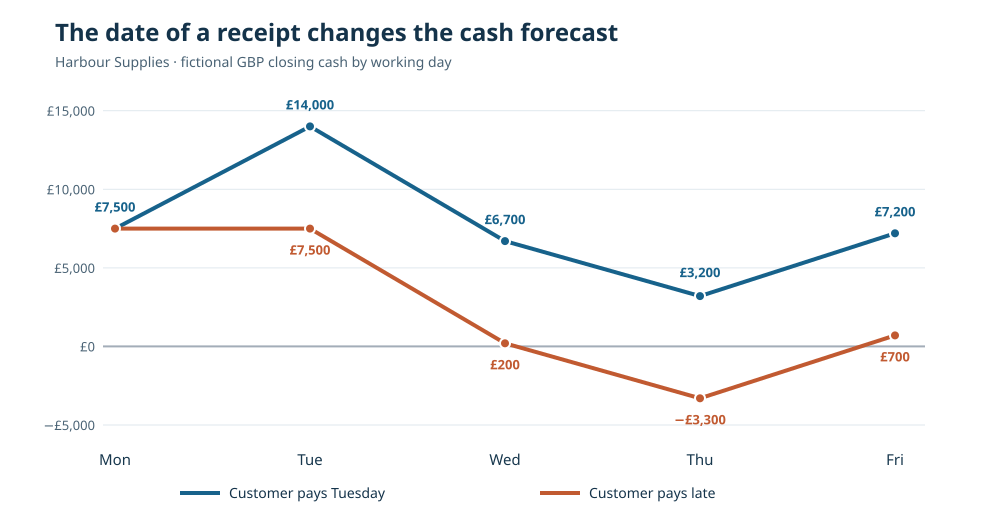

# 13. Can we pay Friday's bills? Build a seven-day cash forecast

*Treasury Management, TMS and Calypso — From Zero · Practical foundations*

Imagine that you manage the money for a small business called Harbour Supplies. It sells equipment to local shops, pays staff every week and keeps its money in a bank account. The business appears healthy: orders are arriving, invoices are being issued and customers have promised to pay. Yet on Wednesday afternoon, the owner asks a worrying question: **“Will there be enough money in the account to pay our supplier tomorrow?”**

You cannot answer that question from sales figures alone. A sale is not necessarily cash in the bank. You need to know **how much money is available now**, **what you expect to receive**, **what must be paid** and **when each movement is likely to happen**. That is the beginning of cash forecasting.

By the end of this lesson, you will have made a simple cash forecast by hand. You do not need a financial qualification, a computer program or a Calypso installation. A calculator and a sheet of paper are enough.

## Start with the money we already have

On Monday morning, Harbour Supplies has **£12,000** available in its ordinary business bank account. We call this the *opening balance*: the amount available at the start of the period we are studying. A bank statement could help establish that figure, but the balance shown in an accounting system may not be identical. There can be payments in transit, bank charges or entries not yet reconciled.

The company expects the following movements during the working week beginning **Monday, 2 November 2026**. All dates and figures in this course are fictional.

| Date | What happens | Money in | Money out | How certain is it? |
|---|---|---:|---:|---|
| Mon 2 Nov | Pay the monthly rent | — | £4,500 | Approved payment |
| Tue 3 Nov | Customer pays an invoice | £6,500 | — | Expected, not received |
| Wed 4 Nov | Pay staff wages | — | £7,300 | Approved payment |
| Thu 5 Nov | Pay an equipment supplier | — | £3,500 | Approved payment |
| Fri 6 Nov | Receive a project grant | £4,000 | — | Forecast only |

**Money in** is a *receipt* (an inflow). **Money out** is a *payment* (an outflow). We give each movement a date because cash arriving next week cannot pay a bill due today.

## Work out the closing balance for each day

The rule is simple:

> **Closing balance = opening balance + receipts − payments**

On Monday, there is no expected receipt and rent is £4,500:

> £12,000 + £0 − £4,500 = **£7,500**

Tuesday starts where Monday ended: £7,500. If the customer pays £6,500 as expected, Tuesday closes at £14,000. Wednesday then begins with £14,000 and pays wages of £7,300, leaving £6,700.

Continue one day at a time. You should reach this table:

| Day | Opening balance | Receipts | Payments | Closing balance |
|---|---:|---:|---:|---:|
| Monday | £12,000 | £0 | £4,500 | **£7,500** |
| Tuesday | £7,500 | £6,500 | £0 | **£14,000** |
| Wednesday | £14,000 | £0 | £7,300 | **£6,700** |
| Thursday | £6,700 | £0 | £3,500 | **£3,200** |
| Friday | £3,200 | £4,000 | £0 | **£7,200** |

The final figure is useful, but the **lowest point** matters just as much. On Thursday, the business expects to have only **£3,200** left. If its policy is to retain a minimum cash buffer of **£5,000**, it is short of that buffer by **£1,800**. That does *not* automatically mean the business is unable to pay its bills: £3,200 is still positive. It means that an agreed safety threshold would be breached and the treasury team should investigate.

## What changes when a customer pays late?

Here is the danger of treating an expected receipt as if it were guaranteed. Imagine the £6,500 customer payment does **not** arrive on Tuesday. It may arrive the following Monday instead. Recalculate the balance **without** that receipt:

| Day | Closing balance if customer pays on time | Closing balance if customer is late |
|---|---:|---:|
| Monday | £7,500 | £7,500 |
| Tuesday | £14,000 | £7,500 |
| Wednesday | £6,700 | **£200** |
| Thursday | £3,200 | **−£3,300** |
| Friday | £7,200 | **£700** |

A negative forecast balance is a **warning**, not permission to overdraw the account. It shows that the planned payments would exceed the available cash unless something changes. The bank could reject a payment, the business might have an agreed credit facility, or a supplier might allow a revised date. Those are decisions requiring confirmation and approval; a forecast cannot assume them.

Notice how misleading Friday's projected £700 can be if you look only at the end of the week. Thursday's shortfall happens first. The time at which money is needed is central to treasury work.

## Cash is not the same as profit

The customer may have bought equipment worth £6,500, so a sale has occurred even before payment. The company might recognise revenue according to its accounting policy. But the sale does not put £6,500 into the bank account immediately. **Profitability** concerns income and expenses over a period. **Liquidity** concerns meeting obligations when they fall due. A profitable business can face a liquidity problem if its customers pay late.

There is another distinction. Imagine the £4,000 grant is legally restricted to buying equipment for a particular project. Although it is cash, the business may **not** be free to use it for wages. In a professional treasury system, available, restricted, forecast, confirmed and settled amounts should not be mixed without clear rules.

## How a Treasury Management System helps

A Treasury Management System can keep a dated record of expected and actual cashflows, collect bank balance information, group cash by account and currency, and show a *cash ladder* like the table you just built. It may also flag upcoming shortfalls or show how the forecast changes if a large receipt is delayed.

But software cannot make an uncertain receipt certain. It must preserve useful facts: the **currency**, **amount**, **date**, **account**, **source**, **status** and **last update time**. A report that simply adds every promised amount together can make a business look safer than it really is.

Later, you will see the same idea inside Calypso. A trade may create future cashflows, but a future cashflow is not the same as a settled payment. Treasury needs the dates and states of each obligation before it can safely use them in a cash forecast.

## Try it yourself

**Exercise A — a change in timing.** The equipment supplier agrees, in writing, that the £3,500 payment may move from Thursday to the following Monday. Keep every other assumption as in the original forecast. What is Thursday's new closing balance? Does it satisfy the £5,000 buffer?

**Exercise B — the risk of counting a forecast.** The supplier will not move the due date, and the customer payment is delayed. How much additional cash would the company need by Thursday to keep its £5,000 buffer, assuming no other changes?

**Exercise C — explain it to a colleague.** Write two sentences explaining why “our sales are excellent” is not an answer to “can we pay wages on Wednesday?”

### Check your answers

**A:** Thursday would close at **£6,700** instead of £3,200. That meets the £5,000 buffer, although the payment has only moved and still needs funding later.  
**B:** Thursday's delayed-receipt projection is **−£3,300**. To reach the £5,000 buffer requires **£8,300** in additional available cash or an equivalent change to the payment schedule. A facility would have to be genuinely available and authorised before it could count.  
**C:** Sales may be invoiced but not yet paid. Wages require available cash on their payment date, so the timing of receipts matters.

**Before moving on:** You should be able to explain *opening balance*, *receipt*, *payment*, *closing balance*, *forecast*, *settled cash*, *liquidity* and *cash buffer* in your own words. If you can, you are ready to learn how deposits and loans change the cash ladder.
